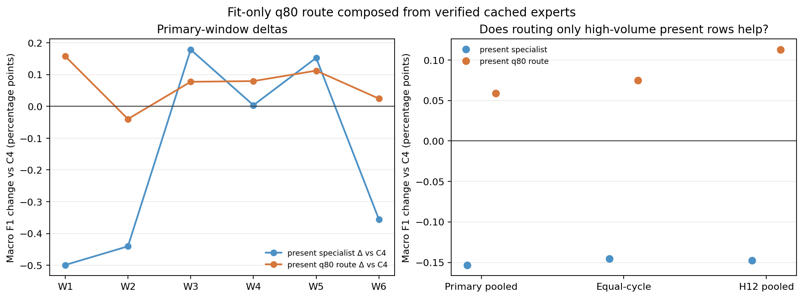
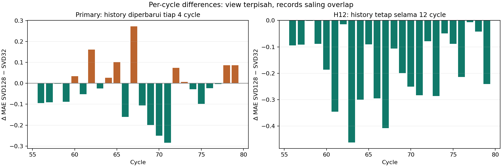

# Samuel — autonomous EDA-driven modeling research

31 Oktober 2026 · **Research + Kaggle results checkpoint selesai.** Rekomendasi: pertahankan C4_HGB dan LightGBM/SVD32 resmi. Pertahankan availability sebagai rekomendasi topik EDA berbasis keputusan modeling; status EDA A tetap resmi sampai review pengguna.

## Jawaban utama

Insight baru yang paling berguna adalah **heterogenitas manfaat spesialisasi menurut volume narasi**. Melatih expert khusus stream-present secara menyeluruh merugikan pooled F1, tetapi menggunakan expert itu hanya untuk present streams di atas Q80 volume fit-only menghasilkan gain internal kecil dan cukup konsisten. Public Kaggle hampir sama, sedikit lebih rendah. Ini contoh keputusan routing yang dapat diuji, sekaligus contoh mengapa gain development tidak otomatis mentransfer.

Regression menunjukkan **batas kompresi representasi teks**: memperluas SVD32 menjadi SVD128 membantu kedua H12 windows dan sedikit memperbaiki primary. Namun public MAE memburuk serta subgroup target tinggi/missing merugi. Variance teks yang lebih banyak dipertahankan tidak otomatis memberi generalisasi yang lebih baik.

| Task dan recipe | Primary temporal | Equal-cycle primary | H12 pooled | Kaggle public |
|---|---:|---:|---:|---:|
| Classification · C4_HGB resmi | 0,825481 | 0,818278 | 0,796810 | **0,82641** |
| Classification · Q80 route baru | **0,826072** | **0,819028** | **0,797939** | 0,82640 |
| Regression · LightGBM/SVD32 resmi | 11,931600 | 12,283548 | 14,704041 | **11,71363** |
| Regression · SVD128 paired baru | **11,916362** | **12,255918** | **14,519600** | 11,81149 |

Classification lebih tinggi lebih baik; Regression lebih rendah lebih baik. Internal dan public mempunyai records, horizon, denominator dan risiko adaptasi berbeda. Public bukan untouched/unbiased holdout. Tidak ada skor Kaggle baru yang digunakan memilih kandidat atau tuning.

## Rangkaian hipotesis yang benar-benar diuji

### 1. Availability-specific expert fitting

**Pertanyaan EDA:** apakah perubahan komposisi label dan volume pada populasi stream-present/missing membuat manfaat expert yang dilatih pada populasi masing-masing berbeda?

Raw EDA memakai official Classification Train: 47.204 present dan 3.404 missing. Gap artifact missing−present menurut tiga periode adalah −1,84, +10,01, +3,18 pp; median volume missing sekitar 21–22 dan present sekitar 31–32. [Riset availability sebelumnya](../impact_eda/DECISION.md) juga menunjukkan gap +3,66 pp mentah berubah menjadi −2,30 pp setelah standardisasi period×volume, dengan support penuh pada 3×5 bins. Itu deskripsi komposisi, bukan treatment effect, kualitas teks, atau penjelasan otomatis expert mana yang akan unggul.

**Mekanisme prediktif yang diuji:** joint fitting dapat memengaruhi koefisien structured/hybrid, walau text vector pada missing nol. Mengubah hanya fit population dapat mengurangi interferensi antar-populasi, tetapi sekaligus membuang data yang berguna. C1_B/C2_B, fitur, parameter, threshold0,50 dan folds dipertahankan.

| Ablation | Primary F1 | H12 F1 | Δ primary terhadap C4 | Hasil |
|---|---:|---:|---:|---|
| C4_HGB frozen | 0,825481 | 0,796810 | — | Kontrol |
| Hybrid fit hanya present; HGB fit semua | 0,823949 | 0,795333 | −0,001532 | Campuran; Q5 membaik, mayoritas volume bins merugi |
| HGB fit hanya missing; hybrid fit semua | 0,818753 | 0,786020 | −0,006728 | Tidak layak upload; missing subgroup jauh memburuk |
| Kedua expert fit subset masing-masing | 0,817138 | 0,784326 | −0,008342 | Tidak layak upload |

Tepat 12 branch fits baru (dua per cutoff) dipakai bersama lintas tiga route. Missing fit support hanya 826–2.878 rows pada cutoff temporal, sedangkan present 11.194–39.239; tiap kelas memenuhi support minimal, tetapi memenuhi support bukan jaminan cukup untuk HGB. Tidak ada eksperimen tambahan yang mengklaim mengisolasi apakah kerugian missing berasal dari ukuran data, komposisi, atau variance model. **Heterogenitas populasi tidak membenarkan subset fitting menyeluruh.**

### 2. Satu follow-up adaptif: spesialisasi hanya pada volume tinggi

Q5 pada uniform present-specialist memperbaiki F1 primary +0,001976 dan H12 +0,004073, sementara Q1–Q4 umumnya melemah. Setelah melihat outcome subgroup tersebut, satu follow-up dibekukan: missing→C1_B fit-all; present dengan `text_load > np.quantile(fit_text_load,0.80)`→C2_B fit-present; present lainnya→C2_B fit-all. **Pemilihan route adaptif memakai evidence validation lama**; nilai cutoff setiap fold dihitung hanya dari fit inputs. Tidak ada pencarian kuantil atau threshold classification dari outer labels.

Recipe baru dinilai dengan komposisi vector yang sudah terverifikasi, **nol fit temporal tambahan**. Primary gain +0,000591 F1 (+0,05911 pp), equal-cycle +0,000751, H12 +0,001129. W1/W3/W4/W5/W6 positif dan W2 turun −0,000399; kedua H12 naik +0,001050/+0,001198.

Present-high primary n=7.501, Macro F1 0,750987→0,753010; H12 n=7.575, 0,746583→0,750774. Missing n=2.578 dan present-not-high n=28.509 primary /28.435 H12 tetap **probability-identical** dengan C4. Kenaikan pooled F1 tidak dihitung sebagai weighted average F1 subgroup. Precision/recall kelas1 primary berubah 0,793442/0,756384→0,796048/0,754882, jadi F1 naik disertai sedikit kehilangan recall; kelas1 H12 juga kehilangan recall 0,699449→0,696731.

**External evaluation:** full-Train q80=38,0229; Test mempunyai 9.872 present-high dan 19.549 baris lainnya. Prediksi baru mengubah 71 label, semuanya present-high; label lainnya persis baseline accepted. Kaggle public **0,82640 vs0,82641**, selisih −0,00001. Praktis setara pada presisi yang ditampilkan, **belum ada external improvement**. Tetap C4_HGB resmi; Q80 route disimpan sebagai research candidate, bukan dipromosikan otomatis.

### 3. Resolusi representasi teks Regression

**Pertanyaan EDA:** seberapa banyak variasi TF-IDF belum direpresentasikan oleh SVD32, dan apakah resolusi yang lebih besar membantu prediksi `threat_rank` pada history/horizon yang sulit?

Target-blind spectrum pada enam fit histories menunjukkan 32 komponen awal dalam dekomposisi128 memuat sekitar15% variance; total128 sekitar27%. Misalnya cutoff55:15,10% versus27,47%. Raw marginal target tetap hampir seragam antarcycle: median sekitar50 dan p10–p90 sekitar10–90. Spectrum tidak membuktikan bahwa variance tambahan berhubungan dengan target atau memiliki arti semantik. Error analysis historis, terutama H12_E, memberi alasan menguji kapasitas representasi.

**Ablation tunggal:** LightGBM regression_l1, structured preprocessing, TF-IDF, parameter per-fold dan rank weights lama dipertahankan; hanya requested SVD width32→128. Enam outer fits baru, kontrol source/row/prediction hashes cocok. Randomized SVD dengan width berbeda juga dapat mengubah leading basis, sehingga ini **uji resolusi seluruh representasi**, bukan isolasi kausal komponen33–128 yang ditambahkan ke 32 komponen lama yang persis sama.

Primary gain0,015239 MAE sangat kecil dan hanya3/6 windows membaik. H12 gain0,184441 lebih konsisten: early17,473257→17,247402 dan late12,361143→12,211741. Primary bias −0,418158→−0,402366; H12 +0,190617→+0,066794.

| Guardrail paired SVD128 | Δ primary MAE | Δ H12 MAE |
|---|---:|---:|
| Stream present | −0,023535 | −0,204443 |
| Stream missing | +0,100642 | +0,094959 |
| Target≤5 | −0,066798 | −0,313671 |
| Target≥95 | +0,143959 | +0,332622 |

Negatif berarti lebih baik. Tambahan representasi tidak menyelesaikan seluruh tails atau missing-stream risk.

**Refinement terbatas:** karena paired candidate kompetitif, lakukan12 inner fits (dua parameter lama×enam cutoff), memilih dari lima rankweights lama menggunakan inner labels masa lalu. Semua parameter outer terpilih sama, jadi keenam outer fits reused, tanpa outer refit baru. Weight berubah pada cutoff63/67. Primary11,916083 dan H1214,530784: hampir sama, H12 lebih buruk daripada paired; H12 high-tail bahkan memburuk +0,825221 versus kontrol. Tidak ada alasan mempromosikan refinement.

Untuk full-Train, inner fit47–75→76–79 memilih `base/0,5`, **identik dengan paired full-Train recipe**. Satu base vector sudah tersedia; satu regularized inner fit tambahan diperlukan. Mengirim kedua nama policy akan menduplikasi CSV, jadi hanya satu kandidat Regression dikirim. Public **11,81149 vs11,71363**, MAE memburuk0,09786. **Retain SVD32**, walaupun H12 internal candidate lebih baik.

## Submission receipts dan disiplin pemilihan

Batas awal satu per task dinaikkan pengguna menjadi maksimal dua per task. Selection dibekukan sebelum upload/score baru pada [selection.json](../../experiments/autonomous_eda/selection.json); commit source checkpoint `1c48e69` dibuat sebelum full-Train inference. Hanya satu distinct candidate per task layak dipakai. Sisa allowance tidak dipakai untuk feedback-driven tuning.

| Task | Ref Kaggle | Status | Public | CSV SHA-256 |
|---|---:|---|---:|---|
| Classification Q80 route | **57831227** | **COMPLETE** | **0,82640** | `a54a0344ccb438b87fe7fd0e97422d21be405071410c2307c98814a09d7646da` |
| Regression SVD128 paired | **57831201** | **COMPLETE** | **11,81149** | `ce3be350c19f6fd8a6d78f3fa6751258706580490ba1b0d205e2d26610a35c1e` |

Keduanya dikirim melalui **Kaggle Python SDK/API**, memakai autentikasi lokal standar dan tim `kasdud lovers`; bukan kontrol Chrome. Aturan dan allowance diverifikasi dari authenticated API sebelum upload. Rules: hanya data yang disediakan, tidak menyalin kelompok lain, dan submission melalui tim. Receipt lengkap: [Classification](kaggle/classification__samuel_cls_q80_route_v1_ledger.json), [Regression](kaggle/regression__samuel_reg_svd128_paired_v1_ledger.json). Public score adalah satu external check yang adaptif, bukan estimasi unbiased generalisasi atau izin otomatis mengganti final model.

## Implikasi EDA individual

**Rekomendasi tetap availability, kini dengan volume sebagai konteks manfaat expert.** Rumusan yang layak dipilih pengguna:

> Apakah komposisi artifact_signal berbeda menurut ketersediaan signal_stream dan volume narasi, serta bagaimana heterogenitas tersebut berkaitan dengan manfaat representasi teks pada Classification?

Bagian raw EDA harus menjawab komposisi label dan support; bagian error/modeling yang terpisah menjawab manfaat expert. Jangan menjadikan metrik model sebagai satu-satunya EDA atau mengklaim penelitian dilakukan sebelum modeling. Alternatif yang lebih murni raw-data tetap pertanyaan availability pada milestone sebelumnya; Q80 routing menjadi tindak lanjut retrospektif.

| Kandidat EDA | Kekuatan | Incremental utility | Putusan |
|---|---|---|---|
| TTR pada exact length | Asosiasi langsung kuat dan robustness baik | TTR membantu LR sederhana tetapi tidak final hybrid | Tetap valid; masih resmi |
| Availability + volume | Raw komposisi, confounding, support dan expert heterogeneity mudah ditunjukkan | Routing lama bermanfaat sudah dalam final; Q80 baru gaininternal kecil/publicsetara | **Paling kuat untuk cerita data→keputusan, dengan batas kronologi jelas** |
| Vocabulary coverage | Residual difficulty association | Gain kecil dan tails trade-off, sudah diuji milestone sebelumnya | Tidak diulang |
| SVD resolution | Menjelaskan keterbatasan representasi/horizon | H12 internal lebih baik; public lebih buruk | Research diagnostic, lebih bergantung pada model daripada EDA individual |

Availability/volume/text representation berbeda substantif dari EDA Rousan (EF/impact–artifact), Abhi (scope_pressure incremental–threat setelah impact), dan Rizky (telemetry/module_spread–artifact). EF/tail pada model hanya guardrail. Tidak ada pertanyaan atau file anggota lain yang diubah. Status pertanyaan EDA Samuel **tidak berubah otomatis**.

## QA, kendala teknis, dan batas interpretasi

- **PASS 31 scoped tests +28 subtests**; mencakup fitur/target guards, fit-only Q80, routing equality, model audits, CSV, frozen selection/source binding, SDK status, max2 ledger, serta simulasi koneksi terputus setelah acceptance tanpa upload ulang.
- Independent verifiers merekonsiliasi baseline, seluruh subset fits, cached routes, primary/H12/percycle/window/class/subgroup metrics, fit fingerprints,12 inner selections dan policy. Final [QA.json](QA.json) memeriksa kedua CSV/manifests/source-commit bytes, official input SHA, full-Train branch boundaries, serta receipt COMPLETE.
- Kedua CSV tepat29.421 rows; schema/IDs/order sesuai sample, classification0/1, regression finite[0,100]. Full-Train source checkpoint dan exact source hashes ada di manifest; semua learned preprocessing hanya dari fit Train. Official Test dipakai setelah selection dibekukan untuk inference/schema, tanpa target.
- **485 file historis byte-identical**, termasuk notebook formal EDA A, dua notebook modeling final, model/manifest lama, serta pekerjaan anggota lain. Raw data, per-row vectors dan model binaries tetap ignored.
- Pelaporan Regression sempat berhenti karena canonical primary aggregation; koreksi dan skala grafik tercatat di empat linked amendments, original fit caches tetap. Grafik awal `paired_cycle_mae_delta.png` mewakili H12; gunakan grafik dua-panel yang ditautkan di atas agar primary/H12 tidak dicampur. Dua pernyataan prose diperjelas setelah review: pemilihan Q80 memang dipicu hasil validation, dan tidak ada statistical standard-error estimate yang dihitung.
- Persiapan Classification pertama berhenti **setelah training, sebelum CSV/upload**, karena baseline CSV lokal hilang. Salinan accepted ref57808225 diunduh melalui API dan cocok persis SHA lama; recipe sama dilatih ulang dan output diperiksa. Ini menyebabkan satu build ulang tiga expert, bukan eksperimen atau submission tambahan. Regression full-Train hanya satu fit; official baselines tidak disubmit ulang.
- Semua Train telah berulang kali dieksplorasi; first-stage/extension freezes membatasi perubahan setelah scoring tetapi **tidak menghapus adaptive selection bias**. H12 memakai ulang records primary. Q80 adalah post hoc limited follow-up, bukan konfirmasi independen. Public score bukan alasan menambah eksperimen baru.

Reproduksi: [README](../../experiments/autonomous_eda/README.md). Tidak ada final notebook preparation, ZIP, SCeLE export atau pengumpulan tugas. **Berhenti di research + Kaggle results checkpoint.** Keputusan pengguna selanjutnya adalah memilih/menetapkan topik EDA serta mengonfirmasi retain model lama; tidak ada perubahan resmi sampai instruksi baru.
