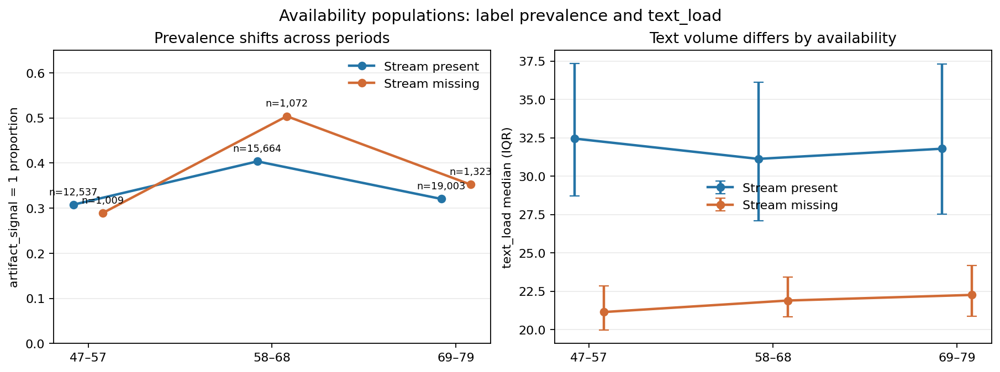
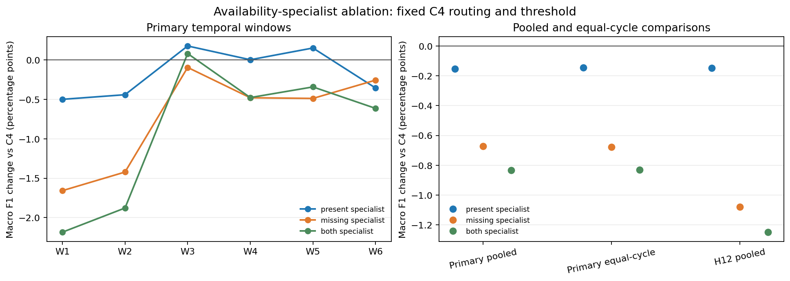

# Autonomous Classification: availability-specialist ablation

## Pertanyaan dan desain

Apakah melatih masing-masing expert C4 hanya pada populasi ketersediaan yang menerima prediksinya dapat mengurangi gangguan antar-populasi? C2_B (structured + TF-IDF Logistic Regression) tetap menjadi expert untuk stream-present; C1_B (expanded structured HGB) tetap menjadi expert untuk stream-missing. Tiga kandidat hanya mengubah baris yang masuk ke fit expert. Fitur, preprocessing, hyperparameter, routing berdasarkan availability, serta threshold 0,50 tidak diubah.

Kandidat present-only, missing-only, dan both-specialist dibekukan sebelum fit. Dua expert subset baru per cutoff dipakai ulang lintas ketiga route, sehingga ada tepat 12 fit baru. Kontrol C1_B/C2_B berasal dari cache Round 1 yang probabilitasnya cocok persis dengan audit. Tidak ada threshold tuning, pencarian model, atau akses ke nilai official Test.

## Konteks EDA mentah

Pertanyaan raw EDA adalah apakah prevalensi artifact dan dukungan text_load dalam populasi availability berubah antarperiode. Ini deskripsi input dan label Train; tidak menyamakan availability dengan penyebab label. EDA sebelumnya mencatat gap missing-vs-present sebesar −1,84 pp pada cycle 47–57, +10,01 pp pada 58–68, dan +3,18 pp pada 69–79; volume adjustment juga dapat membalik arah gap. Jumlah serta prevalensi fit subset yang benar-benar dipakai tiap cutoff tersedia di `fit_support.csv`; rate per periode dan IQR text_load ada di `raw_eda_by_period.csv`.

Grafik menunjukkan perubahan komposisi temporal dan skala volume antarstatus. Itu mendukung pengujian spesialisasi sebagai hipotesis tentang conditional population, tetapi tidak membuktikan bahwa fitting subset akan lebih baik.

## Hasil temporal

Kontrol C4_HGB yang direkonstruksi menghasilkan primary Macro F1 **0.825481**, equal-cycle **0.818278**, dan H12 **0.796810**. Ketiga nilai sama dengan kontrol Round 2 pada toleransi 1e−12.

| Model | Primary F1 | Δ primary | Equal-cycle F1 | Δ equal-cycle | H12 F1 | Δ H12 | Window positif | Guard |
|---|---:|---:|---:|---:|---:|---:|---:|---|
| C4_HGB | 0.825481 | +0.000000 | 0.818278 | +0.000000 | 0.796810 | +0.000000 | 0/6 | control |
| present_specialist | 0.823949 | -0.001532 | 0.816824 | -0.001454 | 0.795333 | -0.001477 | 3/6 | FAIL |
| missing_specialist | 0.818753 | -0.006728 | 0.811516 | -0.006761 | 0.786020 | -0.010790 | 0/6 | FAIL |
| both_specialist | 0.817138 | -0.008342 | 0.809983 | -0.008295 | 0.784326 | -0.012484 | 1/6 | FAIL |

Per-window metrics dan delta, per-cycle metrics, per-class precision/recall/F1, availability subgroup, serta fit-defined text_load quintiles tersedia di `windows.csv`, `per_cycle.csv`, dan `subgroups.csv`. Setiap subgroup menyertakan denominator, positive rate, Macro F1, false positives, dan false negatives.

## Interpretasi dan keputusan

Nilai guard adalah penyaring praktis sebelum MAIN mempertimbangkan paling banyak satu kandidat eksternal; guard bukan uji signifikansi atau keputusan upload otomatis. Kandidat harus tidak jauh lebih buruk pada primary, equal-cycle, H12, window terburuk, kelas, dan availability subgroup, serta menunjukkan kenaikan pooled primary atau H12 agar direkomendasikan untuk review. Hasil tetap development evidence karena folds sudah pernah diamati.

Kandidat paling layak menurut bukti ini: **NONE**. Bila tertulis `NONE`, tidak ada kandidat memenuhi seluruh guard dan menunjukkan pooled gain positif. MAIN tetap memegang keputusan akhir dan semua refit full-Train/inference/submission.

## Batas interpretasi

Availability adalah atribut proses pengumpulan, bukan intervensi kausal. Subset training dapat mengurangi penggunaan contoh dari populasi lain, tetapi juga membuang informasi bersama. Stream availability dan text_load tidak menghilangkan confounding; H12 memakai ulang baris primary; seluruh siklus merupakan development data; hasil tidak menjamin performa official Test atau Kaggle. Hasil ini tidak mengubah model resmi, EDA resmi, atau submission.

Input Train SHA-256 `875552a68a3d24b0f3e1966d6ddb5671e6f54305a1c526e2f0a76747942ed91c`. Freeze signature `73b81ff3455c2ddc39992dbf806e8754fee5fe79a5d67845561ad832ed41d137`. Fit baru: 12; submission Kaggle: 0.
