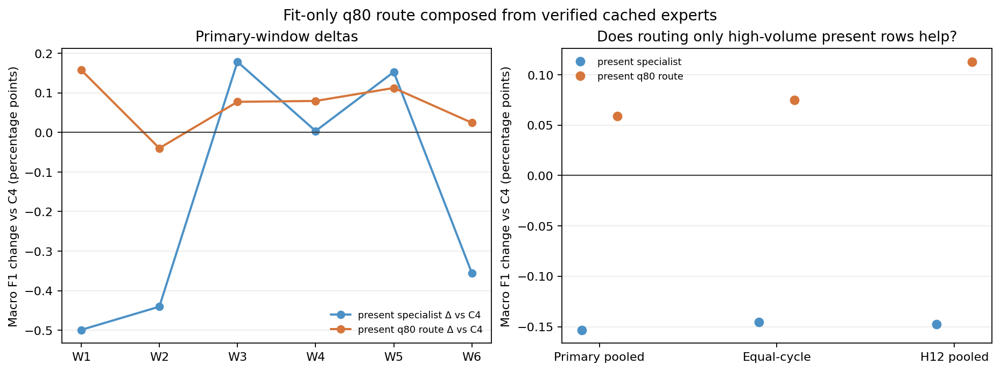

# Classification follow-up: fit-only q80 route for present streams

## Adaptive question and fixed rule

The earlier uniform present-specialist was close to C4 overall, with localized gains in the highest fit-defined text_load quintile. This limited follow-up asks whether routing only present-stream rows above the fit-only 80th percentile to that specialist can retain those gains while leaving other rows on the established C4 experts.

For each temporal fit cutoff, q80 is `np.quantile(text_load[cycle_code <= fit_end], 0.80)`. Stream-missing rows route first to all-row C1_B. Present rows strictly above q80 route to present-only C2_B; equality and lower values use all-row C2_B. The quantile and route were fixed before scoring. This is an adaptive follow-up on already viewed Train folds, not an independent test.

The comparison only composes three previously audited prediction vectors. It performs zero new temporal model fits and leaves all original fit caches and receipts read-only.

## Pooled results

| Route | Primary Macro F1 | Δ vs C4 | Equal-cycle | H12 Macro F1 | Δ H12 vs C4 |
|---|---:|---:|---:|---:|---:|
| C4_HGB | 0.825481 | +0.000000 | 0.818278 (24 cycles) | 0.796810 | +0.000000 |
| present_specialist | 0.823949 | -0.001532 | 0.816824 (24 cycles) | 0.795333 | -0.001477 |
| present_q80_route | 0.826072 | +0.000591 | 0.819028 (24 cycles) | 0.797939 | +0.001129 |

Per-window chronology and class metrics are in `windows.csv`; cycle-level results are in `per_cycle.csv`.

## Route and subgroup checks

The q80 route is exactly identical to C4 on every missing-stream row and every present row at or below the cutoff. On high-volume present rows it is exactly identical to the uniform present-specialist. Denominators and full per-class precision/recall/F1, positive rates, false positives, and false negatives for stream-missing, present-low, present-high, and text_load quintiles are in `subgroups.csv`.

The fit-only q80 thresholds and train/validation branch counts are frozen in `freeze.json`. All cutoffs used thresholds computed only from rows available by that cutoff; q80 was not selected using validation labels.

## Interpretation

This route is an adaptive ablation prompted by the earlier Q5 result. Any improvement would localize to the present/high-volume branch by construction; it would not establish that high text volume causes better predictions. Earlier validation subgroup outcomes did inform the decision to test this one route. Validation input values and labels were not used to estimate each fold's q80 cutoff, and no public Kaggle outcome influenced the route. Primary and H12 reuse development records, so the results are not independent confirmation. This wording corrects an overly broad statement in the initial report; model recipes, predictions, metrics and receipts are unchanged.

Input Train SHA-256 `875552a68a3d24b0f3e1966d6ddb5671e6f54305a1c526e2f0a76747942ed91c`. Extension freeze `5a5650a03470e775cf01a39bf9acbb795029d741714aa1ea3e6bbc3a560eee05`. New model fits: 0; official Test read: no; Kaggle submissions: 0.

MAIN retains all candidate selection and external evaluation decisions.
