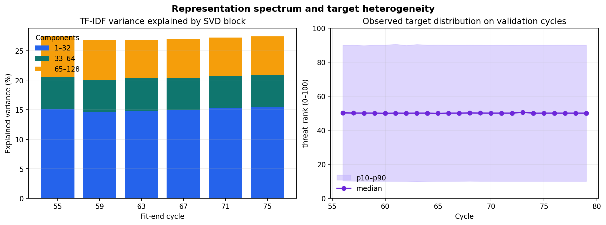
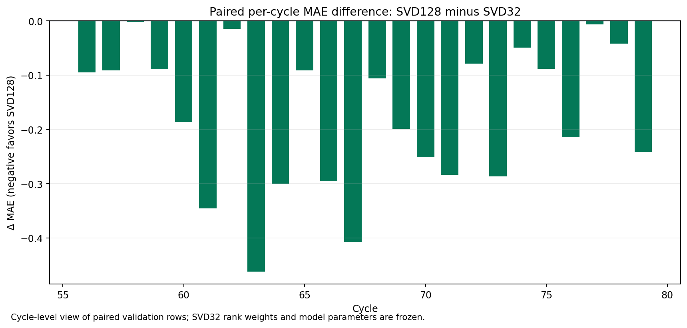

# SVD128 LightGBM paired ablation

## Research question

Could TF-IDF information represented by SVD components 33–128 add predictive signal for `threat_rank` beyond the frozen SVD32 LightGBM recipe?

This is a representation-resolution ablation. SVD uses no target values; explained-variance summaries are target-blind descriptions of the fit-fold text matrices. Paired errors are retrospective model evidence on the existing temporal development windows, not a causal or semantic claim.

## Frozen comparison

Only the requested SVD width changes. The selected Stage 5 parameter and per-cycle rank weight remain fixed for each fit end. Six outer fits cover the same six primary windows and H12 early/later periods; no SVD128 parameter or mapping selection was performed.

| Evaluation | Rows | SVD32 MAE | SVD128 MAE | Δ MAE | Equal-cycle SVD32 | Equal-cycle SVD128 |
|---|---:|---:|---:|---:|---:|---:|
| Primary cycles 56–79 | 38,588 | 11.931600 | 11.916362 | -0.015239 | 12.283548 | 12.255918 |
| H12 pooled (56–67, 68–79) | 38,588 | 14.704041 | 14.519600 | -0.184441 | 14.769251 | 14.593251 |

### Temporal windows

| Window | Rows | SVD32 MAE | SVD128 MAE | Δ MAE | Paired candidate win rate |
|---|---:|---:|---:|---:|---:|
| W1 | 4,114 | 16.405781 | 16.341059 | -0.064722 | 0.502 |
| W2 | 6,493 | 12.042870 | 12.067244 | +0.024374 | 0.494 |
| W3 | 7,078 | 12.354210 | 12.418395 | +0.064185 | 0.495 |
| W4 | 4,950 | 11.999389 | 11.765523 | -0.233866 | 0.522 |
| W5 | 7,462 | 10.774911 | 10.761446 | -0.013465 | 0.497 |
| W6 | 8,491 | 10.303425 | 10.341559 | +0.038133 | 0.490 |
| H12_E | 17,685 | 17.473257 | 17.247402 | -0.225855 | 0.528 |
| H12_L | 20,903 | 12.361143 | 12.211741 | -0.149402 | 0.516 |

## Spectrum and target heterogeneity

The first figure separates fit-fold, target-blind explained variance by SVD component block from observed `threat_rank` p10–p90 span and median on a common 0–100 scale. It does not establish that any component has a particular meaning. The cycle-level paired error plot shows where added representation helps or hurts.





## Interpretation and limitations

The paired SVD128 ablation changes primary MAE by -0.015239 and H12 MAE by -0.184441 relative to the exact frozen Stage 5 controls. A negative value favors SVD128. Interpret this as evidence about this one LightGBM recipe and these reused temporal windows; the windows are development data, so results are adaptive rather than an untouched holdout.

TF-IDF/SVD is not semantically interpreted. Greater explained variance is not automatically predictive value. Missing and present streams, entry-friction groups, target regions, and target tails are summarized as model guardrails; this analysis does not ask an explanatory question about those member-owned EDA features. No full-train/Test fit or Kaggle action was performed.

## Reproducibility

From the repository root with official raw data available at `data/raw/regression/Train.csv` (or `TP2_DATA_DIR`):

```powershell
python scripts/research_autonomous_regression.py
python scripts/verify_autonomous_regression.py
```

The run manifest freezes code, Train input identity, Stage 5 control-vector hashes, selected parameters, rank weights, fold definitions, fit audits, and prediction hashes. Model fit receives only its training rows and their targets.
