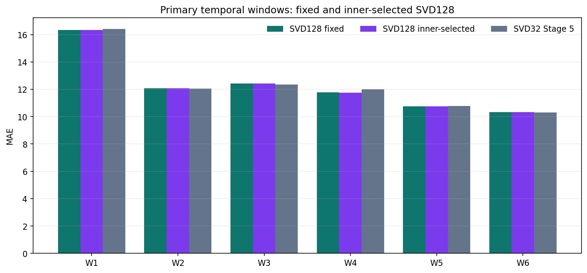

# SVD128 LightGBM inner-selected refinement

## Frozen refinement

After the paired SVD128 ablation showed a near-neutral, mixed primary effect but lower MAE on both H12 halves, the parent approved this bounded re-selection of the existing two LightGBM parameter sets and five rank weights. Only past inner-validation labels selected each fold policy. No new features, model family, parameter values, ranking weights, folds, Test prediction, or leaderboard use were introduced.

The twelve inner fits cover six past-only folds, two parameter sets per fold. The outer stage reuses the paired SVD128 fit when its parameter matches the inner choice and fits only an absent selected parameter when needed.

## Selections

| Outer fit end | Stage 5 SVD32 choice | SVD128 inner choice | Inner MAE | Changed parameter? | Changed weight? |
|---:|---|---|---:|---|---|
| 55 | base / 0.25 | base / 0.25 | 13.250618 | False | False |
| 59 | regularized / 0.25 | regularized / 0.25 | 16.137915 | False | False |
| 63 | base / 0.25 | base / 0.50 | 12.011521 | False | True |
| 67 | base / 0.50 | base / 0.25 | 12.418395 | False | True |
| 71 | base / 0.25 | base / 0.25 | 11.747303 | False | False |
| 75 | base / 0.50 | base / 0.50 | 10.720587 | False | False |

## Temporal results

| Evaluation | Rows | SVD32 Stage 5 | SVD128 fixed policy | SVD128 inner-selected | Inner vs fixed Δ | Inner vs SVD32 Δ |
|---|---:|---:|---:|---:|---:|---:|
| Primary W1–W6 | 38,588 | 11.931600 | 11.916362 | 11.916083 | -0.000279 | -0.015517 |
| H12 pooled | 38,588 | 14.704041 | 14.519600 | 14.530784 | +0.011184 | -0.173256 |

### Per-window MAE

| Window | SVD32 | SVD128 fixed | SVD128 inner-selected | Δ inner vs fixed | Δ inner vs SVD32 |
|---|---:|---:|---:|---:|---:|
| W1 | 16.405781 | 16.341059 | 16.341059 | +0.000000 | -0.064722 |
| W2 | 12.042870 | 12.067244 | 12.067244 | +0.000000 | +0.024374 |
| W3 | 12.354210 | 12.418395 | 12.429619 | +0.011224 | +0.075409 |
| W4 | 11.999389 | 11.765523 | 11.747303 | -0.018220 | -0.252087 |
| W5 | 10.774911 | 10.761446 | 10.761446 | +0.000000 | -0.013465 |
| W6 | 10.303425 | 10.341559 | 10.341559 | +0.000000 | +0.038133 |
| H12_E | 17.473257 | 17.247402 | 17.247402 | +0.000000 | -0.225855 |
| H12_L | 12.361143 | 12.211741 | 12.232388 | +0.020647 | -0.128755 |

## Guardrails

Primary and H12 subgroup error tables, tails, missing/present streams, signed error, and cycle deltas are stored in `inner_refinement.json`. These diagnostics do not redefine the member EDA questions.

## Fit and boundary audit

Exactly 12 inner SVD128 fits were performed. 0 additional selected-parameter outer fits were performed; 6 outer fits were reused from the fixed paired stage. No full-train fit, official Test access, Kaggle submission, or leaderboard feedback occurred.

The prediction errors remain internal development evidence; no statistical standard-error estimate is claimed. Any later full-train parameter selection requires a separate decision and a fit-cycle 47–75 / validation-cycle 76–79 boundary; this report does not select a final inference recipe.
