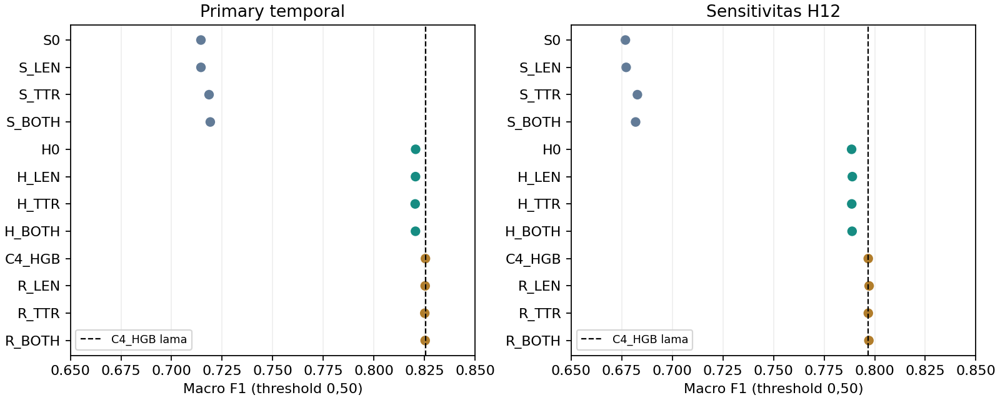
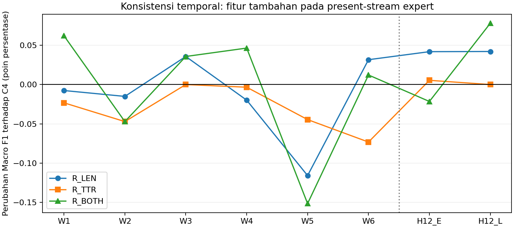

# Samuel — EDA-driven Classification ablation

**Keputusan: pertahankan C4_HGB, threshold 0,50. Tidak ada submission Kaggle baru.** TTR membantu structured Logistic Regression yang lebih sederhana, tetapi tidak menunjukkan manfaat tambahan yang meyakinkan setelah structured + TF-IDF digunakan. EDA A tetap valid sebagai hasil asosiasi; fitur dari EDA tidak wajib masuk model akhir.

## Eksperimen dan batas data

Sumber: official Classification Train, 50.608 baris, cycle 47–79. SHA-256 dan seluruh versi lingkungan ada di [protocol](../../experiments/classification_ttr/protocol.json). Primary memakai enam window temporal lama; H12 memakai dua window history lebih panjang. Masing-masing keluarga mengevaluasi 38.588 baris unik, terdiri atas 36.010 stream-present dan 2.578 stream-missing. H12 menggunakan ulang observasi primary sehingga bukan validasi independen.

Tujuh tambahan LR pada enam cutoff menghasilkan **42 fit baru**, disertai 18 vector kontrol historis dengan hash probabilitas persis sesuai audit. Blok structured, TF-IDF, hyperparameter, target boundary, dan cutoff 0,50 tetap. Tidak ada tuning threshold/hyperparameter, entropy search, akses official Test, atau perubahan notebook resmi.

TTR mengikuti regex lowercase `[A-Za-z0-9]+`, bukan penggantian tokenizer TF-IDF. TTR undefined dan count pada stream missing memakai imputasi median fit-only, lalu StandardScaler fit-only. Teks nonblank tanpa token tetap present, count 0 dan TTR undefined. Detail recipe dan instruksi reproduksi berada di [README eksperimen](../../experiments/classification_ttr/README.md).

`repeat_ratio=(n−n_unique)/n` identik dengan `1−TTR`, sehingga tidak diuji sebagai fitur baru. Definisi lain mengenai kemunculan seluruh token yang berulang tidak identik, tetapi di luar lingkup ini. Kontrol count-only dan availability-only ditambahkan untuk atribusi yang lebih tepat. Semua fitur diturunkan dari input teks tanpa target.

## Perbandingan utama

S = structured LR C1_A; H = hybrid LR C2_B; LEN = token count; BOTH = TTR + count; AV = indikator missing. R memakai expert hybrid eksperimental hanya pada stream-present dan **fallback HGB lama yang sama persis** untuk stream-missing.

| Model | Primary Macro F1 | Equal-cycle primary | H12 Macro F1 |
|---|---:|---:|---:|
| S0 | 0,714525 | 0,712132 | 0,676786 |
| S_AV | 0,714481 | 0,712111 | 0,676973 |
| S_LEN | 0,714540 | 0,711672 | 0,677155 |
| S_TTR | 0,718545 | 0,715364 | 0,682716 |
| S_BOTH | 0,719146 | 0,715795 | 0,681829 |
| H0 | 0,820633 | 0,812379 | 0,788581 |
| H_LEN | 0,820571 | 0,812198 | 0,788938 |
| H_TTR | 0,820415 | 0,812171 | 0,788656 |
| H_BOTH | 0,820559 | 0,812302 | 0,788826 |
| **C4_HGB lama** | **0,825481** | **0,818278** | **0,796810** |
| R_LEN | 0,825353 | 0,818194 | 0,797237 |
| R_TTR | 0,825149 | 0,817976 | 0,796835 |
| R_BOTH | 0,825348 | 0,818312 | 0,797126 |

Structured LR memperoleh +0,004019 primary dan +0,005930 H12 dari TTR (sekitar +0,402 dan +0,593 poin persentase Macro F1). Count saja hampir tidak membantu. Setelah count tersedia, tambahan TTR (S_BOTH − S_LEN) masih +0,004606 primary dan +0,004673 H12. Kontrol missing indicator juga hampir tidak mengubah skor. Jadi manfaat pada structured LR tidak cukup dijelaskan oleh token count atau availability saja, dalam desain linear yang diuji.

Sebaliknya H_TTR − H0 adalah −0,000218 primary dan +0,000075 H12. H_BOTH − H_LEN adalah −0,000012 primary dan −0,000112 H12. **Tidak ada bukti manfaat praktis tambahan di luar representasi hybrid yang ada.** Hasil ini konsisten dengan TF-IDF + structured sudah membawa banyak informasi yang berkaitan dengan diversity, tetapi tidak membuktikan TF-IDF merekonstruksi TTR atau membuatnya redundan secara matematis. Pengujian terbatas pada scalar linear LR; tidak mencakup seluruh interaksi atau recipe lain.

Diagnostik input pada stream-present menunjukkan korelasi Pearson TTR–count −0,810751 dan TTR–text_load −0,809981. Structured sudah memuat `text_load`; karena itu count-only controls lebih informatif daripada mengatribusikan setiap kenaikan BOTH kepada TTR. Korelasi marginal ini tidak menggantikan hasil EDA pada exact length yang sama.

## Konsistensi temporal dan subgroup

Perubahan berikut memakai **poin persentase Macro F1**, yaitu 100 × selisih skor, bukan perubahan relatif.

| Routing baru vs C4 | Δ primary | Δ equal-cycle | Δ H12 | Arah primary windows |
|---|---:|---:|---:|---|
| R_TTR | −0,03320 pp | −0,03011 pp | +0,00251 pp | 0 positif, 5 negatif, 1 sama |
| R_BOTH | −0,01330 pp | +0,00340 pp | +0,03154 pp | 4 positif, 2 negatif |

R_BOTH mempunyai penurunan terbesar di W5 (−0,15156 pp); H12_E turun −0,02153 pp sementara H12_L naik +0,07803 pp. Ini bukan kenaikan temporal yang konsisten. S_TTR sendiri membaik pada 4/6 primary windows dan kedua H12 windows, tetapi tidak mendekati performa hybrid/routing.

| Model | Present primary | Missing primary | Present H12 | Missing H12 |
|---|---:|---:|---:|---:|
| C4_HGB | 0,828555 | 0,781712 | 0,800474 | 0,745006 |
| R_TTR | 0,828197 | 0,781712 | 0,800501 | 0,745006 |
| R_BOTH | 0,828412 | 0,781712 | 0,800815 | 0,745006 |

Kesamaan missing branch telah diperiksa pada **probabilitas**, bukan hanya label atau skor. Semua perubahan routing berasal dari present branch. Primary F1 kelas 0/1 C4 adalah 0,876491/0,774470; R_TTR menjadi 0,876288/0,774009; R_BOTH 0,876384/0,774312. Tidak ada penurunan kelas yang besar, tetapi juga tidak ada keuntungan primary. Precision/recall/F1 lengkap kedua keluarga: [per_class.csv](per_class.csv). Denominator dan diagnostik tambahan: [windows.csv](windows.csv), [subgroups.csv](subgroups.csv), [per_cycle.csv](per_cycle.csv).

## Keputusan dan hubungan dengan EDA/model resmi

Gate operasional telah ditetapkan sebelum hasil: kenaikan minimal 0,002 pada primary dan H12, 0,0015 pada equal-cycle primary, minimal 5/6 primary windows positif, guard kelas/window/present, dan fallback missing identik. R_TTR dan R_BOTH gagal gain, konsistensi window, serta present guard. Detail boolean dan selisih presisi penuh ada di [results.json](results.json). Gate ini batas praktis, bukan uji signifikansi.

**Tidak melakukan full-Train official inference atau upload tambahan**, karena gate gagal. Public score lama 0,82641 tetap sekadar hasil historis model C4, bukan hasil eksperimen ini dan tidak digunakan memilih kandidat. Tidak ada Regression submission atau perubahan model/notebook resmi.

EDA A menjawab asosiasi diversity–artifact pada length sama. Ablation menjawab apakah statistik tersebut membantu prediksi ketika fitur lain sudah tersedia. Kedua jawaban dapat berbeda tanpa membatalkan EDA. Rekomendasi notebook resmi: pertahankan recipe yang ada; bila disetujui pada review berikutnya, cukup tambahkan catatan singkat bahwa ablation TTR tidak memberi peningkatan hybrid yang konsisten. Jangan mengklaim token diversity menyebabkan artifact atau kenaikan F1.

## QA dan receipt

- **PASS:** 18 unit checks untuk wrapper Classification, routing components, tokenization, fit-only transforms, dan target-field exclusion.
- **PASS:** 130 blok metrik dihitung ulang dengan sklearn secara independen, termasuk pooled/per-window, precision/recall/F1, confusion matrix, equal-cycle, dan present/missing.
- **PASS:** 42 median/scaler tambahan dihitung ulang hanya dari fit rows; baseline preprocessing, TF-IDF vocabulary/IDF, parameter, fitur, dan fit fingerprint diverifikasi.
- **PASS:** input/protocol/code hashes, seluruh temporal row arrays, bounds/probability hashes, dan gate keputusan diverifikasi; 441 file historis byte-identical.
- Dua grafik dibuka dan diperiksa secara visual. Tidak ada raw dataset atau prediction cache masuk Git.

[QA.json](QA.json) mencatat pemeriksaan mesin; [freeze.json](../../experiments/classification_ttr/freeze.json) mencatat fit identity. Dua penghentian pelaporan sebelum outcomes diperiksa disebabkan perbedaan metadata threshold dan pembulatan agregasi mean/Brier ~1e−17 pada kontrol. Amendment hanya menormalisasi metadata serta mengizinkan selisih <1e−15 pada dua reduksi tersebut; hash probabilitas tetap persis sama. Seluruh fit disimpan, lalu perhitungan laporan dilanjutkan dari checkpoint terverifikasi tanpa tuning atau refit. Karena itu final `results.json` mencatat 0 fresh fits pada replay pelaporan dan 60 reused vectors (42 baru + 18 kontrol), bukan bahwa eksperimen tidak dilatih.

Keterbatasan: hipotesis berasal dari EDA Train, H12 tidak independen, belum ada external check baru, dan hasil negatif tidak membuktikan TTR tak pernah berguna. Milestone berhenti pada rekomendasi C4_HGB untuk review pengguna.
