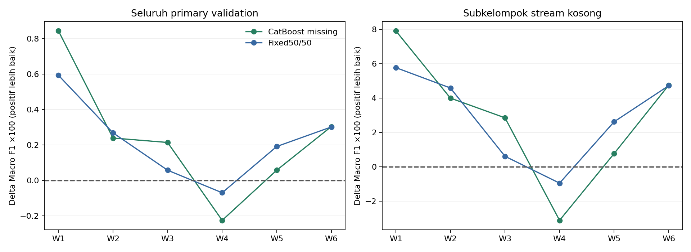

# Samuel — Dual-Lane checkpoint, 31 Oktober 2026

## Keputusan

Lane akademis selesai. Official EDA adalah availability × cycle/text_load; notebook modeling akademis tetap memakai C4_HGB dan LightGBM SVD32. Lane riset menghasilkan challenger yang dibahas terpisah di bawah. Rekomendasi promosi tidak otomatis mengubah notebook akademis. Tidak ada ZIP/SCeLE.

## Lane A — EDA dan kesiapan akademis

**Pertanyaan:** Apakah proporsi artifact_signal=1 berbeda menurut ketersediaan signal_stream, dan bagaimana perbedaannya berubah setelah mempertimbangkan periode cycle_code serta volume narasi (text_load)?

Official Train: 50.608 baris; missing 3.404, present 47.204. Prevalensi missing 38,13% vs present 34,47%; gap marginal +3,66 pp dan cycle-standardized +3,96 pp. Setelah standardisasi periode × 5 bin volume, gap −2,30 pp; dengan 10 bin −2,15 pp pada coverage 94,33% (47.740 baris, 28/30 cell). Minimum support 20 baris per availability per cell.

Pembalikan arah konsisten dengan perbedaan komposisi volume/periode. Standardisasi adalah kontras prevalensi berbobot, bukan efek kausal. Coverage bin kasar bukan exact covariate overlap; 906 laporan missing berada di bawah minimum volume kelompok present. Tidak ada klaim bahwa missingness menyebabkan target.

Notebook resmi: [EDA12](../../notebooks/samuel/12_samuel_formal_eda_availability.ipynb), [Classification10](../../notebooks/samuel/10_samuel_final_classification.ipynb), [Regression09](../../notebooks/samuel/09_samuel_final_regression.ipynb). Keempat grafik EDA membandingkan prevalensi marginal, periode/cycle, distribusi text_load, dan kontras standardisasi. Classification memuat ringkasan EDA beserta satu visual; diagnosis model sebelumnya tetap dibedakan dari EDA yang dibuat kemudian. Regression diaudit tanpa perubahan recipe.

Fresh-kernel Run All pada source copy dengan dua official Train saja: ketiga notebook PASS, tanpa Test/cache model pribadi. Ada 11 PNG yang dibuka dan diperiksa: 4 EDA, 5 Classification, 2 Regression. Representative W6 benar-benar dilatih dan prediksinya sama dengan receipt historis; tabel seluruh primary/H12 berprovenance, tidak diklaim seluruh fit historis diulang. Lima unit tests EDA PASS. [Receipt akademis](../academic_availability/QA.json), [compliance](../../docs/SAMUEL_FINAL_COMPLIANCE.md), [demo](../../docs/SAMUEL_DEMO.md), [Run All](../../docs/SAMUEL_FINAL_REPRODUCIBILITY.md).

Review pengguna yang tersisa: pemahaman demo, nama export/roster, dependencies/source saat packaging, kelengkapan approach anggota lain, baseline Classification dan final/private leaderboard, serta pengumuman jadwal asdos. PDF memiliki ketidaksesuaian hari/tanggal; tidak dibuat requirement baru untuk menutupnya. EDA TTR11 dan temporal03 serta seluruh pertanyaan anggota lain dipertahankan.

## Lane B — desain dan batas interpretasi

Perbandingan menggunakan enam expanding fits (akhir 55/59/63/67/71/75), empat cycle berikutnya sebagai primary; H12_E fit47–55→56–67 dan H12_L fit47–67→68–79. Primary dan H12 masing-masing 38.588 baris unik tetapi menggunakan outcome yang sama dengan horizon fit berbeda. Seluruh cycle sudah sering dipakai dalam riset: ini bukti development adaptif, bukan untouched holdout.

Tiga keluarga teks Classification menjalankan 18 successful fits; CatBoost missing expert 6 fits; Regression CatBoost 6 fits. Ensemble Regression menggunakan ulang prediksi temporal terverifikasi dan tidak menghitung ulang estimator. Satu fit SVC awal gagal konvergen sebelum skor; iterasi dinaikkan melalui amendment tanpa mengubah hyperparameter lain.

### Classification — Macro F1 lebih tinggi lebih baik

| Route | Primary | H12 pooled | Public | Ref | Keputusan |
|---|---:|---:|---:|---|---|
| C4_HGB resmi | 0.825481 | 0.796810 | 0.82641 | 57808225 | Tetap di notebook akademis |
| DC_SVC | 0.814421 | 0.788843 | Tidak disubmit | — | Retire; kalah primary |
| DC_NBSVM | 0.822975 | 0.796395 | Tidak disubmit | — | Retire; kalah primary |
| DC_WORD_CHAR | 0.822696 | 0.794013 | Tidak disubmit | — | Retire; kalah primary |
| C2_B present + CB_MISSING | 0.827646 | 0.798984 | 0.82701 | 57833406 | Challenger; lihat evaluasi eksternal |
| C2_B present + CB_HGB_50 | 0.827581 | 0.798357 | Tidak disubmit | — | Pembanding fixed blend; tidak perlu upload tambahan |

SVC, NB-weighted LR dan word+char semuanya mempertahankan fallback C1_B. SVC turun di semua enam jendela; word+char juga demikian. NB-weighted LR hanya membaik di W2/W3; AP naik 0,829320→0,836232 tetapi threshold 0,50 tidak menghasilkan F1 lebih tinggi. Semua net paired corrections negatif; blend gate keluarga teks gagal. Rumus NB weighting terinspirasi [Wang & Manning (2012)](https://aclanthology.org/P12-2018/), dengan weighted TF-IDF+LR, bukan klaim replikasi literal NB-SVM.

CatBoost missing expert memakai expanded structured parser/imputer fit-only, native categories dan fixed Logloss500/depth6/lr0,05/seed42/two threads; dilatih pada seluruh baris fit lalu diroute hanya ke stream kosong. C2_B present tidak berubah. Pada 2.578 missing primary rows, F1 0,781712→0,810821; candidate-only correct208 vs HGB-only138. Gate mendukung satu fixed50/50 blend, yang juga kompetitif, tetapi route langsung sedikit lebih baik pada pooled primary/H12 dan memakai dua, bukan tiga estimator.

Direct CatBoost route positif pada 5/6 primary windows. Pooled H12 membaik, tetapi H12_L overall 0,805106→0,803724 dan missing H12_L 0,763347→0,744342. Perbaikan tidak universal. Gate external dibuat sebelum MAIN membaca hasil Stage3, setelah fitting dimulai; bukan pre-fit cryptographic selection freeze. Konfigurasi CV dan conditional blend sudah dibekukan sebelum enam fits.

Submission direct expert mengubah 107 dari 29.421 label Test, seluruhnya dalam 1.062 stream kosong; label present sama persis dengan baseline. Public 0.82701 dibanding C4 0,82641 (delta +0.00060). Rekomendasikan sebagai challenger untuk integrasi berikutnya; official notebook tetap stabil.

### Regression — MAE lebih rendah lebih baik

| Recipe | Primary | H12 pooled | Public | Ref | Keputusan |
|---|---:|---:|---:|---|---|
| LGB SVD32 resmi | 11.931600 | 14.704041 | 11.71363 | 57810150 | Tetap di notebook akademis |
| 75% LGB + 25% Hybrid Ridge | 11.800756 | 14.252094 | 11.64134 | 57832438 | Rekomendasi promosi riset |
| 50% LGB + 50% Hybrid Ridge | 11.875517 | 13.969345 | 11.75259 | 57832444 | Retain comparator; public kalah |
| Hybrid Ridge saja | 12.551305 | 13.938115 | Tidak disubmit | — | Pembanding H12 penting |
| Inner-selected alpha | 12.042797 | 14.354853 | Tidak disubmit | — | Retire; primary tidak membaik |
| CatBoost MAE + SVD32 | 11.809633 | 14.377381 | 12.48607 | 57833185 | Retire; public dan tails lemah |

Ridge25 dipilih dari dua bobot coarse yang dideklarasikan sebelum external score: masing-masing komponen tetap memakai inner-selected within-cycle rank mapping sendiri; full-Train memakai LGBbase/rank0,50 dan Ridge/rank0,75 sesuai resep historis. Fixed ensemble tidak memasang meta-model pada label evaluasi. Alpha yang dipilih inner lebih tidak stabil (0,50/1/0/0/0,50/0,25) dan kalah primary.

Ridge25 menurunkan primary MAE sebesar 0,130844 dan H12 0,451947 terhadap LGB; menang 4/6 primary windows. Primary missing sedikit memburuk (13,04181→13,13072), sedangkan low-tail membaik (12,23539→11,82124) dan high-tail membaik (9,49544→9,37923). W2/W3 tetap lebih buruk. Public MAE 11,64134 memperbaiki 11,71363 sebesar 0,07229 (sekitar0,62%). Ini dukungan gabungan internal/public, bukan klaim private score.

Ridge50 memperbaiki H12 lebih banyak tetapi primary lebih lemah daripada Ridge25, dan public 11,75259 tidak mengonfirmasi keunggulannya. CatBoost kompetitif internal namun low/high-tail lebih buruk (13,059/10,931 vs Ridge25 11,821/9,379), W4–W6 kalah, dan public12,48607 jauh lebih buruk. Shift/variance atau ketidakcocokan recipe adalah kemungkinan, bukan penyebab yang dapat diidentifikasi tanpa label Test. Tidak ada tuning fine alpha, threshold atau label Test setelah public.

CatBoost/LGB fixed-blend gate gagal: row-aligned error correlation0,947841 >0,93. Diagnostic alignment awal salah dan dikoreksi lewat verifikasi independen; MAE/prediksi tidak berubah. Blend tersebut tidak dievaluasi dan tidak dipaksakan setelah melihat public.

## QA, submission, preservation

- Academic portable Run All dan 11 figure: PASS. Unit tests: 24 + 2 tests PASS, serta3 subtests; Stage3 sklearn verifier90 group checks. Root checkpoint menambahkan rekonsiliasi tepat 18 candidate/fold C4 routes terhadap raw C1_B/C2_B caches, dan pemeriksaan independen AP/Brier/per-class metrics untuk Stage3.

- Seluruh upload memakai SDK/API Kaggle terautentikasi, bukan mengontrol Chrome. Setiap candidate refit seluruh50.608Train, output29.421officialTest IDs tepat/schema/order, class0/1 atau regressionfinite[0,100], source/recipe/input/CSV SHA, exclusive manifest serta idempotent ledger. Tidak ada Test label, external dataset, model pretrained atau credential dalam Git. Semua refs di tabel berstatus COMPLETE.

- Freeze chronology dijelaskan terbuka: checksum Stage1 Regression dikonsolidasikan setelah skor eksplorasi pertama; bukan prescore cryptographic freeze. Kegagalan report Classification dipulihkan melalui wrapper/versioned report-only amendment tanpa refits; sumber awal dan failure receipts tetap ada.

- JSON campaign dan tiga executed notebook memakai scoped .gitattributes untuk menjaga byte hashes lintas checkout. Source hashes dinormalisasiLF; evidence byte-exact tersimpan di checkpoint terakhir. Training source_commit dalam manifest tetap menunjuk code commit saat fit.

- Sebanyak549 file historis di luar9 entri akademis terotorisasi byte-identical; tiga baris pertanyaan anggota lain tidak berubah. TTR11 dan temporal03 terjaga. Raw data, prediction caches, model binaries, dan CSV submission tetap ignored.

[Root checkpoint QA](checkpoint_QA.json), [manifest dan acceptance ledger](kaggle/), [Class text detail](classification/FINDINGS.md), [Reg blend detail](regression/STAGE1_PAIRED_BLEND.md), [Reg CatBoost detail](catboost/STAGE2_CATBOOST.md).

## Reproducibility dan stop point

Dependencies akademis: requirements-research.txt. Tambahan campaign: `python -m pip install -r experiments/dual_campaign/requirements.txt` (CatBoost1.2.8, LightGBM4.6.0). Data tetap melalui TP2_DATA_DIR atau data/raw/{classification,regression}; officialTrain/Test/SampleSubmission hanya diperlukan sesuai tahap. Kaggle SDK memakai environment terpisah; credentials hanya melalui mekanisme standar.

Academic Run All dan data layout: docs/SAMUEL_FINAL_REPRODUCIBILITY.md. Verifikasi campaign: `python scripts/verify_dual_campaign_checkpoint.py --output <new-receipt.json>` setelah cache temporal lokal tersedia. Root report ini dapat dibangun ulang dari tracked evidence dengan `python scripts/report_dual_campaign.py` tanpa fit/API.

Research caches memang derived lokal, bukan bundled raw/model assets. Untuk rekonstruksi, gunakan docs/CLASSIFICATION_ROUND1.md untuk C1_B/C2_B controls dan docs/REGRESSION_RESEARCH.md untuk prediction lineage. Fixed expert dapat dilatih langsung dengan `build_catboost_classifier()`; `--freeze` lalu runner research_campaign_classification_catboost.py menjalankan enam fits. Existing immutable outputs tidak ditimpa; fresh replay menggunakan checkout/source yang sama dan output namespace baru. Jangan menghapus receipt agar rerun terlihat baru. Script pre-recovery lama sengaja tetap merekam failure; entry recovery yang benar adalah assemble_campaign_classification_stage2_report_v2.py.

Inference entrypoints: prepare_campaign_candidate.py (Ridge25/50), prepare_campaign_catboost_candidate.py (RegCB), prepare_campaign_classification_catboost_candidate.py (ClassCB), masing-masing dengan decision JSON terkait. Existing candidate CSV/manifest menolak overwrite. Tidak menjalankan upload otomatis saat mereproduksi report atau notebook.

Campaign ini menggunakan 1 submission Classification dan 3 Regression. classification: allowance8, totalteam3; regression: allowance6, totalteam9. Snapshot live pada receipt preflight; dapat berubah bila anggota lain submit. Satu slot shared-team tetap dilindungi oleh gate.

Lane B berhenti karena beberapa keluarga berbeda sudah diuji, kandidat kuat telah ditemukan, dan fine tuning tambahan pada cycle/public yang sama akan memperbesar bias adaptif. Bukan karena quota habis. Kemungkinan lanjutan yang belum dieksekusi: past-only calibration NB-weighted ranking atau sensitivity forward-chaining alternatif; belum ada bukti cukup untuk membenarkan search/submission baru pada checkpoint ini.

Academic models tetap C4_HGB dan LGB SVD32. Rekomendasi integrasi riset berikutnya harus mempertimbangkan subgroup/tails dan beban demo; tidak otomatis menulis ulang notebook resmi. Tidak ada blocker teknis aktif; private score, final leaderboard dan keputusan packaging tetap belum diketahui.
