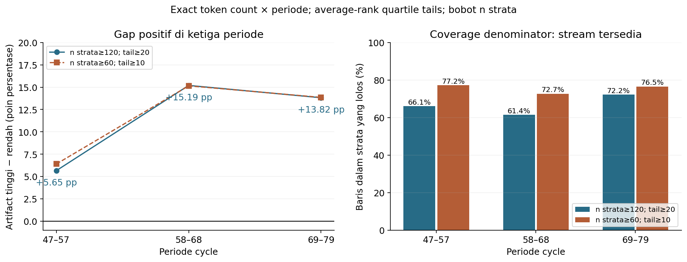
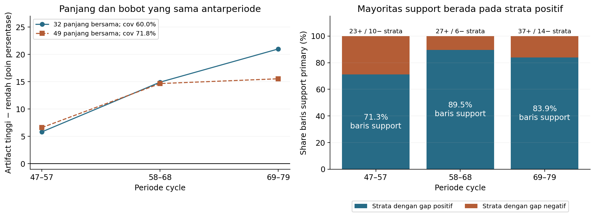
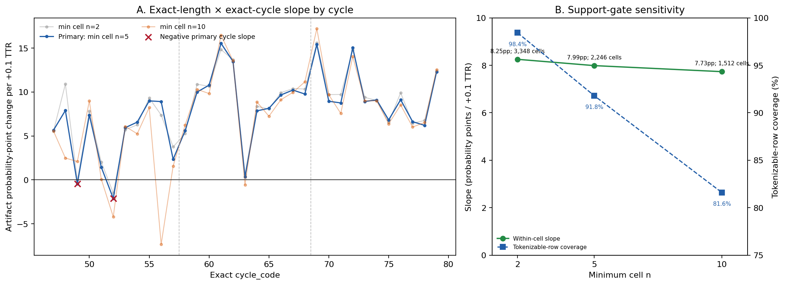

# EDA A — targeted robustness terhadap cycle

31 Oktober 2026 · Berangkat dari `80a6488`. **A tetap layak dipilih; pemeriksaan ini memperkuat rekomendasi penggantian, tanpa mengganti pertanyaan resmi.** Arah positif bertahan pada ketiga periode dan pada pemeriksaan exact cycle dengan coverage tinggi. Besar asosiasi tidak seragam dan bukan klaim kausal, kualitas teks, atau semantik token.

## Aturan dan denominator

Hanya official Classification Train dipakai: 50.608 baris, SHA-256 `875552a68a3d24b0f3e1966d6ddb5671e6f54305a1c526e2f0a76747942ed91c`. Stream NaN/blank sebanyak3.404 dikecualikan; **47.204 stream tersedia/tokenizable** menjadi denominator coverage utama. Tokenisasi regex `[A-Za-z0-9]+`, lowercase; TTR = jumlah token unik / jumlah token. Tidak ada token dipilih berdasarkan target.

Aturan utama mempertahankan **n≥120 per exact length×periode, ≥20 di masing-masing tail**. Sensitivitas yang ditetapkan terpisah: n≥60/tail≥10. Di dalam setiap strata, average percentile rank TTR≤0,25 adalah rendah dan≥0,75 tinggi; ties dipertahankan. Batas TTR absolut dapat berbeda antarperiode. Mean artifact tiap tail diberi bobot n strata yang sama untuk kedua grup. Baris tengah mendefinisikan bobot/support, tetapi tidak masuk kontras.

Aturan tercatat dalam [protocol_and_preservation.json](protocol_and_preservation.json). Ini lanjutan eksploratif pada Train yang sudah dilihat, bukan validasi konfirmatori baru.

## 1. Exact length × tiga periode

| Periode | Stream tersedia | Strata lolos | Support rows (coverage) | n rendah / tinggi | Gap artifact (pp) | Strata + / − |
|---|---:|---:|---:|---:|---:|---:|
|47–57|12.537|33|8.284 (66,08%)|1.810 /2.074|**+5,65**|23 /10|
|58–68|15.664|33|9.621 (61,42%)|2.336 /2.454|**+15,19**|27 /6|
|69–79|19.003|51|13.717 (72,18%)|3.239 /3.671|**+13,82**|37 /14|

Gabungan: **+12,10 pp**, prevalence tertimbang26,23%→38,32%; 117 strata,31.622 support rows (**66,99% present;62,48% seluruh Train**). Kontras sebenarnya memakai7.385 rendah dan8.199 tinggi. Sebanyak87 strata positif/30 negatif; strata positif memuat **82,27% support rows**, dengan share perperiode71,27%/89,49%/83,85%. Jadi pola bukan hanya satu periode atau beberapa kelompok positif, tetapi juga bukan universal.

Aturan60/10 menghasilkan gap **+6,40/+15,15/+13,85 pp**; pooled **+12,24 pp**, coverage **75,44% present** (35.611 baris), strata129 positif/34 negatif/1 nol. Equal-period mean utama tetap **+11,55 pp**, sehingga ukuran periode terbesar tidak menentukan arah sendirian.

Dibanding discovery14,20 pp, perubahan ini **bukan dekomposisi efek cycle murni**: support dan ranking lokal berubah. Mask utama mempertahankan31.394/37.681 (**83,32%**) baris support lama serta menambahkan228 yang kini memenuhi gate lokal; aturan longgar mempertahankan93,90% support lama. Ini kehilangan moderat, bukan coverage yang mendekati nol.

## 2. Panjang yang sama dan bobot yang sama antarperiode

Irisan support utama mempertahankan **32 panjang**,28.343 baris (**60,04% present**). Dengan satu set bobot panjang dari pooled counts ketiga periode, gap perperiode tetap **+5,83/+14,92/+20,99 pp**. Equal-period mean+13,92 pp. Aturan longgar mempertahankan49 panjang/33.882 baris (**71,78% present**), dengan gap **+6,61/+14,67/+15,54 pp**. Tanda tidak bergantung pada perbedaan komposisi panjang antarperiode, tetapi variasi magnitude dan seleksi support tetap penting.

## 3. Pemeriksaan exact length × exact cycle sekaligus

Tiga blok masih menyisakan perbedaan antarsiklus. Pemeriksaan tambahan memusatkan TTR dan artifact pada mean **setiap exact length×exact cycle cell**, lalu merangkum `β = Σ(x_centered*y_centered) / Σ(x_centered²)`. Ini menghilangkan perbedaan mean antarsel. Tidak diperlukan dua tail besar pada setiap sel kecil, tetapi ringkasan mengasumsikan satu kemiringan linear bersama dan membobot menurut variasi TTR dalam sel. **Estimand ini berbeda dari gap quartile14,20 pp** dan tidak boleh disamakan dengannya.

| Minimum n/sel, ≥2 TTR berbeda | Sel lolos | Support rows | Coverage present | Ringkasan per +0,10 TTR |
|---|---:|---:|---:|---:|
|2, sensitivitas|3.348|46.462|98,43%|+8,25 pp|
|**5, utama**|**2.246**|**43.333**|**91,80%**|**+7,99 pp**|
|10, sensitivitas|1.512|38.513|81,59%|+7,73 pp|

Sel dengan artifact konstan tetap dipakai; eligibility hanya berdasarkan n dan variasi TTR. Pada aturan utama, **1.401 positif/165 nol/680 negatif**; sel positif memuat29.600/43.333 (**68,31%**) support rows dan70,70% variasi TTR within-cell. Korelasi within-cell≈0,110: arah konsisten tidak menjadikan TTR penjelasan utama artifact.

Slope percycle positif **31/33**; cycle49 dan52 menjadi counterexample (−0,44/−2,12 pp per+0,10 TTR). Seluruh33 leave-one-cycle-out estimates tetap positif, **+7,73 sampai+8,28 pp**. Satu cycle terbesar hanya menyumbang5,71% variasi TTR; tiga terbesar15,62%. Pola bukan sekadar prevalence tinggi pada satu era. Ringkasan ini tetap deskriptif; tidak menjamin hubungan linear di setiap sel atau menghilangkan confounding kategori/konteks lain.

## Keputusan dibanding EDA lama

**Tetap rekomendasikan A sebagai calon pengganti.** Kekhawatiran utama bahwa asosiasi hanya mencerminkan perbedaan era kini berkurang: semua periode searah, common-length weighting searah, dan exact-cycle check tetap positif pada coverage91,80% present (**85,62% seluruh Train**). Klaim yang layak adalah asosiasi positif yang heterogen, bukan gap tetap14,20 pp pada setiap waktu.

EDA lama tetap kuat untuk pertanyaan Regression temporal: common impact×EF coverage96,09%, periodisasi dan rank geometry sudah matang. Kedua coverage tidak langsung sebanding karena variabel, target dan estimand berbeda. A lebih fokus untuk karakteristik teks/Classification dan lebih mudah diringkas; pemeriksaan ini memberi alasan cukup untuk memilih A, tanpa menyatakan EDA lama gagal. Teks kosong dan kelompok tanpa dukungan tetap di luar klaim A; tidak ada validasi independen/kausal atau interpretasi semantik.

Reproduksi: `python scripts/eda_a_period_robustness.py`, `python scripts/eda_a_within_cells.py`, lalu `python scripts/plot_eda_a_robustness.py`. Input portable melalui `TP2_DATA_DIR`. Pemeriksaan numerik independen: `python scripts/verify_eda_a_robustness.py`; [receipt](verification.json) merekonsiliasi rank tails, common weights, cell slopes/signs dan preservation382 tracked files+8 draft. CSV granular outcome hanya untuk primary cells n≥5; tidak ada raw text, ID record, notebook baru, perubahan model, pekerjaan teman, atau Kaggle submission. **Berhenti untuk review pengguna; pertanyaan resmi belum berubah.**
