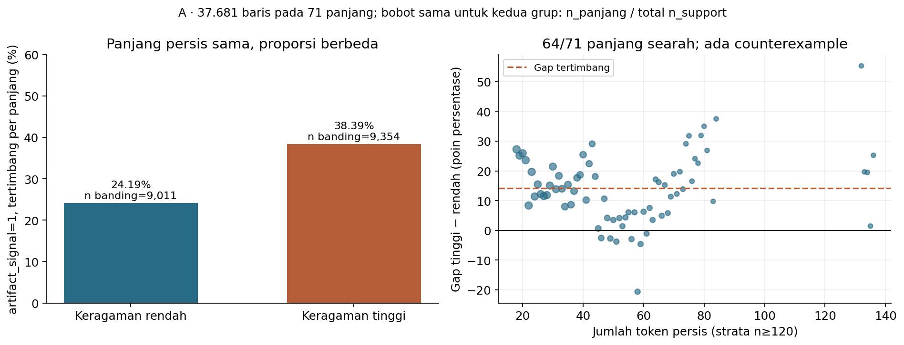
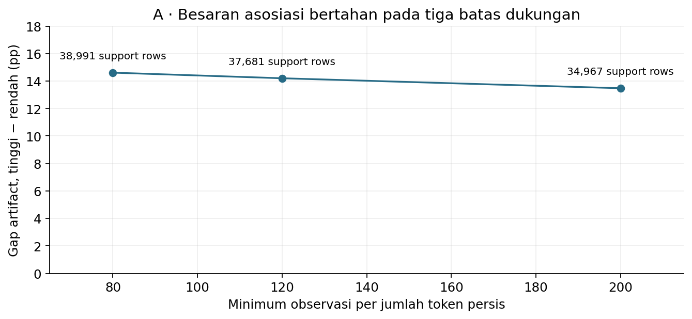
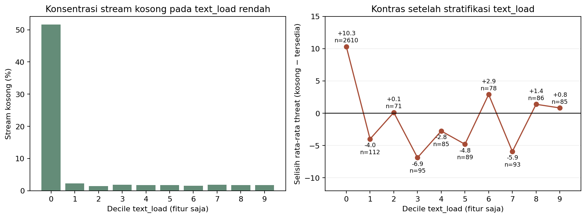
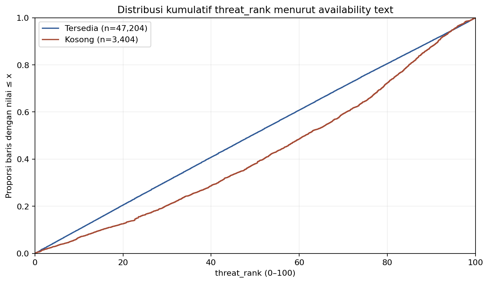
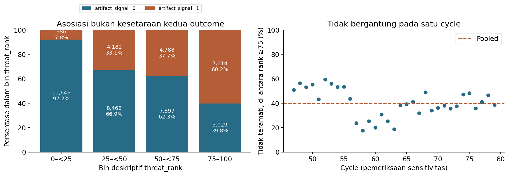

# Samuel — independent EDA discovery

31 Oktober 2026 · **Penelitian kandidat selesai untuk comparative review; pertanyaan resmi belum diganti.**

Rekomendasi terbaik untuk dipertimbangkan adalah **A, keragaman token pada jumlah token yang sama**. Bukti utamanya berasal dari asosiasi label langsung, bukan skor model: prevalence `artifact_signal=1` tertimbang berbeda **24,19% versus 38,39%**, gap **14,20 poin persentase**, pada common support yang dijelaskan di bawah. C (availability dan komposisi volume) dan F (keselarasan kedua target) menjadi alternatif utama. EDA temporal lama tetap valid dan mempunyai robustness serta coverage yang kuat; rekomendasi ini tidak otomatis menggantikannya.

## Sumber dan batas penelitian

PDF resmi `TP KASDAD Ganjil 2026_2027.pdf`, 57 halaman, SHA-256 `386fa63541cc3e9b36b56ee8f8f6c479b3bbaa7753b9482d60763326f4465c0a`, dibaca kembali. Halaman 2 mewajibkan pertanyaan EDA individual, eksplorasi, visualisasi, dan interpretasi; p.9 mengharuskan notebook dapat dijalankan ulang. Pada p.16, `signal_stream` adalah token teknis anonim dari narasi yang dapat kosong/noisy; p.17 mendeskripsikan `text_load` sebagai indikator volume narasi. Tidak ada aturan yang mengharuskan pertanyaan rumit, model untuk EDA, atau teknik tertentu. Semantik target TP2 dicatat dalam [informasi kompetisi](../../docs/COMPETITION_INFO.md), terpisah dari target TP1 pada PDF.

Kedua Train resmi berisi 50.608 baris ×19 kolom, cycle 47–79. ID unik dan seluruh 18 kolom bersama—termasuk ID—cocok sebelum label disejajarkan one-to-one. Hanya Train digunakan; Test, pseudo-label, cache prediksi/model, dan skor leaderboard tidak masuk perhitungan atau pemilihan kandidat. Raw dipertahankan. Data mentah, isi token, dan record-level outputs tidak disimpan dalam artifacts riset.

| Input | SHA-256 |
|---|---|
| Regression Train | `756523ff8156a9cd776e52249f7e2a8f23dcec432b8d10570e55ff6db0e0f082` |
| Classification Train | `875552a68a3d24b0f3e1966d6ddb5671e6f54305a1c526e2f0a76747942ed91c` |

Seluruh Train telah dieksplorasi dalam pekerjaan sebelumnya. Bins, support thresholds, ukuran keragaman, dan shortlist merupakan pilihan discovery pada data yang sama; bukan praregistrasi dan bukan validasi konfirmatori. Cycle checks dan definisi alternatif menilai sensitivitas, bukan menambah observasi independen. Tidak ada p-value yang dijadikan dasar pemilihan. Ukuran efek, support, counterexample, dan batas interpretasi lebih penting daripada klaim signifikansi.

## Enam arah yang benar-benar diperiksa

| ID | Hipotesis eksploratif | Hasil awal dan penyaringan |
|---|---|---|
| A | Repetisi/keragaman `signal_stream` berkaitan dengan outcome pada panjang sebanding. | Asosiasi artifact bertahan pada exact token count, beberapa support cutoffs, dan ukuran keragaman lain. Masuk shortlist. |
| B | `text_load` mungkin memuat karakteristik selain panjang stream teramati. | Spearman terhadap token count **0,98291**, terhadap panjang karakter **0,98336** (47.204 present). Sangat berguna sebagai konteks panjang, tetapi terlalu dekat dengan definisi volume untuk menjadi pertanyaan utama. |
| C | Kelengkapan/availability laporan mempunyai profil outcome yang berbeda. | Skor completeness umum lemah; stream kosong tersendiri menunjukkan gap rank besar yang ternyata sangat sensitif terhadap komposisi `text_load`. Masuk shortlist untuk mempelajari komposisi, bukan mengklaim efek missingness. |
| D | `pattern_code` mempunyai profil kedua target yang heterogen. | 115 known codes n≥30 mencakup **80,22%** Train; heterogenitas tetap pada support100/300. Data mendukung, tetapi kode anonim membatasi penjelasan domain. Disimpan sebagai alternatif cadangan. |
| E | Konteks organisasi/modul menjelaskan heterogenitas outcome. | Known-code coverage n≥30 hanya **50,4%/23,6%**; median kategori berukuran satu. Rentang ekstrem mudah muncul pada kategori langka, sementara semantik kode tidak diketahui. Dieliminasi. |
| F | Indikasi artefak sejalan dengan prioritas, tetapi kedua outcome tidak dapat dipertukarkan. | Mean rank berbeda **24,45** poin, namun **39,78%** rank≥75 berlabel0. Masuk shortlist; sangat intuitif tetapi lebih deskriptif. |

Seluruh kategori yang memenuhi support diperiksa, bukan beberapa mean ekstrem. A/B menggunakan fitur teks numerik yang tidak dipilih berdasarkan token bertarget ekstrem. C memakai tujuh indikator availability dan secara eksplisit mengecualikan `telemetry_flag`. Semua hipotesis tetap dinilai meskipun hasilnya negatif. Tabel awal: [candidate_screening.csv](candidate_screening.csv).

## Shortlist A — keragaman token pada panjang persis sama

**Pertanyaan:** Pada laporan dengan jumlah token yang sama, apakah keragaman token dalam `signal_stream` berkaitan dengan proporsi `artifact_signal` yang teramati?

Token = regex `[A-Za-z0-9]+`, lowercase; keragaman = jumlah token unik / jumlah token. Ini ukuran repetisi, bukan ukuran kualitas bahasa, kelengkapan semantik, atau jenis eksploit. Tidak ada arti yang diberikan kepada token anonim.

Dari 50.608 baris, 3.404 (6,73%) stream kosong/blank dan 47.204 tersedia. Untuk setiap **exact token count**, ambil average percentile rank keragaman: rendah≤0,25, tinggi≥0,75; ties tidak dipecah arbitrer. Syarat n≥120 per panjang dan n≥20 di tiap tail menghasilkan **71 panjang /37.681 support rows**: 79,83% present, 74,46% semua Train. Itu denominator support, bukan jumlah yang benar-benar dibandingkan: kontras memakai **9.011 rendah dan9.354 tinggi**, total18.365. Baris tengah mendefinisikan bobot support tetapi tidak masuk mean tail.

Kedua grup menggunakan bobot panjang yang sama, `n_panjang / total n_support`. Prevalence tertimbang **24,185%→38,387%**, gap **+14,202 pp**. Pooled prevalence tail tanpa bobot adalah24,348%→38,828%, gap+14,480 pp; kedua estimand tidak dicampur. Seluruh stratum disimpan di [exact_length_type_token_ratio.csv](text/exact_length_type_token_ratio.csv).

Asosiasi positif pada **64/71** panjang; tujuh counterexample tetap ditampilkan. Rentang gap individual **−20,59 sampai+55,31 pp**, sehingga rata-rata bukan hukum universal. Panjang dengan arah positif mencakup92,82% support rows.

| Pemeriksaan | Hasil | Batas interpretasi |
|---|---|---|
| Minimum n80/120/200; tiap tail≥20 | 84/71/53 panjang; support38.991/37.681/34.967; gap+14,61/+14,20/+13,48 pp | Support rules dipilih dalam discovery, bukan cutoff konfirmatori. |
| Shannon entropy; inverse repeat-share | Gap+10,05/+14,87 pp | Mengukur aspek berdekatan dan saling bergantung; bukan tiga replikasi. |
| Broad length bins dalam cycle | Artifact direction positif30/33 cycle | Panjang masih bervariasi di dalam broad bin. |
| Exact length×cycle; n≥60/length dan ≥10/tail, lebih longgar dari primary120/20 | Hanya5 cycle mempunyai strata cukup | Bahkan dengan gate lebih longgar, tidak boleh mengklaim kontrol exact length dan cycle untuk seluruh Train sekaligus. |
| Threat sebagai outcome lain | Arah tidak sekonsisten artifact; hanya23/33 cycle negatif pada broad bins | Jangan memperluas pertanyaan utama menjadi klaim umum dua target. |

Siklus bootstrap10.000×seed42 memberi rentang sensitivitas mean cycle contrast yang masih positif, tetapi mengasumsikan cycle exchangeable dan tidak menangani dependensi serial. Itu bukan confidence interval konfirmatori, generalisasi Test, atau bukti kausal. Komposisi kategori, tipe laporan, dan proses observasi dapat menjelaskan sebagian asosiasi; tidak ada kontrol seluruh confounder. Kekuatan A adalah pertanyaan yang fokus dan effect size langsung, bukan identifikasi mekanisme.

## Shortlist C — stream kosong, gap rank, dan komposisi volume

**Pertanyaan:** Apakah laporan tanpa `signal_stream` mempunyai profil `threat_rank` yang berbeda, dan seberapa jauh perbedaan tersebut berkaitan dengan komposisi `text_load`?

Skor completeness umum tidak menjanjikan: 26.767 complete versus23.841 any-missing, gap mean rank any-missing−complete **+0,384**, dengan tanda20/33 versus13/33 cycle. Prevalence artifact35,11% versus34,27%. Kelompok4–5 missing terlalu kecil untuk dijadikan cerita utama.

Untuk stream sendiri, mean rank missing/present **57,605/49,487** (gap **+8,118**), median61,302/49,152. Arah mean gap positif32/33 cycle; ini tampak kuat sebelum memeriksa metadata volume. Namun **2.610/3.404 (76,67%)** missing stream berada pada decile `text_load` terendah. Rate missing pada decile pertama51,6%, sedangkan decile lain sekitar1,4–2,2%.

Setelah kedua grup diberi share bin `text_load` yang sama, mean gap menjadi **+0,253/−0,887/−1,448** untuk5/10/20 quantile bins. **Penyusutan gap besar lebih stabil daripada tanda gap**; tidak tepat menyebut pembalikan tanda robust. Semua bin memenuhi minimum20 per status dan nominally mencakup100% Train, tetapi itu bukan exact matching. Effective n missing setelah pembobotan hanya sekitar1.049/963/953.

Positivity juga tidak sempurna: **906/3.404 (26,62%)** missing rows memiliki `text_load` di bawah minimum present20,6456. Common observed range20,6456–77,5241 menyisakan2.498 missing dan raw gap+4,123; tetap bukan bukti sebab-akibat. Standardisasi pattern-only masih memberi+8,35/+9,05 pada minimum20/30 per status, tetapi joint pattern×volume support min20 hanya6.576 baris (13,0%). Tidak ada klaim simultaneous adjustment yang mewakili semua data.

Low-tail≤5 missing/present3,26%/5,12%, tetapi high-tail≥95 hampir sama~5,05%. Mean yang lebih tinggi tidak berarti seluruh distribusi bergeser atau extreme risk lebih besar. C menjadi kandidat yang bagus untuk menjelaskan confounding dan common support; ia lebih rumit saat demo dan tidak menetapkan mengapa teks hilang. Tidak ada kesimpulan MCAR/MAR, kualitas laporan, atau dampak mengisi teks yang hilang.

## Shortlist F — sejalan rata-rata, tidak identik

**Pertanyaan:** Seberapa sejalan indikasi artefak eksploit publik dengan prioritas respons, dan seberapa besar kelompok observasi yang tidak sejalan?

Mean `threat_rank` label1 **65,995** versus label0 **41,543**; gap **24,452**, point-biserial **0,4033**. Probability of superiority0,7445 berarti skor sebuah baris label1 melebihi skor baris label0 dengan probabilitas empiris tersebut, memakai half-credit untuk ties; bukan skor classifier baru. Arah gap positif pada33/33 cycle, leave-one-cycle-out24,121–24,735.

Pada batas deskriptif rank≥75, **5.029/12.643 (39,78%)** berlabel0. Pada≤25, **987/12.638 (7,81%)** berlabel1. Ambang66⅔/75/80/90 dan10/20/25/33⅓ juga diperiksa; [sensitivitas ambang](targets/threshold_sensitivity.csv) mencegah kesan bahwa75 adalah batas risiko resmi atau satu-satunya cerita yang dipilih.

Pattern check mencakup59 grup/44.675 baris (88,28%), dengan ≥30 baris **di setiap kelas**; seluruhnya mempunyai arah gap positif. Filter ini memakai hitungan label dan tidak disebut target-blind. Gap24,170 adalah group-size-weighted gap dalam satuan rank, bukan conventional standardized mean difference. Temuan bersifat deskriptif dua outcome; tidak ada inferensi kausal atau izin menggunakan target silang di model. Label0 berarti indikasi artefak tidak teramati, bukan terbukti tidak ada. Formula rank/risiko nyata tidak diketahui.

## Perbandingan dengan EDA lama dan rekomendasi

EDA lama telah memeriksa 33 cycle, periodisasi2/3/4, equal-cycle effects, standardisasi impact×EF dengan96,09% coverage, distribusi kondisional, tails, dan geometri rank. Tidak ada alasan ilmiah menurunkan nilainya hanya karena model kemudian menggunakan teks. A lebih fokus dan mudah dijadikan satu visual utama, tetapi common support lebih sempit dan belum mempunyai simultaneous exact-length×cycle support yang luas. **Tidak ada klaim A lebih unggul secara statistik universal.**

**Rekomendasi satu kandidat: A.** Jika Samuel ingin beralih ke pertanyaan yang lebih langsung tentang karakteristik teks dan Classification, manfaatnya cukup nyata untuk dipertimbangkan: effect size dapat dijelaskan, pembandingan panjang persis dapat diaudit, dan topiknya berbeda dari anggota lain. Ini bukan keharusan mengganti. C adalah alternatif jika ingin menekankan komposisi/confounding; F paling sederhana jika memprioritaskan penjelasan dua target. Mempertahankan EDA lama juga tetap keputusan akademis yang layak.

Lihat [perbandingan dan non-overlap lengkap](CANDIDATE_COMPARISON.md). **Pertanyaan resmi, notebook final yang dihentikan, model, dan Kaggle submissions tidak diubah.** Milestone berhenti pada comparative review pengguna. Reproduksi, pemeriksaan independen, dan batas QA dicatat di [REPRODUCIBILITY.md](REPRODUCIBILITY.md).
