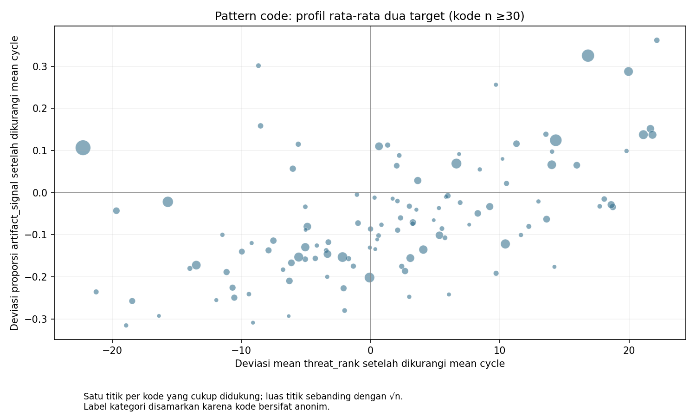
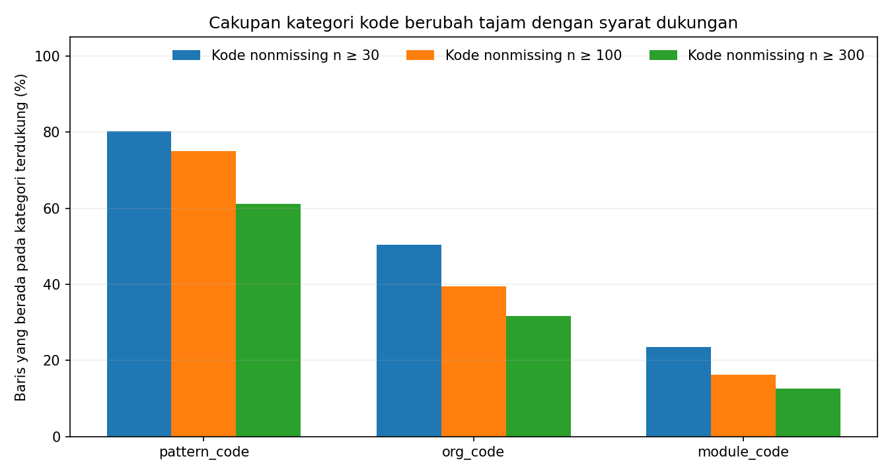

# Explorasi kategori anonim dan heterogenitas dua target

**Status: eksplorasi awal, belum rekomendasi pertanyaan EDA.**

Train regression dan classification masing-masing 50.608 × 19; SHA cocok dengan audit, record_id berurutan sama, dan semua predictor cocok per baris. Tidak ada Test atau teks mentah. Cutoff dukungan 30/100/300 ditetapkan tanpa melihat target.

## Profil dukungan kategori (selection target-blind)

| Fitur kode | Kode nonmissing | Missing | Median ukuran grup | Cakupan kode bernama n≥30 | n≥100 | n≥300 | Top-10 kode share |
|---|---:|---:|---:|---:|---:|---:|---:|
| `pattern_code` | 495 | 8,183 (16.2%) | 4 | 80.2% | 75.0% | 61.2% | 41.8% |
| `org_code` | 8,610 | 2,686 (5.3%) | 1 | 50.4% | 39.4% | 31.6% | 20.2% |
| `module_code` | 14,516 | 4,044 (8.0%) | 1 | 23.6% | 16.3% | 12.7% | 12.7% |

## Efek deskriptif kode setelah pemusatan per cycle

Ukuran η² satu-arah adalah proporsi variasi outcome yang sudah dikurangi mean setiap cycle, pada baris kode bernama yang melampaui dukungan minimum. Komposisi kategori dalam tiap cycle tidak distandardisasi; ini ringkasan deskriptif, bukan partial effect kausal atau p-value.

| Kode | Target | n≥30: grup/coverage/η² | n≥100: grup/coverage/η² | n≥300: grup/coverage/η² |
|---|---|---:|---:|---:|
| `pattern_code` | `threat_rank` | 115/80.2%/0.2456 | 68/75.0%/0.2546 | 28/61.2%/0.2798 |
| `pattern_code` | `artifact_signal` | 115/80.2%/0.1106 | 68/75.0%/0.1091 | 28/61.2%/0.1020 |
| `org_code` | `threat_rank` | 165/50.4%/0.3086 | 49/39.4%/0.3066 | 24/31.6%/0.3250 |
| `org_code` | `artifact_signal` | 165/50.4%/0.4642 | 49/39.4%/0.4059 | 24/31.6%/0.3720 |
| `module_code` | `threat_rank` | 104/23.6%/0.3113 | 20/16.3%/0.2827 | 10/12.7%/0.3260 |
| `module_code` | `artifact_signal` | 104/23.6%/0.4494 | 20/16.3%/0.2836 | 10/12.7%/0.2292 |

Each dot is an anonymized pattern code with at least 30 rows; axes are code-level mean deviations after removing the cycle-wide outcome mean. Bubble size reflects support. The plot reveals whether high-mean categories on one outcome tend to be high or low on the other. It does not show within-record correlation or claim the code causes either outcome.

Profile association remains positive under all three label-blind overall supports: details and denominators are in `stats.json`. As an additional cycle-composition check, code-level profile correlations are recomputed within each cycle for codes with at least 10 rows in both tasks; this is a stability check, not an alternative temporal research question.

Org and module identifiers are extremely sparse: most rows have unique/rare values. Their wide raw group ranges are expected to include noisy small groups and do not make these categories a strong teaching question without pooling or verified semantic labels. Pattern_code retains broad support and gives a more tractable direction, but its anonymized categories still lack interpretable names.

## Overlap screen

- **Rousan:** no `impact_load` or `entry_friction`; category code outcomes are the focus, so not the same question.
- **Abhi:** no `scope_pressure` or `impact_load`; category identifiers are the focus.
- **Rizky:** `module_code` is not `module_spread`; avoid making module_code × telemetry the question. `pattern_code`/`org_code` direction is distinct.
- **Samuel old EDA:** targets differ in primary emphasis (code-associated category heterogeneity/cross-target alignment); cycle adjustment only handles composition. Not a cycle trend analysis.

## Preliminary interpretation and stop point

The strongest screening signal is pattern_code: many groups have enough rows for an aggregate comparison, while org/module coverage is low at the same support rule. Whether its cross-target category heterogeneity is sufficiently stable and interpretable to shortlist requires the broader candidate comparison. The code values have no stated domain semantics, and cycle-centering alone leaves substantial confounding. Since all directions were discovered in the same data, this screen is exploratory and must not be described as confirmation.

Complete machine-readable figures and sensitivity values are in `stats.json`. Reproduce with `python scripts/eda_candidates_categories.py`.
