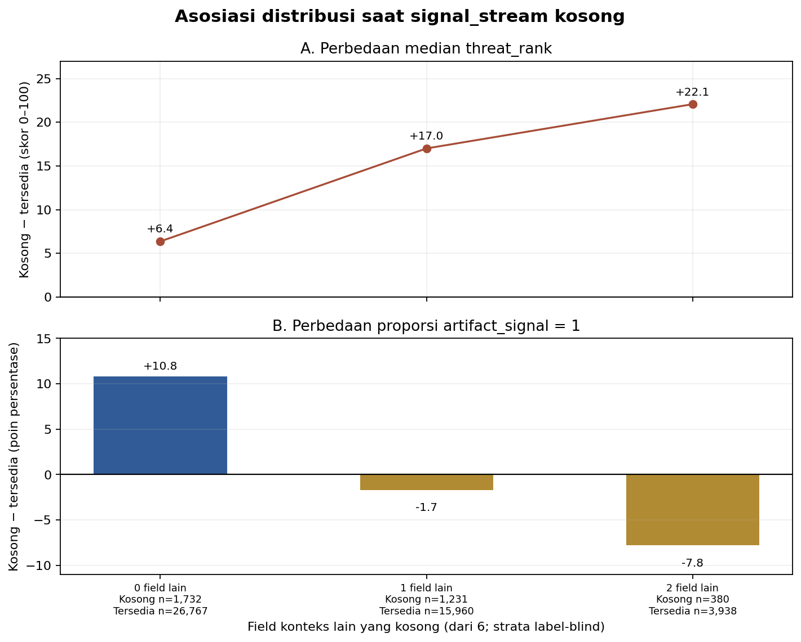
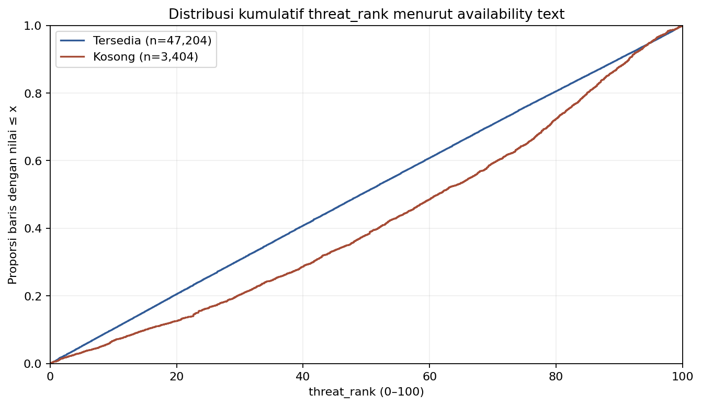
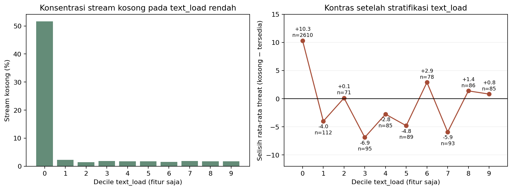
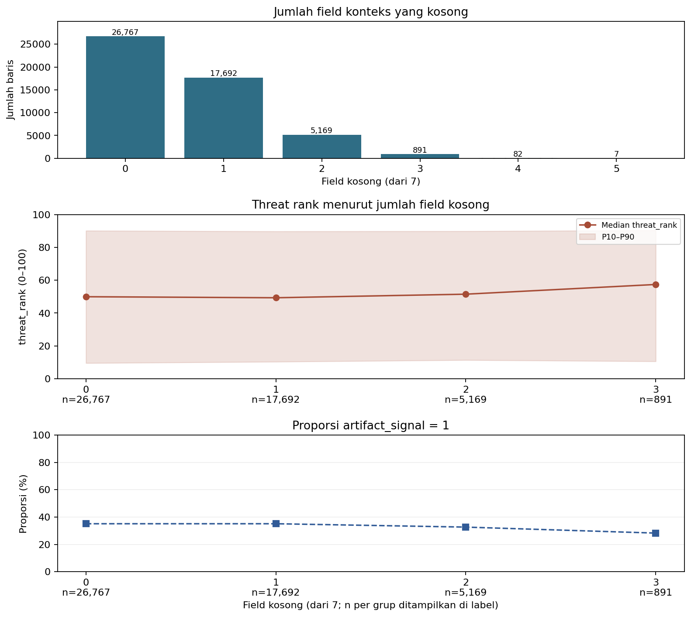
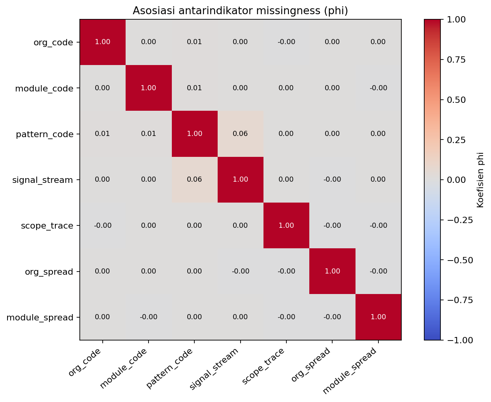

# Discovery awal: ketersediaan signal_stream dan kelengkapan laporan

## Pertanyaan eksploratif

Apakah ketersediaan `signal_stream` berkaitan dengan distribusi `threat_rank` dan proporsi `artifact_signal`, setelah melihat perbedaan volume laporan dan ketersediaan field lain?

Screen awal dihitung dari jumlah field kosong pada `7` kolom (`org_code, module_code, pattern_code, signal_stream, scope_trace, org_spread, module_spread`), dengan `telemetry_flag` dikeluarkan agar pertanyaan tidak berpusat pada topik Rizky. Lalu saya menguji khusus availability `signal_stream` menurut aturan pipeline NaN/blank setelah trim. Train Classification dan Regression diverifikasi memiliki baris/fitur yang sama setelah join `record_id`.

## Cakupan dan hasil utama

- 26,767/50,608 baris (52.9%) lengkap pada ketujuh field; 23,841 memiliki sekurangnya satu field kosong.
- Jumlah field kosong 0–5: 0: n=26,767, 1: n=17,692, 2: n=5,169, 3: n=891, 4: n=82, 5: n=7. Kelompok 4–5 hanya berisi 89 baris; tidak dipakai untuk tren.
- Median `threat_rank`: 0 kosong = 49.945, 3 kosong = 57.408; n untuk kelompok 3 = 891. Nilai 1–3 kosong tidak menghasilkan gradien sederhana: lihat tabel/figur.
- Rata-rata `threat_rank` untuk 1–3 kosong = 50.174; kontras rata-rata missing-any dengan complete = +0.384.
- Proporsi `artifact_signal=1`: 0 kosong = 35.114%; 1 kosong = 35.118%; semua missing = 34.273%. Perubahan kecil ini tidak mendukung cerita kuat tentang outcome klasifikasi.
- Kontras threat missing-vs-complete per cycle: median +0.363, rentang -4.716 hingga +4.213; arahnya positif 20/33 dan negatif 13/33 cycle. Kontras artifact per cycle juga melintasi nol (median -2.075%).
- Phi missing `pattern_code` dengan missing text = 0.063; missing `scope_trace` dengan `org_spread` = -0.004. Nilai ini menunjukkan pola ketersediaan bersama tertentu, bukan penyebab bersama.

## Penyelidikan terpisah: `signal_stream` kosong

Mengikuti definisi pipeline yang telah ada, kosong berarti NaN **atau** teks blank setelah trim. Ini eksplorasi langsung dari label Train, tanpa prediksi model. Dari 3,404 (6.73%) stream kosong, mean/median `threat_rank` = 57.605/61.302; stream tersedia = 49.487/49.152. Kontras mean +8.118 tidak menunjukkan hubungan sebab-akibat.

Di antara 33/33 cycle dengan dukungan memadai pada kedua grup, mean threat saat teks kosong lebih tinggi; kontras positif pada 32 cycle, negatif pada 1. Median kontras antar-cycle +7.060 (rentang -1.545 hingga 23.881); leave-one-cycle-out mean delta masih 8.454 hingga 9.248. Arah yang sama juga tampak setelah menstandarkan jumlah **field lain** yang kosong, pada strata label-blind [0, 1, 2]; weighted mean-difference +7.514. Namun missing stream sangat terkonsentrasi pada volume rendah: 76.7% dari 3.404 stream kosong berada di decile pertama `text_load` (n=2,610; sekitar separuh decile ini missing). Sembilan decile lain masing-masing hanya memuat 71–112 stream kosong. Standardisasi mean by decile bergantung pada jumlah bin: 5 bins +0.253, 10 bins -0.887, 20 bins -1.448; effective sample size missing setelah penimbangan decile berkisar 953–1,049 dibanding n mentah 3.404.

Decile menyamakan komposisi volume secara kasar, bukan exact common support. Minimum `text_load` pada baris stream tersedia 20.6456, lebih tinggi daripada minimum pada stream kosong. Sebanyak 906 (26.62%) baris stream kosong berada di luar common observed range; batas irisan kedua rentang adalah 20.6456–77.5241. Di dalam irisan ini 2,498 baris stream kosong tertahan (dari 3,404) dan mean gap mentah menyusut menjadi +4.123. Ini konsisten dengan komposisi volume rendah yang berkontribusi pada gap pooled, tetapi tidak memisahkan pengaruh volume dari semua perbedaan lain.

Standardisasi q-bin 5/10/20 memberi kontras +0.253, -0.887, dan -1.448; seluruh konfigurasi menutup 100% baris, tetapi ESS grup stream-kosong turun ke 953–1,049. Karena tandanya berubah dengan resolusi bin dan 26.6% grup stream-kosong berada di luar rentang volume bersama, ini **bukan** bukti pembalikan tanda yang robust atau penjelasan lengkap.

Untuk `artifact_signal`, pooled positive rate 38.13% vs 34.47% berbeda +3.66 poin. Di strata tanpa missing lain, kontrasnya +10,79 poin; pada satu dan dua field lain yang kosong, kontrasnya −1,70 dan −7,78 poin. Setelah common-support reweighting strata 0–2 menurut hitungan gabungan (label-blind), selisih tetap positif +4.89 poin. Jadi agregat menyembunyikan arah kontras yang berbeda menurut kelengkapan lain. Ini menguatkan kehati-hatian, bukan klaim stream kosong menaikkan artifact rate.

Pattern-code-only common-support comparison masih memberi selisih mean threat +8.350 pada minimum 20 baris per status (32 kelompok, mencakup 78.5% Train), atau +9.050 pada minimum 30 (22 kelompok, coverage 70.1%). Namun rentang mean-delta per kelompok pada min30 lebar (-2.42 hingga +30.92). Simultan dengan decile text-load memberi dukungan hanya 6,576 baris (13.0%) pada min20; jadi jenis pattern dan volume sulit dipisahkan secara menyeluruh.

Efek raw threat yang tampak stabil sesudah stratifikasi cycle mengecil pada pemeriksaan `text_load`; missing-stream sangat terkonsentrasi pada volume rendah. Ini temuan heterogenitas yang berguna tetapi mengurangi kekuatan pertanyaan sederhana tentang missingness. Model sebelumnya juga membahas error khusus missing-stream, jadi nilai barunya adalah profil label langsung dan sensitivity terhadap komposisi, bukan topik tanpa jejak sebelumnya. Bandingkan tetap dengan EDA text/category yang lain.

## Grafik

Jumlah hilang dibuat label-blind; kurva outcome ditampilkan hanya untuk 0–3 field karena dukungan 4–5 kecil. Band target P10–P90 memperlihatkan penyebaran, bukan interval kepercayaan.

Phi meringkas ketergantungan dua indikator missingness. Ia tidak membuktikan apakah satu field seharusnya tersedia ketika field lain tersedia.

## Penilaian dan batas

Ini tema yang berbeda dari pertanyaan Rousan (entry_friction/impact dan artifact), Abhi (scope_pressure dan threat), Rizky (telemetry/module_spread dan artifact), dan EDA lama Samuel (impact–threat sepanjang cycle). Unit analisis utama di sini ialah **proses ketersediaan beberapa field laporan**; target digunakan sebagai deskripsi lanjutan, bukan pasangan fitur utama. Walau begitu, tiap-field hasil memberi konteks kepada Rizky; karena itulah telemetry dikeluarkan dan efek `signal_stream` tunggal tidak akan direkomendasikan sebagai pertanyaan Samuel.

Discovery ini belum menunjukkan bahwa satu skor completeness ringkas mempunyai hubungan yang kuat dan stabil dengan target: perbedaan pooled mengecil dan berganti tanda antar-cycle; klasifikasi sangat kecil; kelompok dengan 3+ missing makin jarang. Siklus dan jenis record dapat menjelaskan pola marginal. Missingness tidak dapat didiagnosis MCAR/MAR dari data ini, dan tidak ada klaim kausal. Seluruh Train dan hipotesis telah dilihat sehingga hasil bersifat exploratory.

**Status kandidat:** availability count luas adalah hasil negatif dan tidak direkomendasikan sebagai pertanyaan utama. Subcandidate yang layak dibandingkan: “Apakah distribusi `threat_rank` dan `artifact_signal` berbeda saat `signal_stream` kosong, dan sejauh mana perbedaannya bertahan setelah `text_load` diperhitungkan?” Ia berbeda dari Rousan (entry_friction/impact dan artifact), Abhi (scope_pressure dan threat), Rizky (telemetry/module_spread dan artifact), serta pertanyaan lama Samuel (impact–threat antarcycle). Keunggulannya ialah pertanyaan jelas dan gap threat lintas-cycle; kelemahannya ialah 76.7% stream kosong berada di decile `text_load` terbawah, hanya 73.4% punya volume dalam common observed range, penyesuaian bin sensitif terhadap resolusi, dan existing modelling telah menilai performa kelompok missing-stream. Ini kandidat pembanding dengan bukti serta batas yang menarik untuk diajarkan, bukan kandidat yang otomatis unggul atau bukti bahwa availability menjelaskan target. Belum ada rekomendasi untuk mengganti pertanyaan EDA lama sebelum perbandingan kandidat lain.

## Reproduksi

`python scripts/eda_candidates_missingness.py` membaca data via `TP2_DATA_DIR` atau resolver dataset resmi, memverifikasi hash Train yang dipatok dan seluruh fitur non-target bersama setelah menyelaraskan ID, lalu menulis statistik agregat dan grafik. Tidak ada model, label Test, raw text, ataupun baris individual yang disimpan.
