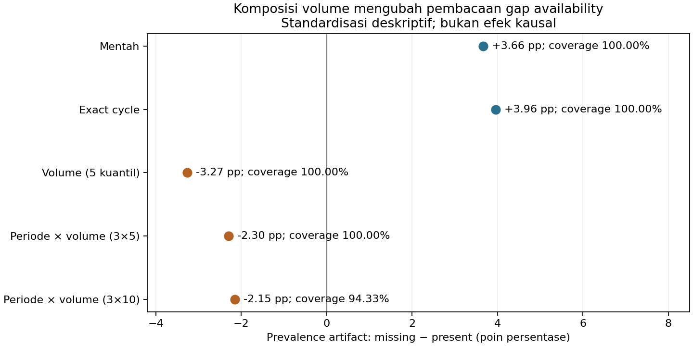

# Samuel — impact-driven EDA discovery

**Rekomendasi untuk tujuan demo EDA → keputusan modeling: kandidat B, availability `signal_stream`, dengan pemeriksaan komposisi volume dan waktu.** Routing sudah memberikan manfaat pada model final; ini bukan gain baru. Kandidat baru C, coverage kosakata historis, menghasilkan penurunan MAE yang kecil dan tidak cukup konsisten. EDA A tetap resmi sampai pengguna menyetujui penggantian. Tidak ada notebook, model resmi, submission, atau pertanyaan anggota lain yang diubah.

## Pertanyaan yang dibandingkan

| Kandidat | Research question | Status evidence dan nilai untuk demo |
|---|---|---|
| A · token diversity | Pada jumlah token yang sama, apakah keragaman token berkaitan dengan proporsi `artifact_signal=1`? | Asosiasi kuat dan robust; ablation tidak meningkatkan hybrid/routing final secara konsisten. Tetap EDA akademis valid. |
| **B · availability** | **Apakah proporsi `artifact_signal=1` berbeda menurut ketersediaan `signal_stream`, dan bagaimana perbedaannya berubah setelah mempertimbangkan periode cycle dan volume narasi (`text_load`)?** | Raw EDA menunjukkan heterogenitas dan komposisi; diagnostik model terpisah mendukung pemilihan expert berdasarkan informasi yang tersedia. Dampak sudah masuk C4_HGB. |
| C · coverage kosakata | Pada cycle dan panjang laporan sebanding, apakah rendahnya cakupan kosakata TF-IDF historis berkaitan dengan heterogenitas `threat_rank` dan kesalahan prediksi? | Ada pola raw target spread dan retrospective error; satu scalar ablation versus model final memberi gain kecil dengan trade-off tails. Tidak direkomendasikan sebagai pengganti utama. |

Hanya satu hipotesis baru Lane B diuji. Tidak menambah kandidat untuk memenuhi kuota. Review historis mencakup Classification R1–R2, TTR ablation, Regression R1–R2, ranking/text/LightGBM stages, history/novelty/tail/shift diagnostics, serta pembagian EDA. Histories/feature removal/rank grid yang sudah dieksplorasi tidak diulang sebagai temuan baru.

Sebagai kontrol konseptual, A mempunyai gap prevalence +14,20 pp pada 71 exact lengths/37.681 support rows (9.011 low dan 9.354 high); 64/71 lengths positif. Namun [controlled TTR ablation](../classification_ttr/FINDINGS.md) memberi R_TTR primary −0,000332 dan H12 +0,000025 versus C4; R_BOTH primary −0,000133/H12 +0,000315. TTR membantu structured LR +0,004019 primary, tetapi itu pembanding yang lebih lemah, bukan new impact terhadap final. Kekuatan asosiasi dan manfaat final model dinilai terpisah.

## B — temuan raw-data yang berdiri sendiri

Official Classification Train berisi 50.608 laporan unik, cycle 47–79. Stream missing mengikuti rule null/blank wrapper lama: **3.404 (6,73%) missing**, 47.204 present. Semua missing aktual merupakan null, bukan nonnull whitespace. Prevalence artifact **1.298/3.404 = 38,13%** pada missing dan **16.272/47.204 = 34,47%** pada present: gap missing−present **+3,66 pp**.

Gap tiga periode **−1,84 / +10,01 / +3,18 pp**. Standardisasi exact cycle dengan minimum 20 per status mencakup 33/33 cycle dan seluruh data; gap **+3,96 pp**, dengan 21 cycle positif dan 12 negatif. Jadi tidak ada arah universal.

Namun missing juga terkonsentrasi pada volume teks rendah: median `text_load` 21,81 versus 31,78. Setelah kedua status diberi bobot stratum yang sama, pembacaan gap berubah:

| Pembandingan deskriptif | Gap missing−present | Supported cells | Denominator supported | Coverage |
|---|---:|---:|---:|---:|
| Exact cycle | +3,96 pp | 33/33 | 50.608 | 100% |
| Volume 5 kuantil | −3,27 pp | 5/5 | 50.608 | 100% |
| Volume 10 kuantil | −2,26 pp | 10/10 | 50.608 | 100% |
| 3 periode × 5 kuantil volume | −2,30 pp | 15/15 | 50.608 | 100% |
| 3 periode × 10 kuantil volume | −2,15 pp | 28/30 | 47.740 | 94,33% |

Kuantil memakai input `text_load` tanpa target; minimum 20 present dan 20 missing per cell. Bobot sama untuk kedua grup: `n_cell / seluruh supported rows`. Pada 3×10, denominator adalah 3.372 missing dan 44.368 present (99,06% dan 93,99% masing-masing grup); 32 missing dan 2.836 present dikeluarkan. Ini bukan exact matching volume: **906 missing** berada di bawah minimum volume present; dukungan coarse bins tidak menghapus perbedaan support di dalam bin. Tidak ada klaim causal effect, MCAR/MAR, atau bahwa mengisi teks akan mengubah label.

**Insight raw EDA:** status informasi tersedia/tidak tersedia menandai komposisi laporan yang berbeda; arah marginal label bukan sifat tetap missingness. Ini menghindari cerita dangkal “stream kosong lebih berbahaya”. Fenomena availability sudah diperiksa dalam discovery terdahulu; penghitungan joint period×volume ini memperjelasnya, bukan klaim menemukan ulang fenomena baru.

## Apa yang baru diketahui setelah model dievaluasi

Raw prevalence tidak dapat menentukan expert mana yang lebih baik. Review error terdahulu menunjukkan hybrid LR kuat untuk present, tetapi structured HGB lebih baik pada missing. Penambahan missing indicator saja tidak menyelesaikan deficit; coefficient/logit accounting R2 menunjukkan joint fitting mengubah kontribusi structured meskipun text vector missing nol. Ini penjelasan mekanis terukur, bukan identifikasi penyebab data hilang.

Rekonsiliasi ulang saved vectors pada 38.588 record per keluarga:

| Model/policy | Primary Macro F1 | Equal-cycle primary | H12 Macro F1 | Missing primary F1 |
|---|---:|---:|---:|---:|
| Hybrid C2_B | 0,820633 | 0,812379 | 0,788581 | 0,710427 |
| C4_HGB routing | 0,825481 | 0,818278 | 0,796810 | 0,781712 |

Gain **+0,004848 primary / +0,008229 H12** sudah ada dalam final model. Present probability identik, missing errors turun **743→550** pada primary dan **923→639** pada H12; present errors tetap 5.609/6.451. Routing menang 5/6 primary windows dan kedua H12, dengan counterexample W2 turun sekitar 0,000057 F1. Pooled F1 bukan weighted mean F1 subgroup.

Urutan yang jujur saat demo: **(1)** raw EDA memprofilkan availability dan perbedaan komposisi; **(2)** error analysis retrospektif menemukan expert heterogeneity; **(3)** controlled routing memverifikasi keputusan. Hipotesis diperdalam setelah modeling, sehingga jangan menyebutnya discovery prospektif pra-model. EDA tetap dapat berdiri sendiri tanpa tabel skor, sementara modeling menjadi evidence tindak lanjut yang terpisah.

## C — opportunity baru dan actual controlled ablation

Coverage = bagian occurrence unigram/bigram analyzer yang masuk vocabulary TF-IDF fit-only. OOV termasuk term yang terfilter `min_df` atau batas 20.000 fitur, bukan semantik kata baru. Berbeda dari TTR: dua dokumen dengan TTR sama dapat mempunyai cakupan kosakata historis berbeda.

Vocabulary/IDF direkonstruksi untuk enam cutoff dan cocok dengan audit final. Raw spread dan retrospective error dipisahkan. Pada setiap cycle, present streams dibagi empat strata panjang analyzer yang sebanding (bukan exact length); tie panjang dipecah memakai hash ID tanpa target. Low/high OOV memakai average percentile rank ≤0,25 / >0,75, minimum 20 per tail.

| View | Supported strata / eligible rows | Low/high comparison n | Δ target IQR high−low OOV | Δ frozen-model MAE high−low OOV |
|---|---|---|---:|---:|
| Discovery narrative 56–67 | 48/48; 16.482 | 4.114 / 4.135 | +7,06 | +2,10 |
| Later sensitivity 68–79 | 48/48; 19.528 | 4.871 / 4.910 | +4,14 | +2,26 |

Angka adalah rata-rata kontras dalam stratum berbobot n stratum, bukan selisih pooled IQR. MAE contrast positif pada 34/48 dan 41/48 strata, tetapi target-median contrast berubah +5,22→−1,87. Target tails mempunyai support sangat terbatas (1/48 dan 5/48 cell memenuhi ≥5 contoh di setiap grup untuk kedua tails). Coverage rendah lebih konsisten menandai kesulitan/spread daripada arah pergeseran conditional median.

**Mekanisme yang diuji:** representasi TF-IDF mengabaikan term di luar vocabulary; satu scalar OOV mungkin membantu model mengenali perubahan informasi yang tidak tersimpan dalam SVD32. Tambahkan tepat satu fitur ke frozen LightGBM; parameter dan rank weight tiap cutoff tetap persis pilihan inner baseline. Tidak ada tuning/reselection baru atau kombinasi fitur lain. Training coverage memakai vocabulary yang di-fit pada training yang sama; perbedaan in-sample/future coverage merupakan keterbatasan yang dapat melemahkan transfer.

| Metrik | Frozen final | +coverage | Gain (lebih rendah MAE lebih baik) |
|---|---:|---:|---:|
| Primary MAE | 11,931600 | 11,917256 | 0,014344 |
| Equal-cycle primary MAE | 12,283548 | 12,261881 | 0,021667 |
| H12 MAE | 14,704041 | 14,677928 | 0,026113 |
| Cycle 56–67 primary MAE | 13,182406 | 13,153473 | 0,028932 |
| Cycle 68–79 primary MAE | 10,873355 | 10,871353 | 0,002002 |

Kandidat menang 4/6 primary windows dan kedua H12, tetapi kehilangan manfaat hampir seluruhnya pada periode lebih akhir. H12 low/high-tail MAE **memburuk +0,254101 / +0,218086**; missing H12 memburuk +0,014946. Gate sebelum fit menuntut minimal gain 0,05 primary/H12, 0,03 equal-cycle, 5/6 windows positif, serta guard window/subgroup 0,10. Kandidat gagal gain, consistency, dan tail guard. Ada perubahan numerik terukur, **belum ada new modeling impact yang cukup meyakinkan untuk mengganti final model**. Memahami variasi error tidak otomatis memperbaiki median prediksi yang dinilai MAE.

## Penilaian objektif dan non-overlap

| Kriteria | A · TTR | B · availability | C · vocabulary coverage |
|---|---|---|---|
| Kejelasan insight | Tinggi: diversity pada exact length | Tinggi: komposisi dan informasi tidak tersedia | Sedang: vocabulary relatif pada history/model |
| Evidence prediktif terhadap final | Tidak ada gain konsisten; R_TTR primary −0,000332 | Gain routing terukur, **sudah dalam final** | Gain MAE baru kecil, gagal robustness gate |
| Konsistensi temporal | Asosiasi kuat; model gain tidak konsisten | Raw gap heterogen; routing 5/6 + kedua H12 | Residual association stabil; late gain ≈0 dan tails merugi |
| Kesederhanaan/demo | Definisi mudah; kaitan model lemah | Paling kuat untuk cerita keputusan expert; wajib pisahkan EDA/error | Membutuhkan vocabulary historis dan batas ketidakpastian |
| Risiko/confounding | Length/time ditangani sebagian; redundancy hybrid | Volume mengubah tanda; retrospective/adaptive | Panjang, filtering, in-sample coverage, repeated validation |
| Putusan sesuai tujuan pengguna | Pertahankan sebagai resmi sementara | **Rekomendasi untuk dipilih pengguna** | Simpan sebagai negative/limited-impact research |

Semua pertanyaan memakai explanatory characteristic berbeda dari Rousan (`entry_friction`/`impact_load`–artifact), Abhi (incremental `scope_pressure`–threat setelah impact), dan Rizky (`telemetry_flag`/`module_spread`–artifact). B menggunakan availability, `text_load`, cycle; C coverage vocabulary dan panjang. EF/tail pada ablation hanya safety diagnostics model frozen, bukan EDA explanatory anggota lain. Tidak ada dokumen bersama yang diedit.

## QA, reproduksi, dan stop point

- Enam fit coverage benar-benar dijalankan; 6 scoped unit tests lulus. Blok structured, vocabulary/IDF, SVD, parameter, fit fingerprint/target boundary identik dengan kontrol; desain hanya bertambah satu kolom.
- Verifier independen menghitung ulang 5 standardisasi availability, 96 matched OOV cells, 20 blok metrik Regression beserta subgroup/bias, dan gain routing Classification; enam vector fitur OOV cocok antara EDA dan model. Gate keputusan dihitung ulang.
- Raw Train hashes dan 459 file historis byte-identical; empat PNG dibuka untuk QA visual. [QA.json](QA.json) mengikat input/output/code; [protocol dan freeze](../../experiments/impact_eda/) menyimpan keputusan sebelum fit. Tidak ada raw text, ID per-record, prediction cache, atau model binary masuk Git.
- Reproduksi dan dependency/cache boundaries: [README eksperimen](../../experiments/impact_eda/README.md). Data detail: [availability stats](availability/stats.json), [OOV stats](oov/stats.json); metrik: [comparison](ablation/comparison.csv), [windows](ablation/windows.csv), [subgroups](ablation/subgroups.csv), [periode](ablation/periods.csv).

Semua Train telah dipakai berulang kali; pembagian discovery 56–67 versus later sensitivity bukan untouched holdout. H12 memakai ulang record primary. Gate mengurangi kebebasan eksperimen setelah outcome, tetapi tidak menghilangkan adaptive selection bias. Tidak ada generalisasi Test yang dikonfirmasi atau signifikansi kausal yang diklaim.

**Jawaban tujuan:** B adalah pilihan terkuat untuk menunjukkan bagaimana profil data bersama error analysis menghasilkan keputusan modeling yang berguna. Jika syaratnya justru EDA prospektif baru dengan improvement final yang sudah terkonfirmasi, tidak ada kandidat yang memenuhi. A tetap resmi; pengguna memutuskan penggantian. Milestone berhenti di sini tanpa perubahan final model/notebook atau Kaggle submission.
