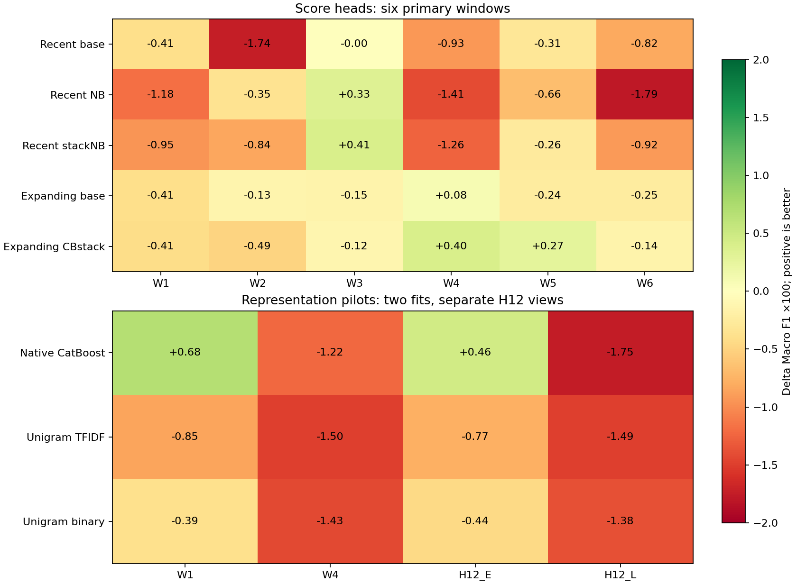
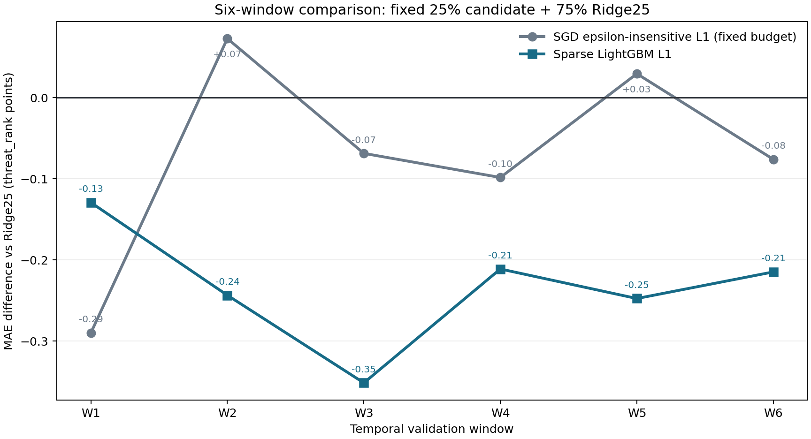
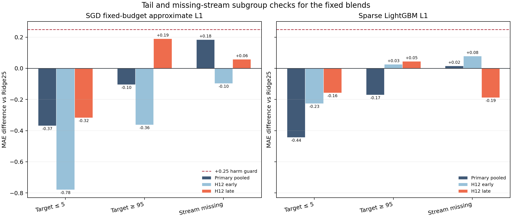

# Optimization V2 — checkpoint akhir

**Hasil:** champion Regression baru adalah 75% Ridge25 +25% LightGBM sparse-text, public MAE **11,35970** (ref57835122), membaik0,28164 atau sekitar2,42% dari11,64134. Classification tetap C2_B present + CatBoost missing pada public MacroF1 **0,82701** (ref57833406). Tidak ada challenger Classification yang lolos untuk upload.

Leaderboard terautentikasi terakhir: Classification peringkat2 dari4 tim yang dikembalikan API, gap0.00081 ke leader0.82782; Regression peringkat1 dari2, gap0.00000. Snapshot: 2026-10-31T10:25:15.279901+00:00. Private/final rank belum diketahui.

## Batas dan protokol

Sumber awal6bd5250. Hanya official data kompetisi; tidak ada label Test, dataset tambahan, pretrained model, solusi kelompok lain, atau probing leaderboard. Code/data/runtime/protokol dibekukan sebelum fits. Semua666 file tracked sebelum kampanye tetap byte-identical, termasuk EDA, notebook akademis, pekerjaan anggota lain dan fallback lama. Semua perubahan berada pada namespace OptimizationV2.

Primary enam expanding fits berakhir55/59/63/67/71/75 dengan empat cycle setelah cutoff; H12_E fit47–55→56–67 dan H12_L fit47–67→68–79. Primary dan H12 masing-masing38.588 observasi unik, dengan outcome yang saling digunakan ulang. Ini development adaptif, bukan untouched holdout. Calibration/stacking memakai skor out-of-fit dan label yang tersedia sebelum cutoff outer.

## Classification

| Present expert, missing tetap CatBoost | Primary enam windows | H12 pooled | Keputusan |
|---|---:|---:|---|
| Champion C2_B | 0.827646 | 0.798984 | Retain |
| Recent-four calibrated_base | 0.822238 | 0.796440 | Retire |
| Recent-four calibrated_nb | 0.821600 | 0.795069 | Retire |
| Recent-four stack_base_nb | 0.823571 | 0.797504 | Retire |
| expanding_base | 0.826368 | 0.797986 | Retire |
| expanding_stack_cb | 0.827527 | 0.797434 | Retire |

Recent-four heads dilatih pada present rows E−3..E memakai skor model yang fit sampaiE−4. Expanding heads memakai disjoint OOF blocks52..E; structured-CatBoost score memberi pembanding nonlinear. Semua memakai LogisticRegression C1, cutoff0,50; tidak ada threshold/C search. Hanya tiga base fits baru sampai51 diperlukan, sedangkan komponen lain menggunakan cache terverifikasi. Higher AP atau tambahan score tidak otomatis memperbaiki MacroF1 di bawah temporal shift.

| Pilot representasi baru | Primary Δ vs champion, W1+W4 | H12 Δ | Keputusan |
|---|---:|---:|---|
| CatBoost native-text | -0.003570 | -0.006627 | Retire setelah2fits |
| unigram_counts TF-IDF | -0.011988 | -0.011518 | Retire setelah2fits |
| unigram_binary TF-IDF | -0.009559 | -0.009371 | Retire setelah2fits |

Pilot primary hanya9.064 baris W1+W4; jangan membandingkan angka pooled primary pilot langsung dengan primary enam windows. H12 tetap38.588 baris. CatBoost native-text memakai BoW+onlineNaiveBayes, dictionary fit-only, native categories, 500trees/depth6/lr0,05. W1/H12_E membaik, tetapi W4 −0,012242 dan H12_L −0,017523. Dua unigram variants mempertahankan seluruh LR/preprocessing lama, hanya menghapus bigram dan membandingkan frequency vs binary presence; keduanya kalah. Tidak ada tambahan fold atau upload untuk keluarga gagal. Missing-branch probabilities tetap persis sama di semua studi.



## Regression

| Model | Primary MAE | Equal-cycle MAE | H12 pooled MAE | Public | Rekomendasi |
|---|---:|---:|---:|---:|---|
| Ridge25 awal | 11.800756 | 12.128720 | 14.252094 | 11.64134 | Fallback tetap |
| 75%Ridge25 +25%sparse LGB | 11.559390 | 11.888282 | 14.047533 | 11.35970 | Promosi champion riset |
| 75%Ridge25 +25%SGD L1 | 11.745840 | 12.054866 | 14.015475 | Tidak disubmit | Comparator; redundant dan fixed-budget |

Kedua model baru memakai sparse TF-IDF langsung +structured/OHE/scaling, tanpaSVD. LightGBM memakai L1 dan parameter base yang sudah ada; SGD memakai epsilon-insensitive epsilon0, targetscale tetap, 2000iterations. Setiap kandidat mendapat fixed rank50 mapping dan fixed25% share, seluruhnya dideklarasikan sebelum fits. Standalone policies gagal pilot; blend yang lolos diteruskan dengan8fits baru dan4pilot fits reused. Tidak ada weight/rank/parameter search atau blend antarkandidat.

Sparse-LGB blend mengurangi primary MAE0,241366, menang6/6windows dan23/24cycles. H12_E/L berkurang0,116971/0,278668. Primary low/high-tail berubah−0,443755/−0,170411; primary missing sedikit naik0,016030. Worst reported tail/missing harm0,078596; high-tail H12_E/L naik0,025997/0,045109. Bias primary−0,557 vs−0,480; H12_L sedikit lebih negatif. Perbaikan tidak universal di seluruh subgroup, tetapi semua guard lolos.

SGD blend memperbaiki primary0,054916 dan H120,236619 tetapi hanya4/6windows; seluruh SGD fits mencapai batas2000iterations dengan ConvergenceWarning. Ini approximate fixed-budget L1, bukan optimizer yang diklaim konvergen. Korelasi prediksi kedua blend0,9967 dan error0,9907: runner-up tidak memberikan pembeda yang cukup untuk memakai slot kedua. Tidak ada fine tuning setelah public.





Resep aktual champion: 56,25% LGB SVD32 (rank0,50),18,75% HybridRidge (rank0,75),25% sparse-text LGB (rank0,50). Seluruh komponen di-refit pada50.608Train resmi. Output29.421Test IDs tepat/schema/order, finite[0,100]; hash CSV dan source commit3e86b17 dikunci sebelum upload. Public improvement searah hasil internal, tetapi dataset/horizon internal dan public berbeda; ini bukan bukti private MAE.

## Submission, QA dan reproduksi

Kampanye memakai **0 Classification dan1 Regression submission**. Reg ref57835122 COMPLETE pada11,35970. Kuota live terakhir Class8 /Reg5; totalteam3/10. Limit API10/day dan deadline2026-11-08 16:55UTC diperiksa ulang, dengan satu shared slot terlindungi. Angka dapat berubah bila anggota tim submit. Upload melalui SDK/API, bukan Chrome.

QA: protected666files PASS; recent score heads direkonstruksi independen18fits, expanding12heads sebelumnya diverifikasi; metrics/routes/past-only fingerprints semua study lolos verifier aktif. Suite akhir15tests PASS (termasuk unigram, kuota/idempotency), ditambah1native-text synthetic test yang dijalankan terpisah; warning feature-name LightGBM bersifat nonfatal dan terekam. Root merekonstruksi rank/mixture/target alignment Regression dan full-Train inference secara independen.

Ada controller/verifier corrections yang disimpan, tanpa mengganti model outputs: native v1 salah memeriksa populasi fit kontrol dan berhenti sebelum fit; v2 memperbaikinya. Reg strict HEAD equality diganti audit konten melalui versioned receipt karena commit Classification yang tidak berkaitan; semua frozen hashes tetap cocok. Verifier unigram awal memakai konvensi JSON digest yang salah; source awal dipulihkan ke hashprefit795922dd… dan corrected verifier_v2 kembali PASS. Failure receipts, sumber awal, serta amendments tetap utuh. Jangan menjalankan verifier legacy yang sengaja diarsipkan sebagai failure path.

Fresh replay tambahan melatih ulang **3komponen dari raw CSV saja**, tanpa cache/CSVprediksi/model binary lama, dalam65.9detik. Seluruh fitted states dan prediction hash identik dengan manifest accepted. [Replay receipt](replay_QA.json), [checkpoint final](checkpoint_final_QA.json), [manifests/receipts](kaggle/).

Dependencies: `python -m pip install -r experiments/optimization_v2/requirements.txt`. Data resmi tetap lokal di data/raw/{classification,regression} atau resolver TP2_DATA_DIR. Untuk mereproduksi winner tanpa derived caches:

```powershell
python scripts/optimization_v2_replay.py --output experiments/runs/optimization_v2_replay/new_run.csv --receipt experiments/runs/optimization_v2_replay/new_run.json
```

Script menolak overwrite dan tidak mengunggah. Manifest/input/source hashes memeriksa resep accepted; exact equality hanya diklaim pada environment yang diperiksa. Full temporal audit memerlukan derived control vectors yang dapat dibangun dari raw melalui docs/CLASSIFICATION_ROUND1.md dan docs/REGRESSION_RESEARCH.md. Canonical frozen outputs dipertahankan; fresh research replay perlu namespace versi baru. Raw data, binaries dan prediction caches tidak masukGit.

## Prior-experiment audit and implications

| Prior evidence | What is already answered | Decision for this campaign |
|---|---|---|
| `docs/CLASSIFICATION_ROUND1.md`, `reports/classification_round2/FINDINGS.md` | Majority/lookup, structured LR/HGB, text-only/hybrid LR, missing indicators, text weights0.5/2, past-only threshold policies and availability routing | Keep hybrid present and CatBoost missing as control. Do not repeat text-weight or indicator sweeps. |
| `reports/classification_ttr/FINDINGS.md` | Count/TTR/availability scalars add little beyond TF-IDF; structured-only TTR gain does not transfer to hybrid | No further TTR/scalar variants; formal EDA remains untouched. |
| `reports/autonomous_eda/classification/FINDINGS.md`, `classification_volume/FINDINGS.md` | Uniform availability specialists lose; q80 specialist has small internal gain but public0.82640 vs C4 0.82641 | No subset-fit/q80 rerun or threshold adjustment from public. |
| `reports/dual_campaign/classification/FINDINGS.md` | SVC and word+char fail; NB-weighted LR improves AP, not fixed-cutoff F1 | Investigate strictly past-only calibration/score combination once, rather than another lexical parameter grid. |
| `reports/dual_campaign/classification_catboost/results.json` | Structured CatBoost is a stronger missing expert; present expert has not been replaced with native-text boosting | Test one native-text CatBoost family and a low-dimensional text/structured score stack. |
| `docs/REGRESSION_ROUND2.md`, `docs/REGRESSION_RESEARCH.md`, `reports/regression_research/FINDINGS.md` | Structured feature/history ablations, HGB, linear Ridge, native-tabular LGB, text-only/hybrid Ridge, HGB+SVD32/128, no-scope, structured Ridge, LGB+SVD32 and rank policies already tested | No new SVD-dimension, structured-only or old ablation sweep. Test sparse L1 and raw sparse-text boosting instead. |
| `reports/autonomous_eda/FINDINGS.md` | Coverage scalar and new SVD128 fail external improvement | Do not repeat those variants. |
| `reports/dual_campaign/regression/STAGE1_PAIRED_BLEND.md`, `catboost/STAGE2_CATBOOST.md` | Ridge25 improves internal/public, Ridge50 loses public; CatBoost has weak tails/public and original CB/LGB blend gate fails | Use exact Ridge25 incumbent. A fresh two-family sparse representation is higher information than tuning old public blend weights. |

The independent read-only audit also explored CatBoost/Ridge25 convex combinations after observing their outcomes. Shares0.10/0.25/0.50 improve reused primary/H12, but tails worsen as CatBoost share increases. These are explicitly posthoc diagnostics, not preregistered model-selection evidence. They do not override the earlier failed CB/LGB gate and are not being uploaded as a public rescue.

## Completed Classification score-head studies

Rincian mesin dan active verifiers ada di classification_calibration/, classification_stack/, classification_text/ dan classification_unigram/. Tabel di atas merupakan ringkasan; tidak ada official EDA/notebook yang diganti. Method references: [calibration](https://scikit-learn.org/stable/modules/calibration), [stacking](https://scikit-learn.org/stable/modules/ensemble), [CatBoost text](https://catboost.ai/docs/en/features/text-features).

## Stop point

Kampanye berhenti setelah beberapa hipotesis berbeda gagal untuk Classification dan satu challenger Regression yang kuat dikonfirmasi internal/public. Memperluas grid atau mengutak-atik bobot pada outcome/public yang sama akan menaikkan bias adaptif; belum ada dasar cukup untuk memakai slot tambahan. Ini checkpoint terbaik yang beralasan dari eksperimen ini, bukan klaim global optimum atau private-leaderboard guarantee. Model awal tetap tersedia sebagai fallback. Tidak ada SCeLE, ZIP, atau perubahan akademis.
