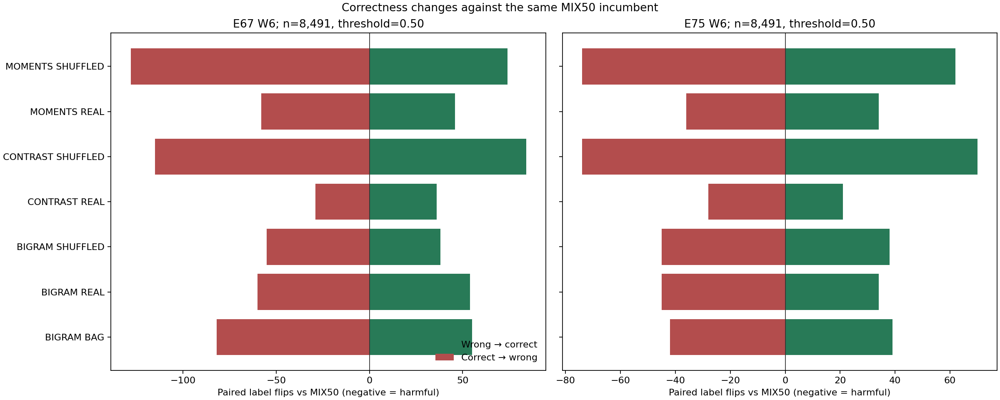
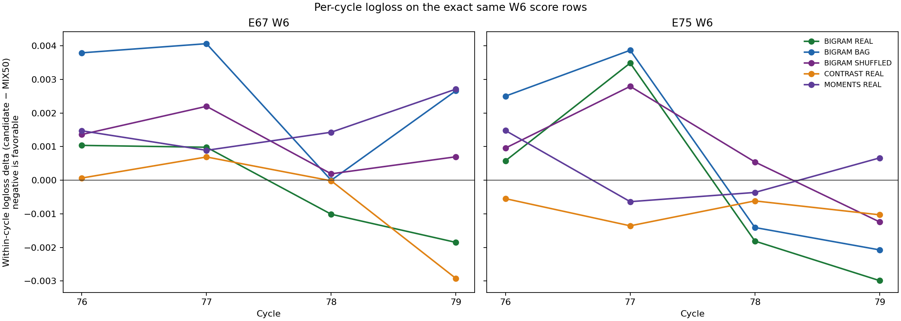

# Zero-fit positional classification error audit

**Status:** completed on frozen E67/E75 temporal Train predictions. No estimator fit, threshold change, Test scoring, SampleSubmission access, or Kaggle action occurred.

This is adaptive development analysis: the Bigram pilot verdicts and previous POS/Contrast/Moments results were already visible. E67 and E75 overlap; their W6 comparison uses the identical 8,491 rows and is descriptive, not an independent replication.

## Provenance and row support

Official Train SHA-256: `875552a68a3d24b0f3e1966d6ddb5671e6f54305a1c526e2f0a76747942ed91c`. Prediction bundles, accepted freeze receipts, and prelabel-verifier bindings are hashed in `AUDIT.json`; all three methods passed source checks before this audit read targets.

| Evaluation view | Rows | Present | Missing | Positive / negative targets |
|---|---:|---:|---:|---:|
| E67 H12_E67 | 20,903 | 19,528 | 1,375 | 6,727 / 14,176 |
| E67 W4 | 4,950 | 4,608 | 342 | 1,853 / 3,097 |
| E67 W5 | 7,462 | 6,955 | 507 | 2,374 / 5,088 |
| E67 W6 | 8,491 | 7,965 | 526 | 2,500 / 5,991 |
| E75 W6 | 8,491 | 7,965 | 526 | 2,500 / 5,991 |

E67 W6 and E75 W6 exact row-position SHA: `2c17e594e04e8c5406a52117894c8e296730cfcf88de1423468438e691580df8`; ID order, cycles, availability, and targets match for all 8,491 rows.
Moments' frozen NPZ stores `score_record_ids` as object dtype; this audit did not unpickle it. Exact alignment was verified with integer `score_rows`, cycle, availability, and official Train identity columns against Bigram and Contrast Unicode-ID bundles.

## Paired W6 probability metrics

Deltas are candidate minus MIX50 for logloss and Brier (negative is favorable), and candidate minus MIX50 for ROC-AUC (positive is favorable). Each comparison uses exactly the same rows; the present-only table isolates rows with available text.

| Method | E67 W6 Δ logloss | Δ Brier | Δ AUC | E75 W6 Δ logloss | Δ Brier | Δ AUC |
|---|---:|---:|---:|---:|---:|---:|
| BIGRAM_BAG | +0.00262 | +0.00106 | -0.00146 | +0.00071 | +0.00022 | -0.00026 |
| BIGRAM_REAL | -0.00024 | -0.00016 | +0.00021 | -0.00015 | -0.00006 | +0.00012 |
| BIGRAM_SHUFFLED | +0.00112 | +0.00049 | -0.00084 | +0.00079 | +0.00024 | -0.00039 |
| CONTRAST_REAL | -0.00055 | -0.00026 | +0.00039 | -0.00091 | -0.00027 | +0.00067 |
| CONTRAST_SHUFFLED | +0.00558 | +0.00187 | -0.00262 | +0.00077 | +0.00032 | +0.00001 |
| MOMENTS_REAL | +0.00162 | +0.00064 | -0.00088 | +0.00022 | +0.00006 | -0.00009 |
| MOMENTS_SHUFFLED | +0.00652 | +0.00240 | -0.00333 | +0.00209 | +0.00064 | -0.00094 |

Present-only results, all E67/E75 views, and score denominators are in `AUDIT.json`. On missing-stream rows the frozen policy routes every candidate exactly to MIX50; these rows therefore contribute zero paired flips and zero probability-score delta.

## W6 threshold flips and errors

At the frozen threshold 0.50, `wrong → correct` counts are useful flips and `correct → wrong` counts are harmful flips relative to MIX50. FP/FN deltas are candidate minus MIX50.

| Origin | Method | n | Unchanged | Flipped | Wrong→correct (y=0 / y=1) | Correct→wrong (y=0 / y=1) | ΔFP | ΔFN |
|---|---|---:|---:|---:|---:|---:|---:|---:|
| E67 | BIGRAM_BAG | 8,491 | 8,354 | 137 | 32 / 23 | 58 / 24 | +26 | +1 |
| E67 | BIGRAM_REAL | 8,491 | 8,377 | 114 | 33 / 21 | 40 / 20 | +7 | -1 |
| E67 | BIGRAM_SHUFFLED | 8,491 | 8,398 | 93 | 23 / 15 | 31 / 24 | +8 | +9 |
| E67 | CONTRAST_REAL | 8,491 | 8,426 | 65 | 24 / 12 | 17 / 12 | -7 | +0 |
| E67 | CONTRAST_SHUFFLED | 8,491 | 8,292 | 199 | 49 / 35 | 79 / 36 | +30 | +1 |
| E67 | MOMENTS_REAL | 8,491 | 8,387 | 104 | 23 / 23 | 38 / 20 | +15 | -3 |
| E67 | MOMENTS_SHUFFLED | 8,491 | 8,289 | 202 | 42 / 32 | 98 / 30 | +56 | -2 |
| E75 | BIGRAM_BAG | 8,491 | 8,410 | 81 | 14 / 25 | 19 / 23 | +5 | -2 |
| E75 | BIGRAM_REAL | 8,491 | 8,412 | 79 | 17 / 17 | 25 / 20 | +8 | +3 |
| E75 | BIGRAM_SHUFFLED | 8,491 | 8,408 | 83 | 12 / 26 | 14 / 31 | +2 | +5 |
| E75 | CONTRAST_REAL | 8,491 | 8,442 | 49 | 16 / 5 | 5 / 23 | -11 | +18 |
| E75 | CONTRAST_SHUFFLED | 8,491 | 8,347 | 144 | 40 / 30 | 22 / 52 | -18 | +22 |
| E75 | MOMENTS_REAL | 8,491 | 8,421 | 70 | 16 / 18 | 17 / 19 | +1 | +1 |
| E75 | MOMENTS_SHUFFLED | 8,491 | 8,355 | 136 | 32 / 30 | 29 / 45 | -3 | +15 |

For E75 W6 Bigram REAL, present rows contribute 7,965 of 8,491; 79 labels change, with 34 useful and 45 harmful flips. Full true-class and availability splits for every method/view are in `AUDIT.json`.

## Incumbent-margin bins and cycle signs

Margins are binned only from `abs(MIX50 - 0.50)` using the fixed bins `[0,0.02)`, `[0.02,0.05)`, `[0.05,0.10)`, `[0.10,0.20)`, `[0.20,0.50]`. Candidate probabilities never determine bin membership. The complete denominators, useful/harmful flips, class counts, and unchanged/flipped rows are in `AUDIT.json`.

Per-cycle logloss, Brier, and AUC deltas plus favorable/unfavorable/tied cycle counts are also in `AUDIT.json`. Cycles are descriptive slices, not independent tests.

## What was already tried

The earlier POS/A02/MIX50 zero-fit audit (`scripts/analyze_posmix_frontier_v1.py`, `reports/optimization_v3/posmix_followup_v1/ERROR_AUDIT.json`) already reported aggregate/per-cycle scores and agreement/fix-break counts against POS and A02. The A02 decision-boundary audit used different fixed probability bands. Neither decomposed Bigram REAL/BAG/SHUFFLED flips against MIX50 by true class, availability, and incumbent margin. Contrast and Moments had prior aggregate pilot gates, preserved unchanged here.

The Bigram pilot verdict remains **FAIL / DIAGNOSTIC_ONLY**. Its original Macro F1 values are unchanged: E67 H12 REAL 0.812143 vs MIX50 0.811937 (Δ +0.000206; required ≥ +0.000500), and E75 W6 REAL 0.814617 vs MIX50 0.816099 (Δ −0.001482; required ≥ +0.000500 and REAL is below BAG/SHUFFLED). See `reports/optimization_v3/bigram_position_pilot_v1/RESULTS.md`. This audit does not reopen or relax any gate, and makes no causal, significance, or Test-generalization claim.

## Next lane recommendation

**No additional fit lane is justified by this audit.** Bigram REAL's logloss improves slightly at both origins (Δ -0.000241 at E67; -0.000145 at E75), but within-cycle logloss improves in 2/4 E67 cycles and 2/4 E75 cycles. At the unchanged 0.50 threshold, E67 W6 flips are harmful exceed helpful by 6 (60 vs 54) and E75 W6 flips are harmful exceed helpful by 11 (45 vs 34). Those local diagnostics do not overturn the existing Macro F1 gate failures. The views are adaptive and overlap, so preserve historical verdicts and wait for review; any later fit needs a separately predeclared and authorized question. This audit starts no follow-up work.

## Visuals

## Reproducibility and boundaries

Run `python scripts/optimization_v3_cls_position_error_audit_v1.py`. It verifies accepted freeze signatures/input hashes, verifier bindings, prediction-file hashes and paths, exact row alignment, then reads only `record_id`, `cycle_code`, and query `artifact_signal` from official Train. It never opens Test/SampleSubmission. Existing models, recipes, thresholds, and historical gate records remain unchanged.
Ledger SHA-256 before/after: `8ee720fac6b5be4f2727bad4980299d39688dc339f6e3eaacc0144f0cb3358e9` (unchanged). New fits: 0. Kaggle accessed: no.

Audit script SHA-256: `b59c1027cbfbe19ba34f6620de61823a31efcde43389c9370c27998e18e96d05`. Latest repo HEAD at analysis: `253f4d949e537d4a53c7ced094d62acfaf23b043`.
