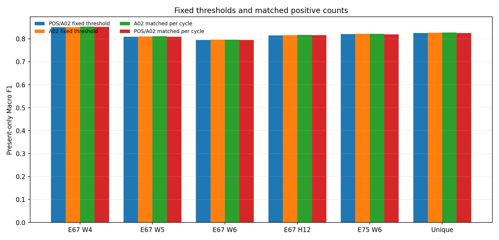
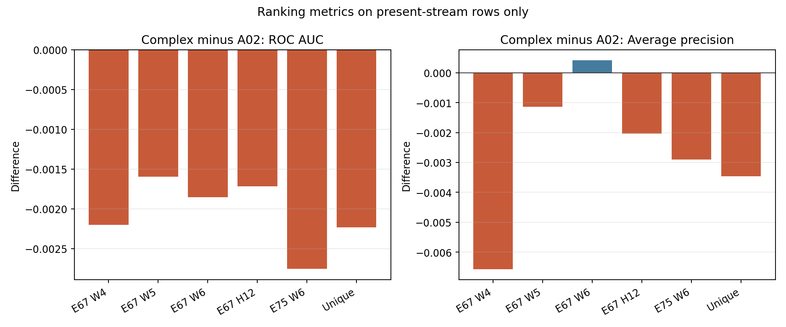

# CLS Simple Rank-Allocation Diagnostic — Corrected Results

## Finding

On these reused temporal development slices, the frozen POS/A02 half blend
does not show a consistent ranking gain over A02 `pA`. It changes the selected
positive set and usually raises the fixed-threshold positive count slightly.
At equal present-row positive counts, A02 `pA` has a small Macro F1 advantage
over the blend on the primary H12 slice and most other views. The differences
are descriptive and small; this is not a new model-selection result.

The comparison is zero-fit. For stream-present rows the complex score is
`0.5*pP + 0.5*pA` and the simple score is `pA`, both thresholded at 0.50. For
every policy, stream-missing rows retain the frozen `pA/CB >= 0.53230976129477`
route. Matched K is derived without labels within the declared origin-cycle
blocks; ties use descending score, then ascending string `record_id`.

## All fixed views

`ΔAUC` and `ΔAP` are complex blend minus A02 on present rows only. `ΔK` is the
present positive-count difference at the fixed threshold (complex minus
simple). Jaccard compares the two fixed-threshold positive sets. `A02@Kc − POS`
is present-only Macro F1 for A02 selected at the blend's per-cycle K, minus
blend-threshold Macro F1. `POS@Ks − A02` is blend selected at A02's per-cycle K,
minus A02-threshold Macro F1. Positive values favor A02 in the first contrast
and the blend in the second.

| View | Rows / present / missing | Missing-route positives | ΔAUC | ΔAP | ΔK | Jaccard | A02@Kc − POS | POS@Ks − A02 |
|---|---:|---:|---:|---:|---:|---:|---:|---:|
| E67 W4 | 4,950 / 4,608 / 342 | 134 | −0.002201 | −0.006577 | +8 | 0.9541 | +0.001859 | +0.000465 |
| E67 W5 | 7,462 / 6,955 / 507 | 210 | −0.001598 | −0.001145 | +38 | 0.9312 | +0.001678 | −0.000337 |
| E67 W6 | 8,491 / 7,965 / 526 | 204 | −0.001857 | +0.000422 | +13 | 0.9252 | +0.001209 | −0.001513 |
| E67 H12 | 20,903 / 19,528 / 1,375 | 548 | −0.001719 | −0.002032 | +59 | 0.9352 | +0.001534 | −0.000591 |
| E75 W6 | 8,491 / 7,965 / 526 | 141 | −0.002756 | −0.002905 | +23 | 0.9371 | +0.001242 | −0.001558 |
| UNIQUE | 20,903 / 19,528 / 1,375 | 485 | −0.002232 | −0.003465 | +69 | 0.9398 | +0.001548 | −0.000597 |

The blend's ROC AUC is lower in all six views; average precision is lower in
five of six, with only a +0.000422 difference in E67 W6. At matched per-cycle
positive counts, A02's Macro F1 is higher than the blend's threshold policy in
all six views, by +0.001209 to +0.001859. The reverse matched comparison favors
the blend only in E67 W4 (+0.000465); the other five differences are negative.

E67 H12 and E75 W6 use overlapping late-cycle records, so they are not
independent replications. `UNIQUE` combines E67 cycles 68–75 with E75 cycles
76–79 and removes that overlap. E67 W6 and E75 W6 have identical record IDs;
their predictions come from their respective frozen origin arrays.

## Primary slice: E67 H12

At the fixed threshold, the blend predicts 6,194 positives on present rows
versus 6,135 for A02, a net increase of 59; both retain the same 548 missing-row
positives. The present-row sets overlap on 5,958 IDs (Jaccard 0.9352), while
413 present-row assignments differ in the symmetric difference. This supports
an allocation/count effect rather than a demonstrated ranking improvement.

| Policy | Predicted positives | TP | FP | FN | TN | Full Macro F1 | Present-only Macro F1 |
|---|---:|---:|---:|---:|---:|---:|---:|
| POS/A02 fixed threshold | 6,742 | 5,012 | 1,730 | 1,715 | 12,446 | 0.811327 | 0.815349 |
| A02 fixed threshold | 6,683 | 4,992 | 1,691 | 1,735 | 12,485 | 0.811934 | 0.816003 |
| A02 matched to POS per-cycle K | 6,742 | 5,025 | 1,717 | 1,702 | 12,459 | 0.812751 | 0.816883 |
| POS matched to A02 per-cycle K | 6,683 | 4,987 | 1,696 | 1,740 | 12,480 | 0.811385 | 0.815412 |

The cycle-matched comparison covers all 12 H12 cycles and all 19,528
stream-present rows. Origin-level sensitivity preserves the same signs: A02
matched to the blend's K is +0.000708 Macro F1 over the blend threshold;
the blend matched to A02's K is −0.000946 versus the A02 threshold. In the
de-overlapped UNIQUE view, the corresponding origin-level differences are
+0.001548 and −0.001433. Thus the result is not dependent on choosing
cycle-level rather than origin-block matching, although gains remain small.

## Figures

The first figure compares fixed-threshold policies with per-cycle matched-count
policies. The second plots complex-minus-A02 ranking metrics; negative values
favor A02. Both are descriptive and use only the declared frozen slices.

## QA and limitations

- The corrected frozen inputs match the pinned hashes, including the four
  bounded novelty-review documents and both saved prediction archives.
- The independent verifier passed 3,144 checks, including all six policies'
  missing-route bits, present/full positive-count closure, confusion-matrix
  closure, stable tie handling, row/ID integrity, and matched-K checks.
- Independent hand-written fixtures cover a missing positive and negative,
  K=0, K=n, ties resolved by ascending ID, and two disjoint origins. Calculation
  and verification both passed the single-job RAM and dual-lock gates.
- No model was fit. No raw Train labels, Test, SampleSubmission, E79, or Kaggle
  were accessed.

These are adaptive development comparisons over reused labels, not unseen
generalization evidence. No confidence interval or causal claim is made. The
very small metric differences should not be treated as statistically decisive.
The result does not justify changing a champion or using public leaderboard
feedback.

**Recommended next action:** retain this as a no-consistent-rank-gain diagnostic
for POS over A02; make no model or champion change from it. Stop this lane here.

The initial replay is preserved at
`reports/optimization_v3/cls_simple_rank_allocation_diagnostic_v1/` with
`SUPERSEDED.md`; its four matched-policy full-row metrics are invalid because
it omitted the missing-stream route. This corrected namespace supersedes it.
