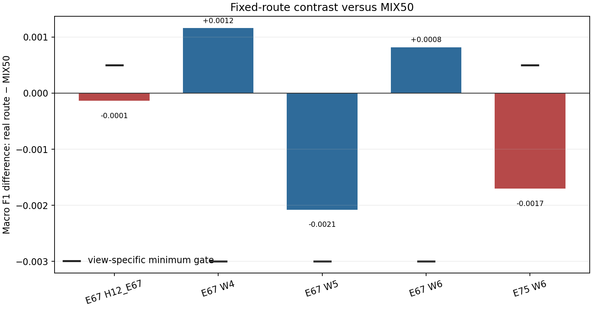
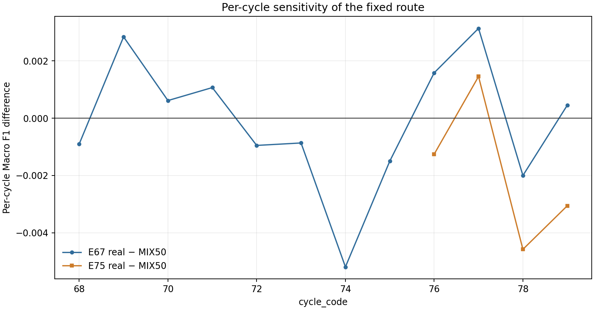

# POS_CONTRAST_V1 — pilot results

**Status:** `PILOT_GATE_FAILED`. The pilot is diagnostic and does not alter the champion.

## Frozen question and comparison

Does removing equal-across-thirds coefficient freedom improve the fixed positional/A02 route? The real candidate uses `0.5 * q + 0.5 * pA` on present-stream rows; missing-stream rows follow the original pP fallback exactly. The shuffled arm is a matched-capacity control. Primary comparisons are against the frozen MIX50 policy.

The follow-up was selected after earlier POS/A02/MIX50 results and error patterns were visible. E67/E75 are overlapping sensitivity views, not fresh or outcome-blind holdouts.

## Primary results

| View | n | Real Macro F1 | MIX50 | Δ real−MIX50 | Shuffled | Δ real−shuffled |
|---|---:|---:|---:|---:|---:|---:|
| E67 H12_E67 | 20903 | 0.811799 | 0.811937 | -0.000138 | 0.809425 | +0.002374 |
| E67 W4 | 4950 | 0.847526 | 0.846365 | +0.001161 | 0.844143 | +0.003383 |
| E67 W5 | 7462 | 0.804388 | 0.806465 | -0.002078 | 0.805183 | -0.000795 |
| E67 W6 | 8491 | 0.793350 | 0.792531 | +0.000819 | 0.788866 | +0.004484 |
| E75 W6 | 8491 | 0.814397 | 0.816099 | -0.001702 | 0.814573 | -0.000176 |

## Gates and subgroup checks

| Gate | Result | Threshold | Status |
|---|---:|---:|---|
| E67_H12_E67_real_gain_vs_MIX50_min_0.0005 | -0.00013829964158995622 | 0.0005 | FAIL |
| E67_H12_E67_real_gain_vs_shuffled_min_0 | 0.0023736697835521348 | 0.0 | PASS |
| E67_H12_E67_availability_present_subgroup_guard | -0.00014967991522851776 | -0.01 F1 / -0.02 recall | PASS |
| E67_H12_E67_availability_missing_subgroup_guard | 0.0 | -0.01 F1 / -0.02 recall | PASS |
| E67_H12_E67_entry_friction_0_subgroup_guard | 5.10305600394112e-05 | -0.01 F1 / -0.02 recall | PASS |
| E67_H12_E67_entry_friction_1_subgroup_guard | -0.0004208461047590095 | -0.01 F1 / -0.02 recall | PASS |
| E67_H12_E67_text_load_Q1_subgroup_guard | 0.000298059507195525 | -0.01 F1 / -0.02 recall | PASS |
| E67_H12_E67_text_load_Q2_subgroup_guard | 0.00012050041604527717 | -0.01 F1 / -0.02 recall | PASS |
| E67_H12_E67_text_load_Q3_subgroup_guard | 0.002083897803635937 | -0.01 F1 / -0.02 recall | PASS |
| E67_H12_E67_text_load_Q4_subgroup_guard | -0.002190804650343603 | -0.01 F1 / -0.02 recall | PASS |
| E67_W4_harm_vs_MIX50_max_0.003 | 0.001161069861121078 | -0.003 | PASS |
| E67_W4_availability_present_subgroup_guard | 0.0012526130400797308 | -0.01 F1 / -0.02 recall | PASS |
| E67_W4_availability_missing_subgroup_guard | 0.0 | -0.01 F1 / -0.02 recall | PASS |
| E67_W4_entry_friction_0_subgroup_guard | 0.00019076655222161065 | -0.01 F1 / -0.02 recall | PASS |
| E67_W4_entry_friction_1_subgroup_guard | 0.0032194508787017906 | -0.01 F1 / -0.02 recall | PASS |
| E67_W4_text_load_Q1_subgroup_guard | 0.0009137703483764748 | -0.01 F1 / -0.02 recall | PASS |
| E67_W4_text_load_Q2_subgroup_guard | 0.006953407760492913 | -0.01 F1 / -0.02 recall | PASS |
| E67_W4_text_load_Q3_subgroup_guard | 0.0 | -0.01 F1 / -0.02 recall | PASS |
| E67_W4_text_load_Q4_subgroup_guard | -0.0009897312393667423 | -0.01 F1 / -0.02 recall | PASS |
| E67_W5_harm_vs_MIX50_max_0.003 | -0.0020775694036294645 | -0.003 | PASS |
| E67_W5_availability_present_subgroup_guard | -0.0022485241146824597 | -0.01 F1 / -0.02 recall | PASS |
| E67_W5_availability_missing_subgroup_guard | 0.0 | -0.01 F1 / -0.02 recall | PASS |
| E67_W5_entry_friction_0_subgroup_guard | -0.0018645291370541495 | -0.01 F1 / -0.02 recall | PASS |
| E67_W5_entry_friction_1_subgroup_guard | -0.002449590024375725 | -0.01 F1 / -0.02 recall | PASS |
| E67_W5_text_load_Q1_subgroup_guard | -0.0019053026356897762 | -0.01 F1 / -0.02 recall | PASS |
| E67_W5_text_load_Q2_subgroup_guard | -0.0033488428625965128 | -0.01 F1 / -0.02 recall | PASS |
| E67_W5_text_load_Q3_subgroup_guard | 0.0022719105168194087 | -0.01 F1 / -0.02 recall | PASS |
| E67_W5_text_load_Q4_subgroup_guard | -0.0040082996832369044 | -0.01 F1 / -0.02 recall | PASS |
| E67_W6_harm_vs_MIX50_max_0.003 | 0.0008194835236958742 | -0.003 | PASS |
| E67_W6_availability_present_subgroup_guard | 0.0008802961843935586 | -0.01 F1 / -0.02 recall | PASS |
| E67_W6_availability_missing_subgroup_guard | 0.0 | -0.01 F1 / -0.02 recall | PASS |
| E67_W6_entry_friction_0_subgroup_guard | 0.0018566913002532326 | -0.01 F1 / -0.02 recall | PASS |
| E67_W6_entry_friction_1_subgroup_guard | -0.0008197826509884765 | -0.01 F1 / -0.02 recall | PASS |
| E67_W6_text_load_Q1_subgroup_guard | 0.002161226115579673 | -0.01 F1 / -0.02 recall | PASS |
| E67_W6_text_load_Q2_subgroup_guard | -0.0002736144463266754 | -0.01 F1 / -0.02 recall | PASS |
| E67_W6_text_load_Q3_subgroup_guard | 0.003108219088552744 | -0.01 F1 / -0.02 recall | PASS |
| E67_W6_text_load_Q4_subgroup_guard | -0.0013615076970836526 | -0.01 F1 / -0.02 recall | PASS |
| E75_W6_real_gain_vs_MIX50_min_0.0005 | -0.001702251297158508 | 0.0005 | FAIL |
| E75_W6_real_gain_vs_shuffled_min_0 | -0.00017594427247036304 | 0.0 | FAIL |
| E75_W6_availability_present_subgroup_guard | -0.0018030815459650906 | -0.01 F1 / -0.02 recall | PASS |
| E75_W6_availability_missing_subgroup_guard | 0.0 | -0.01 F1 / -0.02 recall | PASS |
| E75_W6_entry_friction_0_subgroup_guard | 0.000786086870330438 | -0.01 F1 / -0.02 recall | PASS |
| E75_W6_entry_friction_1_subgroup_guard | -0.005086141915587095 | -0.01 F1 / -0.02 recall | PASS |
| E75_W6_text_load_Q1_subgroup_guard | -0.0019078203426172724 | -0.01 F1 / -0.02 recall | PASS |
| E75_W6_text_load_Q2_subgroup_guard | 0.000776115579048442 | -0.01 F1 / -0.02 recall | PASS |
| E75_W6_text_load_Q3_subgroup_guard | -0.001321924555382381 | -0.01 F1 / -0.02 recall | PASS |
| E75_W6_text_load_Q4_subgroup_guard | -0.004451090951628767 | -0.01 F1 / -0.02 recall | PASS |

Unsupported subgroup views are explicitly `UNKNOWN_UNSUPPORTED` (0); none are treated as passing.

## Interpretation and limitations

The centered projection removes equal coefficient freedom across three position blocks. It does not remove all bag information: sublinear TF is applied within each third, so the common direction is not exactly an unordered bag vector. This experiment tests a fixed capacity restriction and does not establish that common-mode contribution is noise.

The result applies only to the specified Train temporal windows and frozen route. It does not authorize a full-Train fit, Test inference, Kaggle upload, or a follow-up experiment. E67 W6 overlaps E75 W6.

## QA

Independent prelabel and metric verification: `PASS`. Synthetic end-to-end QA was completed before the official fit. Official estimator fits: 4 planned, no retries. Conditional E79 start: not performed.

## Visual summary

The first figure summarizes the real-route Macro F1 difference from MIX50 across the frozen evaluation views; the second shows the corresponding per-cycle difference. E67 W6 and E75 W6 overlap in cycles 76–79 and must not be read as independent replications.

Source commit: `f3befc8550e7887c1ab7b76ba17aef8313754f9c`; freeze signature: `ba295aca5a925f61f307f191f5b2ae1a643c3b6cbc675fb1c83341e460e4d649`.
