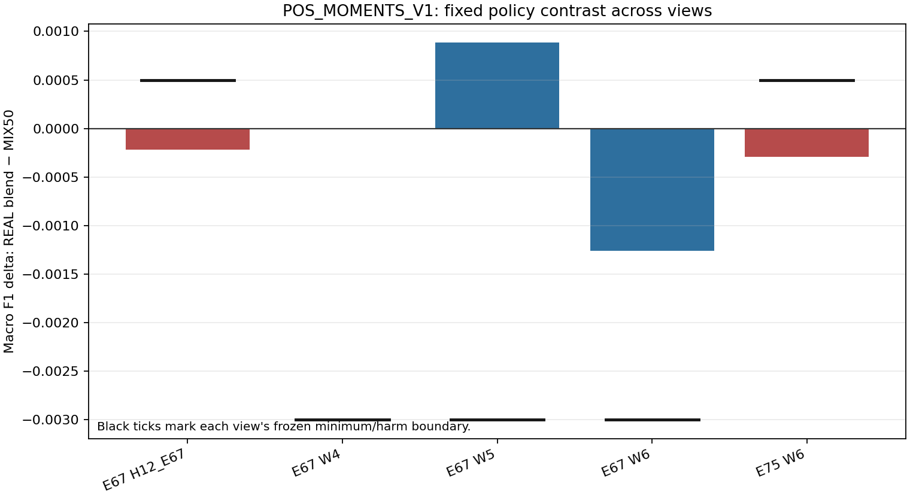
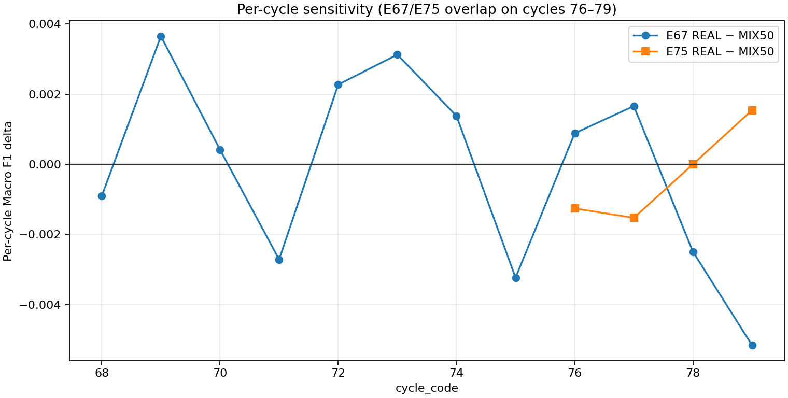

# POS_MOMENTS_V1 — hasil pilot

**Status:** `PILOT_GATE_FAILED`. Kandidat diagnostic; champion tidak berubah.

## Perbandingan utama

| View | n | REAL blend | MIX50 | Δ REAL−MIX50 | Shuffled blend | Δ REAL−shuffled |
|---|---:|---:|---:|---:|---:|---:|
| E67 H12_E67 | 20903 | 0.811721 | 0.811937 | -0.000216 | 0.807896 | +0.003825 |
| E67 W4 | 4950 | 0.846365 | 0.846365 | +0.000000 | 0.843779 | +0.002586 |
| E67 W5 | 7462 | 0.807348 | 0.806465 | +0.000882 | 0.804034 | +0.003313 |
| E67 W6 | 8491 | 0.791268 | 0.792531 | -0.001262 | 0.786335 | +0.004934 |
| E75 W6 | 8491 | 0.815808 | 0.816099 | -0.000291 | 0.813929 | +0.001879 |

## Gate summary

| Gate | Result | Threshold | Status |
|---|---:|---:|---|
| E67_H12_E67_real_gain_vs_MIX50_min_0.0005 | -0.000216 | 0.0005 | FAIL |
| E67_H12_E67_real_gain_vs_shuffled_min_0 | +0.003825 | 0.0 | PASS |
| E67_H12_E67_availability_present_guard | -0.000231 | F1 ≥ −0.01; recall ≥ −0.02 | PASS |
| E67_H12_E67_availability_missing_guard | +0.000000 | F1 ≥ −0.01; recall ≥ −0.02 | PASS |
| E67_H12_E67_entry_friction_0_guard | -0.000257 | F1 ≥ −0.01; recall ≥ −0.02 | PASS |
| E67_H12_E67_entry_friction_1_guard | -0.000119 | F1 ≥ −0.01; recall ≥ −0.02 | PASS |
| E67_H12_E67_text_load_Q1_guard | +0.000612 | F1 ≥ −0.01; recall ≥ −0.02 | PASS |
| E67_H12_E67_text_load_Q2_guard | -0.000618 | F1 ≥ −0.01; recall ≥ −0.02 | PASS |
| E67_H12_E67_text_load_Q3_guard | +0.000194 | F1 ≥ −0.01; recall ≥ −0.02 | PASS |
| E67_H12_E67_text_load_Q4_guard | -0.000883 | F1 ≥ −0.01; recall ≥ −0.02 | PASS |
| E67_W4_real_harm_vs_MIX50_max_0.003 | +0.000000 | -0.003 | PASS |
| E67_W4_availability_present_guard | +0.000000 | F1 ≥ −0.01; recall ≥ −0.02 | PASS |
| E67_W4_availability_missing_guard | +0.000000 | F1 ≥ −0.01; recall ≥ −0.02 | PASS |
| E67_W4_entry_friction_0_guard | +0.000243 | F1 ≥ −0.01; recall ≥ −0.02 | PASS |
| E67_W4_entry_friction_1_guard | -0.000561 | F1 ≥ −0.01; recall ≥ −0.02 | PASS |
| E67_W4_text_load_Q1_guard | +0.000915 | F1 ≥ −0.01; recall ≥ −0.02 | PASS |
| E67_W4_text_load_Q2_guard | -0.000847 | F1 ≥ −0.01; recall ≥ −0.02 | PASS |
| E67_W4_text_load_Q3_guard | -0.000974 | F1 ≥ −0.01; recall ≥ −0.02 | PASS |
| E67_W4_text_load_Q4_guard | +0.000444 | F1 ≥ −0.01; recall ≥ −0.02 | PASS |
| E67_W5_real_harm_vs_MIX50_max_0.003 | +0.000882 | -0.003 | PASS |
| E67_W5_availability_present_guard | +0.000959 | F1 ≥ −0.01; recall ≥ −0.02 | PASS |
| E67_W5_availability_missing_guard | +0.000000 | F1 ≥ −0.01; recall ≥ −0.02 | PASS |
| E67_W5_entry_friction_0_guard | +0.001774 | F1 ≥ −0.01; recall ≥ −0.02 | PASS |
| E67_W5_entry_friction_1_guard | -0.000699 | F1 ≥ −0.01; recall ≥ −0.02 | PASS |
| E67_W5_text_load_Q1_guard | -0.001097 | F1 ≥ −0.01; recall ≥ −0.02 | PASS |
| E67_W5_text_load_Q2_guard | -0.001310 | F1 ≥ −0.01; recall ≥ −0.02 | PASS |
| E67_W5_text_load_Q3_guard | +0.007898 | F1 ≥ −0.01; recall ≥ −0.02 | PASS |
| E67_W5_text_load_Q4_guard | +0.000695 | F1 ≥ −0.01; recall ≥ −0.02 | PASS |
| E67_W6_real_harm_vs_MIX50_max_0.003 | -0.001262 | -0.003 | PASS |
| E67_W6_availability_present_guard | -0.001354 | F1 ≥ −0.01; recall ≥ −0.02 | PASS |
| E67_W6_availability_missing_guard | +0.000000 | F1 ≥ −0.01; recall ≥ −0.02 | PASS |
| E67_W6_entry_friction_0_guard | -0.002395 | F1 ≥ −0.01; recall ≥ −0.02 | PASS |
| E67_W6_entry_friction_1_guard | +0.000539 | F1 ≥ −0.01; recall ≥ −0.02 | PASS |
| E67_W6_text_load_Q1_guard | +0.002154 | F1 ≥ −0.01; recall ≥ −0.02 | PASS |
| E67_W6_text_load_Q2_guard | +0.000000 | F1 ≥ −0.01; recall ≥ −0.02 | PASS |
| E67_W6_text_load_Q3_guard | -0.005269 | F1 ≥ −0.01; recall ≥ −0.02 | PASS |
| E67_W6_text_load_Q4_guard | -0.003398 | F1 ≥ −0.01; recall ≥ −0.02 | PASS |
| E75_W6_real_gain_vs_MIX50_min_0.0005 | -0.000291 | 0.0005 | FAIL |
| E75_W6_real_gain_vs_shuffled_min_0 | +0.001879 | 0.0 | PASS |
| E75_W6_availability_present_guard | -0.000311 | F1 ≥ −0.01; recall ≥ −0.02 | PASS |
| E75_W6_availability_missing_guard | +0.000000 | F1 ≥ −0.01; recall ≥ −0.02 | PASS |
| E75_W6_entry_friction_0_guard | -0.000195 | F1 ≥ −0.01; recall ≥ −0.02 | PASS |
| E75_W6_entry_friction_1_guard | -0.000631 | F1 ≥ −0.01; recall ≥ −0.02 | PASS |
| E75_W6_text_load_Q1_guard | -0.001974 | F1 ≥ −0.01; recall ≥ −0.02 | PASS |
| E75_W6_text_load_Q2_guard | +0.001766 | F1 ≥ −0.01; recall ≥ −0.02 | PASS |
| E75_W6_text_load_Q3_guard | -0.001161 | F1 ≥ −0.01; recall ≥ −0.02 | PASS |
| E75_W6_text_load_Q4_guard | +0.000264 | F1 ≥ −0.01; recall ≥ −0.02 | PASS |

All 40/40 supported subgroup guards passed; there were no unsupported subgroup
views marked UNKNOWN. Overall, 45/47 gates passed: the two failed gates are the
primary REAL-vs-MIX50 minimum-gain checks shown above.

## Interpretasi dan batas

W menggabungkan bag unigram B, momen posisi kontinu orde-1, dan momen kuadratik terpusat, lalu menormalisasi seluruh tiga kanal bersama-sama. Perbandingan adalah adaptif pada temporal Train; E67 dan E75 berbagi siklus 76–79. Hasil tidak membuktikan pengaruh kausal atau perbaikan public score.

Prelabel QA independen: `PASS`. Test/Sample tidak dibuka. Tidak ada full-Train fit, upload, atau continuation E79.

Source commit: `6a2baeb92406c38ca50b1b7a4e85a938e03cf1fa`; freeze signature: `ea1b2ee797356ab5dd889f599ea60bfb63a2c5f19ddf52231364b818bb7f4ea3`.
Independent QA: `PASS`; result core SHA-256: `18be33371cf81381ba335a454dc6f3500b88235ece941e54a1500b92029de451`.

