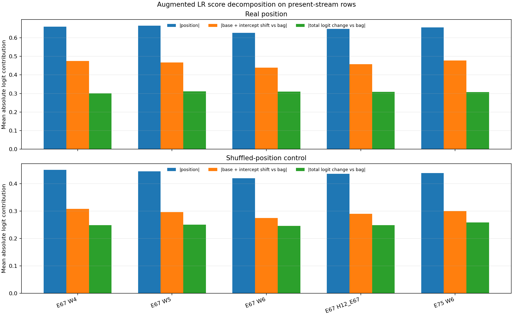
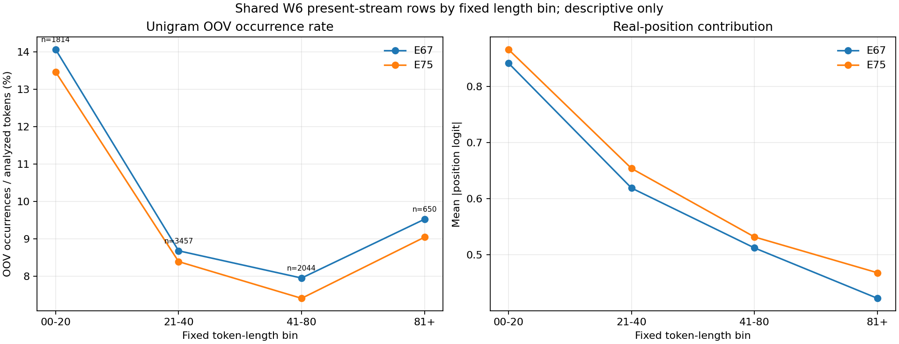

# Positional text score decomposition — ZERO FITS

## Decision scope

This diagnostic decomposes saved pilot Logistic Regression scores. It is adaptive/descriptive and uses overlapping validation histories; it is not causal attribution, a fair refit ablation, independent replication, or a Test policy. The committed three-third recipe remains retired under its original gates.

## Integrity and source boundaries

- Diagnostic source commit: `45bc720753a0b308304d0523c4b0158fa7afe7ea`; script SHA-256 `fa36e48a62e9dd29a408fd142dca743976aa31fd16d9bfa6438f941d8e7bc7fc`.
- Pilot source commit `3429fb93c2a579ca91f0dfe7fc1a67d06a1b8855`; freeze signature `f310d0340ea4402677ca9e86aa29c43b1536ded902c0f6a6f52cb53bd333c292`; Train SHA-256 `875552a68a3d24b0f3e1966d6ddb5671e6f54305a1c526e2f0a76747942ed91c`.
- Live ledger SHA-256 before and after: `59ef4f3c91091cf0f81d71fdb95211992ff796672227f764bc9523e7304ed6a1` / `59ef4f3c91091cf0f81d71fdb95211992ff796672227f764bc9523e7304ed6a1`; exact same = `True`. Fit cap stayed 105; no fit units were consumed.
- Matrix/prediction/model hashes and numerical checks are in [RESULTS.json](RESULTS.json). Official Classification Train only; no Test/Sample/Kaggle access.

## Exact score reconstruction

For each saved binary LR arm, the logit was partitioned as `intercept + X_base @ beta_base + X_position @ beta_position`. The dropped-block diagnostic sets only `X_position @ beta_position` to zero and retains the augmented model's own base coefficients and intercept. It is not a refitted model. The original bag model was separately reconstructed from its own coefficients.

| Origin | Arm | Max abs sigmoid error vs saved raw LR probability | Class order |
|---:|---|---:|---|
| E67 | bag | 0 | `[0, 1]` |
| E67 | position | 8.88e-16 | `[0, 1]` |
| E67 | shuffled_position | 7.77e-16 | `[0, 1]` |
| E75 | bag | 0 | `[0, 1]` |
| E75 | position | 7.77e-16 | `[0, 1]` |
| E75 | shuffled_position | 6.11e-16 | `[0, 1]` |

The routed probability for every missing/blank stream row exactly matches the saved shared C1_B HGB fallback across bag, full, drop-block and shuffled routes.

## Fixed-view metrics

Macro F1 is primary; scores use the original 0.50 threshold and original availability route.

| Origin | View | n | Model | Macro F1 | Δ vs bag | Positive recall | TP | FP | FN |
|---:|---|---:|---|---:|---:|---:|---:|---:|---:|
| E67 | W4 | 4950 | bag | 0.842554 | +0.000000 | 0.805720 | 1493 | 371 | 360 |
| E67 | W4 | 4950 | position_full | 0.838262 | -0.004292 | 0.806800 | 1495 | 395 | 358 |
| E67 | W4 | 4950 | position_drop | 0.833758 | -0.008796 | 0.774960 | 1436 | 348 | 417 |
| E67 | W4 | 4950 | shuffle_full | 0.836535 | -0.006019 | 0.801403 | 1485 | 392 | 368 |
| E67 | W4 | 4950 | shuffle_drop | 0.835657 | -0.006897 | 0.776579 | 1439 | 342 | 414 |
| E67 | W5 | 7462 | bag | 0.799093 | +0.000000 | 0.726201 | 1724 | 651 | 650 |
| E67 | W5 | 7462 | position_full | 0.799238 | +0.000146 | 0.738837 | 1754 | 690 | 620 |
| E67 | W5 | 7462 | position_drop | 0.794065 | -0.005028 | 0.692081 | 1643 | 579 | 731 |
| E67 | W5 | 7462 | shuffle_full | 0.798449 | -0.000643 | 0.735046 | 1745 | 684 | 629 |
| E67 | W5 | 7462 | shuffle_drop | 0.796776 | -0.002316 | 0.697136 | 1655 | 575 | 719 |
| E67 | W6 | 8491 | bag | 0.784403 | +0.000000 | 0.718400 | 1796 | 841 | 704 |
| E67 | W6 | 8491 | position_full | 0.789240 | +0.004837 | 0.726000 | 1815 | 826 | 685 |
| E67 | W6 | 8491 | position_drop | 0.771922 | -0.012481 | 0.678800 | 1697 | 807 | 803 |
| E67 | W6 | 8491 | shuffle_full | 0.776322 | -0.008081 | 0.724000 | 1810 | 931 | 690 |
| E67 | W6 | 8491 | shuffle_drop | 0.778940 | -0.005463 | 0.685600 | 1714 | 771 | 786 |
| E67 | H12_E67 | 20903 | bag | 0.805106 | +0.000000 | 0.745206 | 5013 | 1863 | 1714 |
| E67 | H12_E67 | 20903 | position_full | 0.805996 | +0.000889 | 0.752787 | 5064 | 1911 | 1663 |
| E67 | H12_E67 | 20903 | position_drop | 0.796314 | -0.008793 | 0.709975 | 4776 | 1734 | 1951 |
| E67 | H12_E67 | 20903 | shuffle_full | 0.800018 | -0.005089 | 0.749220 | 5040 | 2007 | 1687 |
| E67 | H12_E67 | 20903 | shuffle_drop | 0.800512 | -0.004594 | 0.714732 | 4808 | 1688 | 1919 |
| E75 | W6 | 8491 | bag | 0.810384 | +0.000000 | 0.690000 | 1725 | 522 | 775 |
| E75 | W6 | 8491 | position_full | 0.810138 | -0.000246 | 0.698000 | 1745 | 552 | 755 |
| E75 | W6 | 8491 | position_drop | 0.787745 | -0.022638 | 0.608000 | 1520 | 410 | 980 |
| E75 | W6 | 8491 | shuffle_full | 0.808658 | -0.001725 | 0.690800 | 1727 | 539 | 773 |
| E75 | W6 | 8491 | shuffle_drop | 0.793398 | -0.016986 | 0.623600 | 1559 | 422 | 941 |

## Contribution magnitudes and helpful/harmful flips

The base-shift term is `(augmented intercept − bag intercept) + X_base @ (augmented base coefficients − bag coefficients)`. All summaries below use present-stream rows. Helpful/harmful flips compare full augmented scores against that same augmented model with its positional contribution zeroed.

| Origin | View | Arm | Component | n | Mean | Mean abs | Median abs | P95 abs |
|---:|---|---|---|---:|---:|---:|---:|---:|
| E67 | W4 | position | position_contribution | 4608 | -0.01925 | 0.65955 | 0.56834 | 1.55142 |
| E67 | W4 | position | augmented_base_and_intercept_minus_bag | 4608 | -0.02502 | 0.47533 | 0.39980 | 1.13313 |
| E67 | W4 | position | total_augmented_logit_minus_bag | 4608 | -0.04427 | 0.30074 | 0.25197 | 0.73237 |
| E67 | W4 | shuffled_position | position_contribution | 4608 | -0.01021 | 0.45068 | 0.38562 | 1.09249 |
| E67 | W4 | shuffled_position | augmented_base_and_intercept_minus_bag | 4608 | -0.02342 | 0.30815 | 0.27298 | 0.73665 |
| E67 | W4 | shuffled_position | total_augmented_logit_minus_bag | 4608 | -0.03362 | 0.24890 | 0.20633 | 0.63346 |
| E67 | W5 | position | position_contribution | 6955 | -0.09696 | 0.66475 | 0.55097 | 1.67080 |
| E67 | W5 | position | augmented_base_and_intercept_minus_bag | 6955 | +0.04056 | 0.46722 | 0.38770 | 1.12111 |
| E67 | W5 | position | total_augmented_logit_minus_bag | 6955 | -0.05640 | 0.31152 | 0.26030 | 0.77314 |
| E67 | W5 | shuffled_position | position_contribution | 6955 | -0.03523 | 0.44505 | 0.38128 | 1.06320 |
| E67 | W5 | shuffled_position | augmented_base_and_intercept_minus_bag | 6955 | +0.00922 | 0.29639 | 0.25474 | 0.72573 |
| E67 | W5 | shuffled_position | total_augmented_logit_minus_bag | 6955 | -0.02601 | 0.25022 | 0.20908 | 0.61495 |
| E67 | W6 | position | position_contribution | 7965 | -0.13663 | 0.62620 | 0.51990 | 1.57330 |
| E67 | W6 | position | augmented_base_and_intercept_minus_bag | 7965 | +0.07297 | 0.43868 | 0.35206 | 1.10216 |
| E67 | W6 | position | total_augmented_logit_minus_bag | 7965 | -0.06366 | 0.31037 | 0.25597 | 0.77747 |
| E67 | W6 | shuffled_position | position_contribution | 7965 | -0.03186 | 0.42026 | 0.35818 | 1.04304 |
| E67 | W6 | shuffled_position | augmented_base_and_intercept_minus_bag | 7965 | +0.01365 | 0.27445 | 0.22662 | 0.69257 |
| E67 | W6 | shuffled_position | total_augmented_logit_minus_bag | 7965 | -0.01821 | 0.24592 | 0.20579 | 0.61281 |
| E67 | H12_E67 | position | position_contribution | 19528 | -0.09480 | 0.64780 | 0.54103 | 1.60388 |
| E67 | H12_E67 | position | augmented_base_and_intercept_minus_bag | 19528 | +0.03830 | 0.45749 | 0.37661 | 1.11747 |
| E67 | H12_E67 | position | total_augmented_logit_minus_bag | 19528 | -0.05650 | 0.30851 | 0.25657 | 0.76716 |
| E67 | H12_E67 | shuffled_position | position_contribution | 19528 | -0.02795 | 0.43626 | 0.37275 | 1.06494 |
| E67 | H12_E67 | shuffled_position | augmented_base_and_intercept_minus_bag | 19528 | +0.00332 | 0.29021 | 0.24675 | 0.71548 |
| E67 | H12_E67 | shuffled_position | total_augmented_logit_minus_bag | 19528 | -0.02463 | 0.24816 | 0.20717 | 0.61719 |
| E75 | W6 | position | position_contribution | 7965 | -0.09023 | 0.65560 | 0.56627 | 1.58791 |
| E75 | W6 | position | augmented_base_and_intercept_minus_bag | 7965 | +0.01560 | 0.47771 | 0.38356 | 1.24176 |
| E75 | W6 | position | total_augmented_logit_minus_bag | 7965 | -0.07463 | 0.30804 | 0.24851 | 0.78417 |
| E75 | W6 | shuffled_position | position_contribution | 7965 | +0.01390 | 0.43873 | 0.37327 | 1.07342 |
| E75 | W6 | shuffled_position | augmented_base_and_intercept_minus_bag | 7965 | -0.06201 | 0.30012 | 0.25265 | 0.72582 |
| E75 | W6 | shuffled_position | total_augmented_logit_minus_bag | 7965 | -0.04811 | 0.25816 | 0.21681 | 0.62428 |

| Origin | View | Arm | Changed labels | Helpful | Harmful | Net correct | Δ TP |
|---:|---|---|---:|---:|---:|---:|---:|
| E67 | W4 | position | 228 | 120 | 108 | +12 | +59 |
| E67 | W4 | shuffled_position | 174 | 85 | 89 | -4 | +46 |
| E67 | W5 | position | 388 | 194 | 194 | +0 | +111 |
| E67 | W5 | shuffled_position | 305 | 143 | 162 | -19 | +90 |
| E67 | W6 | position | 481 | 290 | 191 | +99 | +118 |
| E67 | W6 | shuffled_position | 418 | 177 | 241 | -64 | +96 |
| E67 | H12_E67 | position | 1097 | 604 | 493 | +111 | +288 |
| E67 | H12_E67 | shuffled_position | 897 | 405 | 492 | -87 | +232 |
| E75 | W6 | position | 451 | 267 | 184 | +83 | +225 |
| E75 | W6 | shuffled_position | 361 | 206 | 155 | +51 | +168 |

## Shared W6 history comparison and fixed length/OOV summary

Both origins score the same 8,491 W6 rows; the 7,965 present-stream rows are paired by official `record_id`. E75−E67 contribution differences compare two fit histories on the same cohort, not independent samples.

- Present rows: 7965; missing/blank rows: 526. Paired position-contribution Pearson r: 0.9452; sign agreement: 0.904.

| W6 component | E67 mean abs | E75 mean abs | Paired Δ mean abs | Paired r | Sign agreement |
|---|---:|---:|---:|---:|---:|
| position | 0.62620 | 0.65560 | 0.20670 | 0.9452 | 0.904 |
| base_shift_vs_bag | 0.43868 | 0.47771 | 0.13652 | 0.9642 | 0.908 |
| total_logit_shift_vs_bag | 0.31037 | 0.30804 | 0.16864 | 0.8465 | 0.822 |
- E67 saved prefix unigram vocabulary size: 5675; W6 present-stream OOV occurrences: 28833/317191 (9.09%).
- E75 saved prefix unigram vocabulary size: 5723; W6 present-stream OOV occurrences: 27397/317191 (8.64%).
- Fixed bins are 0–20, 21–40, 41–80 and 81+ analyzer unigrams. Rows are present-stream W6 only; OOV is the occurrence share of analyzer unigrams absent from that origin's saved fit-prefix unigram vocabulary. These are post hoc descriptions, not routing rules.

| Origin | Length bin | n | Mean length | OOV occurrences / tokens | OOV rate | Mean abs position logit | Bag F1 | Drop F1 | Full F1 |
|---:|---|---:|---:|---:|---:|---:|---:|---:|---:|
| E67 | 00-20 | 1814 | 15.9 | 4047 / 28772 | 14.07% | 0.84117 | 0.84988 | 0.83806 | 0.85165 |
| E67 | 21-40 | 3457 | 29.6 | 8875 / 102273 | 8.68% | 0.61895 | 0.77045 | 0.75089 | 0.78553 |
| E67 | 41-80 | 2044 | 56.4 | 9166 / 115319 | 7.95% | 0.51238 | 0.78923 | 0.78069 | 0.78504 |
| E67 | 81+ | 650 | 109.0 | 6745 / 70827 | 9.52% | 0.42271 | 0.64685 | 0.64261 | 0.64028 |
| E75 | 00-20 | 1814 | 15.9 | 3874 / 28772 | 13.46% | 0.86547 | 0.85156 | 0.82169 | 0.86090 |
| E75 | 21-40 | 3457 | 29.6 | 8579 / 102273 | 8.39% | 0.65384 | 0.82540 | 0.79331 | 0.82389 |
| E75 | 41-80 | 2044 | 56.4 | 8540 / 115319 | 7.41% | 0.53192 | 0.80154 | 0.79344 | 0.79337 |
| E75 | 81+ | 650 | 109.0 | 6404 / 70827 | 9.04% | 0.46822 | 0.67506 | 0.64881 | 0.67704 |

## Fixed-K matched-positive-count ranking

Once per origin/cycle, K is the number of present rows the saved bag predicts positive at 0.50. The same K is selected by score rank for bag and position, with ties broken by original Train source row. The selector did not read labels; labels are used only for the resulting F1/confusion counts.

| Origin | Cycle | n present | K | Bag F1 | Position F1 at K | Δ F1 | Δ TP | Δ FP | Δ FN |
|---:|---:|---:|---:|---:|---:|---:|---:|---:|---:|
| E67 | 68 | 525 | 126 | 0.778817 | 0.764071 | -0.014746 | -3 | +3 | +3 |
| E67 | 69 | 997 | 392 | 0.867497 | 0.852890 | -0.014607 | -7 | +7 | +7 |
| E67 | 70 | 1511 | 588 | 0.851954 | 0.847744 | -0.004210 | -3 | +3 | +3 |
| E67 | 71 | 1575 | 606 | 0.844369 | 0.845716 | +0.001347 | +1 | -1 | -1 |
| E67 | 72 | 1687 | 560 | 0.817284 | 0.802667 | -0.014617 | -11 | +11 | +11 |
| E67 | 73 | 1738 | 517 | 0.786071 | 0.791436 | +0.005365 | +4 | -4 | -4 |
| E67 | 74 | 1679 | 521 | 0.835447 | 0.840979 | +0.005531 | +4 | -4 | -4 |
| E67 | 75 | 1851 | 543 | 0.767859 | 0.773120 | +0.005261 | +4 | -4 | -4 |
| E67 | 76 | 1704 | 525 | 0.781969 | 0.775260 | -0.006709 | -5 | +5 | +5 |
| E67 | 77 | 2163 | 629 | 0.788682 | 0.789806 | +0.001124 | +1 | -1 | -1 |
| E67 | 78 | 2015 | 513 | 0.799966 | 0.805248 | +0.005281 | +4 | -4 | -4 |
| E67 | 79 | 2083 | 747 | 0.773992 | 0.787000 | +0.013008 | +12 | -12 | -12 |
| E75 | 76 | 1704 | 496 | 0.798584 | 0.801306 | +0.002722 | +2 | -2 | -2 |
| E75 | 77 | 2163 | 569 | 0.807771 | 0.799665 | -0.008106 | -7 | +7 | +7 |
| E75 | 78 | 2015 | 430 | 0.822205 | 0.822205 | +0.000000 | +0 | +0 | +0 |
| E75 | 79 | 2083 | 612 | 0.825794 | 0.822356 | -0.003438 | -3 | +3 | +3 |

## Finding and scope of the recommendation

The score-level positional term changes decisions inside each augmented LR: E67 H12 Macro F1 is 0.796314 with the term zeroed and 0.805996 with it restored; E75 W6 is 0.787745 versus 0.810138. Yet the augmented models are only +0.000889 versus bag at E67 H12 and -0.000246 at E75 W6. The no-position counterfactual also falls below the separately fitted bag model at both origins. This points to co-adaptation of positional and base coefficients: the positional score moves useful rows, but the augmented fit's base score differs from the bag fit. Because zeroing a block after fitting is not a refit, this describes these saved scores; it does not estimate generalizable incremental value.

That evidence supports only one narrow review question: whether a positional correction can improve the saved bag score while bag coefficients remain frozen. The matched-positive-count ranking result varies by cycle and history, so it does not justify a deployment threshold or a stable-gain claim. Fixed length/OOV patterns are post hoc descriptions.

## Figures

## QA and reproduction

- Synthetic self-tests: `PASS`; cases: logit_partition_sigmoid, empty_position_block, class_order_valid_and_reversed, fixed_k_ties, fixed_k_allzero_allone, exact_missing_fallback, temporary_only_paths, live_ledger_unchanged. Temporary ledger path: `<TemporaryDirectory>/budget.jsonl` under `positional-text-diagnostic-v1-*` (outside the repository). Live ledger assertion `True`.
- Command: `python scripts/optimization_v3_positional_text_diagnostic_v1.py --run`; tests: `python -m unittest tests.test_optimization_v3_positional_text_diagnostic_v1 -v`.
- No model/preprocessor fitting or transformation, parameter search, Test/Sample/Kaggle access, install, notebook edit, or push was performed.

## Judgment

ONE_SPECIFIC_FOLLOWUP_FOR_SOL_REVIEW: if Sol authorizes one more pilot, test a frozen-bag-offset positional residual recipe at E67 and E75, with exactly four predictor fits total (real position and the fixed seed-42 shuffled-position control at each origin) and zero preprocessing fits. Freeze each saved bag LR intercept and coefficient vector. On the existing fit-prefix matrices, optimize only positional gamma with the fixed objective sum_i logaddexp(0, -(2*y_i-1)*(z_bag_i + Xpos_i @ gamma)) + ||gamma||^2/(2*C), C=1, zero initialization, float64 L-BFGS-B, maxiter=2000, ftol=1e-12, no retry and fail on non-convergence; no learned intercept. Use existing temporal and Q4 gates unchanged, threshold 0.50, and the exact saved HGB fallback for missing streams. This is a proposed conditional incremental-information check, not causal evidence or deployment selection. It requires a separate explicit fit-cap authorization; no fit was performed here. If any frozen gate fails, stop further positional fits; a pass advances only to review.
