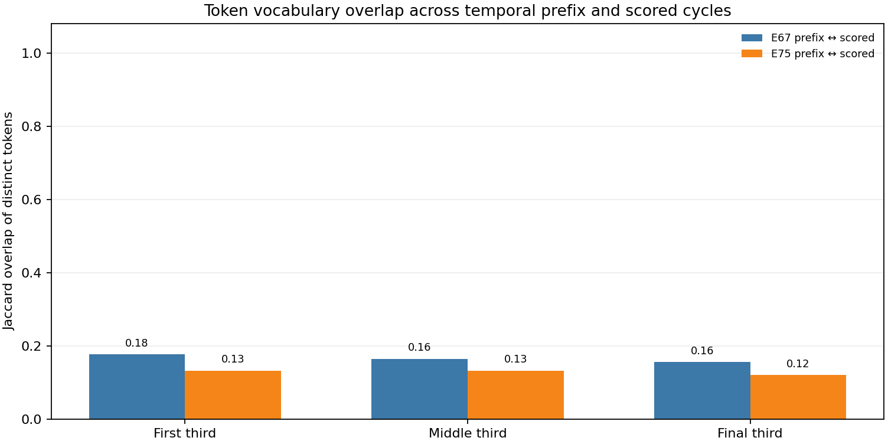
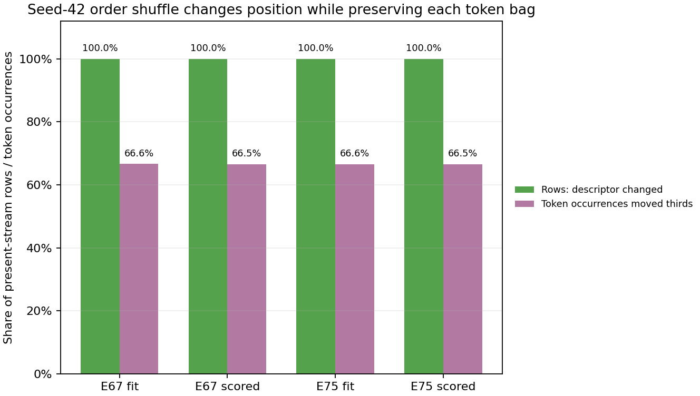

# Positional Text Preflight v1

**Status: `READY_FOR_SOL_PROTOCOL_REVIEW` — no model-fit authorization.**

## Ringkasan

Pemeriksaan label-free pada 50.608 baris official Classification Train menemukan variasi kosakata menurut sepertiga posisi teks dan pergeseran kosakata antarperiode. Shuffle deterministik mengubah deskriptor posisi, sementara bag token, panjang teks, dan ukuran ketiga segmen tetap persis sama. Ini membuat pertanyaan positional-text layak diajukan sebagai pilot terkontrol; hasil ini belum menunjukkan bahwa posisi membantu prediksi.

File statistik lengkap, hash sumber, dan batas akses ada di [`profiling.json`](profiling.json). Grafik memvisualisasikan dua pemeriksaan utama.





## Data dan temuan label-free

Skrip membaca hanya `record_id`, `cycle_code`, dan `signal_stream` dari `data/raw/classification/Train.csv` (SHA-256 `875552a68a3d24b0f3e1966d6ddb5671e6f54305a1c526e2f0a76747942ed91c`). `record_id` hanya untuk cek keunikan/identitas baris. Target tidak dibaca. Tidak ada Test, SampleSubmission, Kaggle, atau learned fit yang digunakan.

Normalisasi missing/blank memakai `_text_values`; tokenizer adalah word analyzer scikit-learn dengan aturan C2_B (lowercase, Unicode accent stripping, token pattern bawaan). Deskriptor positional memakai unigram hasil aturan yang sama. `third(i)=floor(3*i/n)` untuk indeks token nol-basis; stream kosong dicatat terpisah.

| Cohort | Baris | Stream terisi | Median token | P90 | Baris bertoken berulang lintas bagian |
|---|---:|---:|---:|---:|---:|
| E67 fit, cycle 47–67 | 29.705 | 27.676 | 34 | 79 | 80,8% |
| E67 scored, cycle 68–79 | 20.903 | 19.528 | 34 | 76 | 79,7% |
| E75 fit, cycle 47–75 | 42.117 | 39.239 | 34 | 79 | 80,5% |
| E75 scored, cycle 76–79 | 8.491 | 7.965 | 32 | 74 | 79,4% |

Vocabulary Jaccard prefix-versus-scored untuk token pada bagian pertama/tengah/akhir adalah **0,177/0,165/0,156 pada E67** dan **0,132/0,132/0,121 pada E75**. Angka ini menunjukkan pergeseran leksikal temporal yang nyata. Ia tidak memisahkan efek waktu dari efek posisi, dan tidak boleh dibaca sebagai bukti kinerja.

Dengan seed 42, bag dan panjang teks terjaga pada seluruh **47.204** stream terisi. Ukuran tiga segmen juga terjaga pada semua baris; deskriptor hitungan token per-segmen berubah pada 100% baris, dan rata-rata **66,5–66,6%** kemunculan token berpindah sepertiga. Shuffle mengubah posisi sambil mempertahankan informasi bag-of-token.

## Kebaruan terhadap eksperimen lama

- C03 membagi anggaran unigram/bigram tetapi tetap memakai fitur bag; hasil historisnya tidak membedakan posisi absolut.
- C10 menguji trigram/local adjacency dan retired dengan gain di bawah gate; n-gram lokal bukan posisi relatif terhadap awal/akhir dokumen.
- C11 memakai character n-gram dan juga tidak mengodekan sepertiga posisi.
- N06 mengganti identitas token secara deterministik sambil mempertahankan urutan/multiplicity; itu menguji ketergantungan identitas, bukan absolute position.

Karena fitur local n-gram dapat berkorelasi dengan posisi, audit ini tidak mengklaim seluruh kemungkinan representasi telah dicoba. Pembanding shuffle dengan kapasitas yang sama diperlukan untuk mengisolasi tambahan informasi dari penempatan absolut. Tidak ada prediksi atau residual A02 yang digunakan atau diusulkan untuk dipakai ulang.

## Kartu pilot yang diusulkan — belum dibekukan atau dijalankan

**Pertanyaan:** Apakah fitur unigram menurut sepertiga posisi menambah Macro F1 di atas fitur unordered C2_B, dan apakah manfaatnya bertahan dibanding model berkapasitas sama yang menerima urutan token yang diacak?

### Recipe dan kontrol

Gunakan dua origin temporal yang sudah diprofilkan:

- **E67:** fit pada cycle 47–67 (29.705 baris); evaluasi cycle 68–79 (20.903 baris), laporkan W4, W5, W6 terpisah dan pooled H12_E. H12_E memakai baris W4–W6 yang sama, bukan holdout independen.
- **E75:** fit pada cycle 47–75 (42.117 baris); evaluasi W6/cycle 76–79 (8.491 baris). W6 juga muncul di E67, jadi dua hasil W6 adalah sensitivitas terhadap training history, bukan replikasi independen.

Semua model memakai label `artifact_signal` hanya untuk fit prefix dan skor outer temporal. Threshold tetap **0,50**; tidak ada threshold selection.

1. **Bag baseline:** C2_B Logistic Regression, `C=1`, `liblinear`, `max_iter=2000`, `tol=1e-4`, seed 42; fitur structured `EXPANDED_FEATURES` dan TF-IDF unigram+bigrams (`min_df=3`, `max_df=.995`, `max_features=20.000`, `sublinear_tf=True`, lowercase, Unicode accent stripping, L2 default). Structured branch mempertahankan fit-only imputation/feature expansion, `StandardScaler`, dan `OneHotEncoder(min_frequency=30, max_categories=254, handle_unknown="infrequent_if_exist")`; missing-stream indicator tetap disertakan. Semua preprocessing hanya fit pada prefix.
2. **Position candidate:** tambah tiga sparse block hitungan unigram untuk sepertiga awal/tengah/akhir pada matriks C2_B. Gunakan vocabulary dan IDF unigram dari satu vectorizer C2_B yang sama; pakai sublinear TF lalu L2-normalisasi hasil concatenated positional block. Model tetap Logistic Regression dengan parameter sama.
3. **Matched shuffled control:** bag/bigram dan structured matrix identik dengan position candidate. Hanya input untuk tiga positional block yang diacak deterministik per dokumen memakai seed 42 dan digest teks ternormalisasi. Shuffle diterapkan konsisten pada fit dan score; tidak menggunakan ID atau label. Vocab, IDF, jumlah fitur, estimator, dan regularisasi sama dengan position candidate.
4. **Missing-stream expert:** fit C1_B structured HistGradientBoosting (`log_loss`, `learning_rate=.05`, `max_iter=200`, `max_leaf_nodes=15`, `min_samples_leaf=30`, `l2_regularization=1`, `max_bins=255`, no early stopping, seed 42) dengan structured `EXPANDED_FEATURES` serta native categorical preprocessing fit-only dari recipe C1_B. Gunakan expert ini untuk baris stream kosong pada ketiga route. Model C2_B tetap fit pada seluruh prefix sebagaimana recipe asal.

Perbandingan utama adalah position-versus-shuffle (order information dengan kapasitas yang sama). Bag baseline membedakan apakah penambahan positional block membantu sama sekali. Evaluasi mencakup Macro F1 route penuh dan subgroup; subgroup Q4 didefinisikan dari kuartil `text_load` prefix saja. Laporkan denominator dan coverage, termasuk jumlah stream kosong. Jangan menyamakan hasil pilot ini dengan full-six primary atau Kaggle.

### Biaya dan resource yang diusulkan

| Biaya | Per origin | Dua origin |
|---|---:|---:|
| Predictor fits: C2_B bag, C2_B position, C2_B shuffled, C1_B missing | 4 | **8** |
| Learned preprocessing objects: shared C2_B structured state, scaler, one-hot encoder, TF-IDF; C1_B structured state | 5 | **10** |
| Tambahan preprocessing fits untuk shuffle/positional blocks | 0 | **0** |

Positional/shuffle arms menggunakan satu salinan fit-only C2_B vocabulary/IDF dan structured transforms per origin. Jika implementasi tidak dapat membuktikan sharing itu, biaya harus dihitung ulang sebelum freeze. Waktu rencana **sekitar 2–5 menit**, bukan hasil benchmark; receipt Round 2 menunjukkan C2_B 8,9/9,6 detik dan C1_B 2,1/2,8 detik pada origin 67/75, tetapi tiga block posisi belum pernah diukur. Usulan resource: satu job, maksimum 2 thread, process RSS cap 6 GiB, dan sekurangnya 4 GiB RAM bebas sebelum start. Estimasi RAM belum terukur untuk pilot baru.

### Gate yang disarankan untuk dibekukan sebelum fit

Ini rekomendasi untuk review, **bukan gate yang sudah disahkan**:

- E67 pooled H12_E Macro F1 position setidaknya **+0,003** terhadap bag baseline dan **+0,003** terhadap shuffled control.
- Pada E67 W4, W5, W6 dan E75 W6, posisi tidak boleh lebih buruk dari bag baseline atau shuffle lebih dari **0,005** Macro F1.
- Pada subgroup text_load Q4 yang memenuhi minimum dukungan n≥200, penurunan terhadap masing-masing kontrol tidak melebihi **0,02**; selalu laporkan denominator dan subgroup yang tidak memenuhi dukungan.
- Missing-stream predictions harus sama persis untuk semua route. Pemeriksaan leakage, row alignment, finite probability, source hashes, dan fit-only boundary wajib lulus.

Walaupun gate ini lolos, hasil hanya mendukung review lanjutan; tidak otomatis mengubah champion. Dua origin dengan W6 overlap tidak cukup untuk klaim generalisasi.

## Reproduksi dan QA

Jalankan dari root repository:

```powershell
python scripts/positional_text_preflight_v1.py
python -m pytest tests/test_positional_text_preflight_v1.py tests/test_optimization_v3_rnbr_target_median_v1.py tests/test_rnbr_target_median_lifecycle_fixture.py -q
```

Preflight memverifikasi hash/shape/source boundary, menghasilkan `profiling.json` dan dua PNG. Synthetic tests mencakup empty/1/2-token streams, tied thirds, Unicode/duplicates, shuffle determinism, bag/length/segment-size preservation, dan API yang tidak menerima ID/target. Tes lifecycle target-median memakai ledger sintetis sehingga hasilnya independen dari live ledger yang kini memiliki 87 starts; verifier juga memeriksa complete-fit resume, source/receipt tampering, dan hash live-ledger tidak berubah. Semua angka profiling diturunkan dari data saat skrip berjalan; token mentah dan digest per baris tidak disimpan.

## Batas dan keputusan

Ini hanya profiling kosakata dan perubahan deskriptor posisi. Temporal drift besar dapat menjelaskan sebagian perbedaan antarcohort; tidak ada label, model, atau vektor prediksi yang diperiksa. Maka posisi absolut **layak diuji sebagai pilot terkontrol**, namun belum terbukti memberi predictive benefit. `READY_FOR_SOL_PROTOCOL_REVIEW` bukan izin untuk fit atau mengubah antrean. RNBR_TARGET_MEDIAN_v1 tetap retired, tidak diteruskan, dan bukti historisnya tidak diubah.
