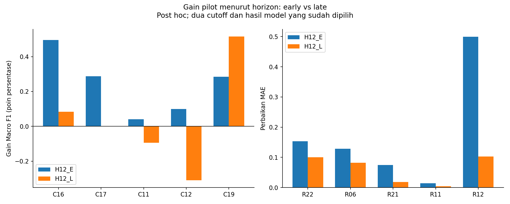
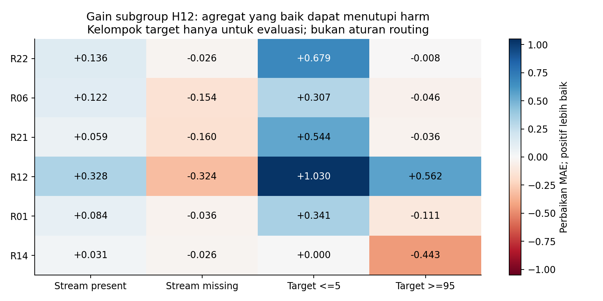
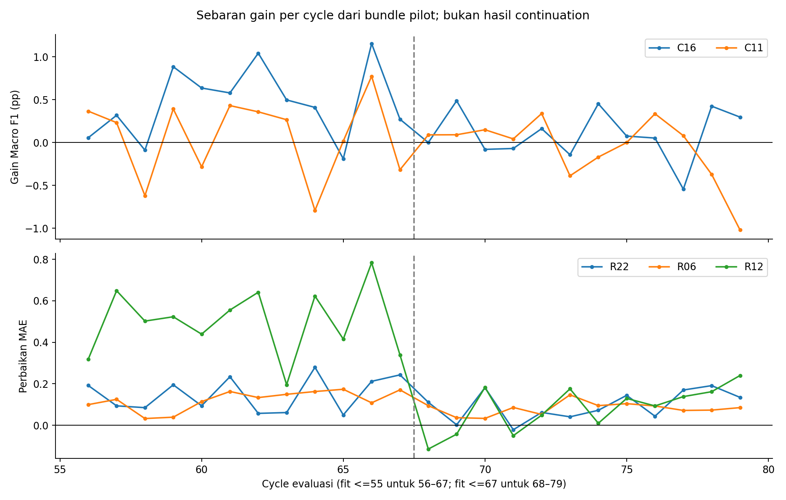

# Review mendalam sesudah screening 45 recipe

Tanggal: 1 November 2026. Snapshot: `49b3fdf4d9ef027f1c1cbbb6bbec03dce6a495cf`.
**Keputusan review: lanjutkan empat kandidat asli secara terkontrol; ajukan satu rescue R12 untuk kritik independen. Kampanye tetap PAUSED_FOR_REVIEW. Tidak ada izin resume/freeze baru yang diterbitkan oleh dokumen ini.**

## Apa yang benar-benar diperiksa

Seluruh 45 kartu dibaca melalui [registry screening](../batch1/batch_ledger.json), recipe, hasil, gate, dan QA. Dua reviewer internal membaca Classification dan Regression secara terpisah; MAIN memeriksa klaim yang mengubah keputusan. Status historis tetap 7 ADVANCE, 36 RETIRED, 2 SKIPPED; review tidak menulis ulang verdict tersebut.

MAIN menjalankan [script review](../../../scripts/optimization_v3_postscreen_review.py) yang hanya membaca official **Train** dan prediksi tersimpan. Hasil terstruktur ada di [diagnostics.json](diagnostics.json) dan [view_metrics.csv](view_metrics.csv):

- 220 pemeriksaan hash artifact/freeze cocok dengan registry.
- 35 kartu STANDARD dihitung ulang dari 70 NPZ beserta sidecar: hash NPZ, integritas sidecar, freeze signature, cutoff, jumlah fit rows, complete-cycle score rows, record ID, dan nilai finite diperiksa.
- 70 perbandingan gain primary/H12 cocok dengan angka registry yang dibulatkan (toleransi 0,00000051); denominator cocok.
- Komposisi C16, C17, C11, R22, R06, R12 dihitung ulang dari skor mentah/komponen kontrol dengan rumus independen dan cocok sampai toleransi absolut 1e-12.
- Sepuluh kartu lain memakai laporan historis terhubung: C01/C20 CACHE_SIX, C09 schema khusus, C15/R15/R17/R18/R19 LATE, serta dua skip R10/R13. Jangan menyebut 45 kartu seluruhnya dihitung ulang dari bundle oleh script ini.
- Tidak ada training, inference baru, Test yang dibuka, Kaggle call, perubahan notebook, atau perubahan frozen artifact. Ini audit prediksi dan pembacaan source; bukan replay training seluruh model atau sertifikasi ulang setiap baris source historis.

[CARD_REVIEW.md](CARD_REVIEW.md) berisi keputusan riset untuk **setiap** kartu. Counterexample, bukan hanya skor terbaik, dipakai untuk menentukan prioritas.

## 1. Empat continuation asli tetap masuk akal, tetapi tingkat keyakinannya berbeda

Gain positif berarti lebih baik. Classification memakai unit Macro F1; Regression memakai penurunan MAE. Semua STANDARD memakai primary W1+W4 n=9.064, H12 n=38.588. H12_E n=17.685 (fit sampai 55); H12_L n=20.903 (fit sampai 67).

| Kartu | Primary pilot | H12 | H12_E | H12_L | Arah positif per cycle pilot | Keputusan |
|---|---:|---:|---:|---:|---:|---|
| C16 | +0,001971 | +0,002837 | +0,004953 | +0,000830 | 17/24 | Prioritas Classification |
| C11 | +0,000661 | −0,000310 | +0,000399 | −0,000947 | 15/24 | Continuation eksploratif yang lemah, keluarga berbeda |
| R22 | +0,098176 | +0,124873 | +0,153722 | +0,100466 | 23/24 | Prioritas Regression |
| R06 | +0,061726 | +0,103260 | +0,128415 | +0,081977 | 24/24 | Pertahankan sebagai keluarga kedua |

**Pembaruan terhadap review Claude sebelumnya:** kesimpulan bahwa gain Regression hampir habis pada horizon late tidak lagi cocok untuk hasil lengkap R22/R06. Snapshot Claude lebih awal terutama menilai R21. R22/R06 tetap memberi perbaikan late yang berarti secara praktis pada pilot; ini belum jaminan generalisasi.

**C16/C17 bukan replikasi independen.** Korelasi delta probabilitas keduanya terhadap kontrol adalah 0,790. C16 mengubah leaves, minimum child, dan lambda sekaligus; C17 juga mengubah beberapa parameter plus panjang boosting. Data ini tidak mengidentifikasi parameter mana yang menyebabkan gain. C17 menjadi reserve, bukan kandidat tambahan hanya untuk menghitung dua kemenangan satu mekanisme.

**C11 bukan pemenang yang kuat.** Delta C11 relatif ortogonal terhadap C16 (korelasi 0,105), tetapi keberagaman bukan bukti manfaat. H12 tanpa primary turun −0,000624; C12 char-only juga merosot late. Reviewer independen menghitung AUC/AP late C11 turun sekitar 0,00055/0,00256; tidak ada dukungan bahwa ranking membaik tetapi tertutup threshold. C11 layak diuji karena sudah lolos aturan screening dan menawarkan keluarga berbeda, bukan karena late evidence meyakinkan. Jangan mencari threshold baru untuk menyelamatkannya sekarang.

**R22 dan R06 menawarkan perubahan yang berbeda.** Korelasi delta prediksi hanya 0,200; keduanya membaik late. Ini mendukung mempertahankan dua family. Korelasi rendah tidak membuktikan blending keduanya akan lebih baik; tidak ada bobot blend baru yang diuji atau dipilih di review ini.



Interpretasi: kelemahan late paling jelas pada Classification char-only/word+char; Regression R22/R06 berbeda dari R21/R11 yang gain late-nya lebih kecil.

## 2. Rescue paling layak: R12 dengan fallback missing-stream

R12 adalah contoh paling jelas **recipe gagal, hipotesis pengurutan belum gagal**. [Gate asli](../batch1/R12/gate.json) memperlihatkan gain primary +0,245801 dan H12 +0,284490, tetapi harm missing mencapai +0,768759 pada W1 (n=392), +0,489276 primary (n=734), dan +0,324499 H12 (n=2.578). Kedua tail H12 justru membaik: MAE turun 1,029815 untuk target ≤5 dan 0,561555 untuk target ≥95.

Intervensi diagnostik hanya satu: **pakai prediksi R12 asli pada stream present; pertahankan persis champion pada missing**. Rank-percentile tetap dihitung pada **seluruh cycle sebelum routing**, bukan dihitung ulang hanya pada baris present. Model, fitur, target, blend 0,75/0,25, dan tie rule tidak diubah. Pemilihan route hanya memakai ketersediaan stream, bukan target aktual atau ukuran error.

| Policy | Primary pilot | H12 | H12_L |
|---|---:|---:|---:|
| R12 asli, RETIRED | +0,245801 | +0,284490 | +0,102701 |
| R12 present-only, post hoc | **+0,285422** | **+0,306170** | **+0,114157** |

Pada policy post hoc, missing harm tepat nol secara konstruksi, present predictions identik dengan R12 asli, dan tidak ada harm tail/missing pada view W1/W4/primary/H12/H12_L yang diperiksa. H12 low/high-tail gain tetap +0,925579/+0,558416. Tidak ada refit untuk menghitung ini.

**Batas interpretasi:** ini hasil rescue yang dipilih setelah hasil pilot dilihat. Nilai pilot tersebut tidak boleh menjadi bukti baru yang independen atau mengubah verdict R12 historis. Perlu ID policy baru, amendment budget/selection yang jelas, freeze sebelum prediksi origin lanjutan dibuat, dan evaluasi side-by-side recipe asli serta champion.

**Uji penjelasan alternatif, tanpa ranker baru:** gunakan `0,75*champion + 0,25*percentile(champion)` pada stream present, exact champion pada missing, dengan whole-cycle rank dan bobot yang sama. Kontrol ini justru merugikan primary −0,018399 dan H12 −0,012084 (late −0,006426). R12 routed mengungguli kontrol mapping-only tersebut sebesar 0,303821 primary dan 0,318254 H12. Jadi keuntungan tidak dapat dijelaskan oleh **aturan mapping tambahan khusus ini saja**. Ini tidak membuktikan semua kalibrasi lain kalah, tidak mengisolasi setiap mekanisme ranker, dan tetap memakai pilot yang telah dilihat. Hasil ada pada `posthoc_no_ranker_matched_control`/`posthoc_ranker_vs_no_ranker_gain` di diagnostics.

Usulan sesudah kritik Claude: tambah **satu** policy `R12_PRESENT_ROUTE` sebagai pengecualian family ketiga Regression, tanpa menggusur R22/R06. Memerlukan empat fit origin baru (59/63/71/75), di samping 16 fit continuation asli: total rencana 20, saldo nominal 86 → 66. Ini proposal, **belum reservasi dan belum otorisasi resume**. Recipe ranker asli dapat menghasilkan output untuk kedua policy sehingga tidak perlu melatih ranker dua kali. Batas family/configuration dan resource harus diperiksa lagi ketika amendment dibuat.

Kriteria prospectif yang diusulkan: seluruh gate full-six lama tetap berlaku; **syarat tambahan baru**, bukan bagian gate frozen lama, adalah gain ≥0,03 MAE pada pooled empat window berikut: cutoff59 → cycle60–63 (W2), cutoff63 →64–67 (W3), cutoff71 →72–75 (W5), cutoff75 →76–79 (W6). Denominator gabungan adalah **29.524 baris unik**, bukan seluruh output 12-cycle dari setiap origin yang akan menggandakan baris. Missing fallback harus bit-identical sehingga tidak ada missing harm. Label baris ini sudah dilihat di pilot; yang baru hanya model origin/prediksinya. Laporkan pula late origins dan kedua tail; jangan mengubah bobot bila hasil buruk. Bila gagal, tutup rescue. Bila hanya data-integrity yang gagal, perbaiki evidence tanpa refit yang tidak diperlukan.

**Mengapa bukan R21-present-only dahulu?** R21 asli sudah kalah screening dari R22 dalam family yang sama; routing hanya membawa gain post hoc H12 menjadi +0,054989, late +0,031300. R12 memiliki diagnosis kegagalan lebih spesifik, gain lebih besar, dan family berbeda.

**R23 juga dapat diselamatkan secara teknis melalui availability routing**, namun menjadi reserve: late gain routing hanya +0,022774 dan pilot W4 memburuk sekitar 0,0226. Ini lebih lemah dibanding R06 saat ini dan tidak membenarkan rescue paralel kedua. R01/R14 tetap bermasalah pada target tinggi meskipun fallback missing diterapkan; routing tidak menyelesaikan kegagalan utamanya. Jangan membuat route dengan target aktual.



Interpretasi: masalah missing melintasi beberapa keluarga, tetapi bukan semua kegagalan disebabkan missing. R14 mempunyai masalah tail-high; memperbaiki missing tidak cukup. R11 justru membantu missing, sehingga aturan present-only universal juga tidak dibenarkan.

## 3. Pelajaran lintas eksperimen

1. **Gagal dengan model A tidak membatalkan representasi pada model B.** Char Ridge historis gagal gate, sementara char sparse LightGBM R06 lolos dan konsisten per cycle. HGB+SVD C13 gagal, tetapi XGBoost+SVD R22 membantu task Regression. Perbedaan task, learner, objective, dan policy mencegah atribusi satu faktor.
2. **Kegagalan Huber R09 tidak membuktikan semua robust loss buruk.** XGBoost pseudo-Huber slope 5 R22 mengungguli XGBoost absolute R21 dalam recipe yang cocok, sedangkan LightGBM Huber R09 berbeda implementasi/parameter. Ini mendukung recipe R22, belum menjelaskan penyebab universalnya. [Dokumentasi XGBoost](https://xgboost.readthedocs.io/en/release_3.2.0/parameter.html) mendefinisikan pseudo-Huber sebagai alternatif smooth absolute loss; bukan loss yang identik dengan Huber LightGBM.
3. **Ranking individual bukan satu-satunya ukuran nilai komponen.** Raw ranker R12 mempunyai mean Spearman per-cycle 0,733412 vs champion 0,693230 pada early, tetapi **0,839047 vs 0,851298 pada late**. Blend late tetap memperbaiki MAE. Jadi tidak tepat mengatakan ranker mengalahkan champion dalam ranking di kedua origin; komplementaritas dan mapping bisa memberi nilai meskipun komponen sendiri kalah.
4. **Target Train sangat sesuai grid percentile within-cycle.** Maksimum deviasi `threat_rank` dari `100 * average_rank(y) / n_cycle` hanya 0,0000499745 pada semua 33 cycle. Ini observasi Train yang kuat untuk memotivasi mapping; bukan bukti mekanisme pembentukan data atau jaminan distribusi official Test. Target/label tidak pernah dipakai untuk memetakan prediksi evaluasi.
5. **Karakter token anonim tidak boleh ditafsirkan semantik.** Char model mungkin memanfaatkan pola encoding/identitas/subtoken atau interaksi statistik. Gain R06 tidak membuktikan string hex serupa mempunyai makna serupa. Deterministic token-renaming ablation dapat menjadi riset mekanisme kelak, tetapi tidak diprioritaskan sebelum continuation.
6. **Asosiasi EDA ≠ informasi prediktif tambahan.** TTR formal tetap menjawab pertanyaan asosiasi. Ablation Classification historis serta kegagalan R08 menunjukkan bahwa scalar tambahan dalam recipe tertentu tidak otomatis memberi gain setelah representasi teks lain tersedia. Itu tidak membatalkan EDA atau membuktikan seluruh statistik teks tidak berguna.
7. **Offset dapat memperbaiki agregat sambil merugikan ekstrem.** R17/R18/R19 menyediakan contoh preference tradeoff, bukan bug. Guard tail adalah tujuan perlindungan subgroup. Jangan melonggarkannya setelah melihat kegagalan.

## 4. Kekuatan dan batas validasi

Primary pilot adalah subset H12; full-six primary dan H12 memakai baris yang sama dengan origin berbeda. Dua metric tersebut memberi pemeriksaan horizon, **bukan dua sampel konfirmasi independen**. Notebook/riwayat juga sudah banyak menggunakan label Train yang sama.

Continuation menghasilkan fit baru pada cutoff 59/63/71/75. Namun baris cycle 60–67 dan 72–79 telah diprediksi oleh fit pilot 55/67. Jadi **origin prediction belum dibuat, tetapi label/baris bukan holdout yang untouched**. Bekukan amendment sebelum continuation untuk mencegah adaptasi terhadap prediksi baru; tetap laporkan hasil sebagai validasi temporal adaptif, bukan estimasi generalisasi bebas selection bias. Risiko seleksi dari banyak percobaan dibahas oleh [Cawley & Talbot, JMLR 2010](https://www.jmlr.org/papers/v11/cawley10a.html).

Jangan menamai enam bin empat-cycle dari dua fit pilot sebagai full-six. `pilot_bin_56_59`, `pilot_bin_60_63`, dst. di diagnostics hanya memotong horizon dari fit 55/67. Full-six yang sebenarnya membutuhkan origins terpisah. Korelasi dan jumlah arah per-cycle juga bukan jumlah eksperimen independen.

Script menyediakan interval sensitivitas moving-block melingkar 3 cycle, 2.000 draw, seed 20261101. Untuk H12_L, C16 sekitar [−0,000230; +0,001912], C11 [−0,003228; +0,000949], R22 [+0,065015; +0,134606], R06 [+0,065601; +0,096411]. Ini **deskriptif, conditional pada fit/seleksi yang sudah terjadi**, hanya 12 cycle per horizon. Tidak mengukur ketidakpastian refit, pencarian 45 recipe, atau drift masa depan; bukan probabilitas bahwa model pasti lebih baik dan bukan gate baru.



Interpretasi: R06/R22 cukup konsisten pada pilot, Classification lebih berfluktuasi. Garis putus menunjukkan perubahan fit origin; semua titik tetap berasal dari dua fit pilot, bukan continuation.

## 5. Temuan audit laporan yang harus dibawa ke continuation

- **C18:** gate mengatakan `supported_subgroup_guards=true`, tetapi detail verifier W1 mencatat text-load Q3 n=772, delta F1 −0,010471 (melewati −0,01). Runner mengambil failure list hanya dari primary. Verdict RETIRE tetap benar karena primary gagal; klaim “seluruh subgroup di semua view lolos” tidak benar. Ini perbedaan scope gate vs diagnostic, bukan bukti training bocor. Frozen file tidak diubah. Continuation harus menyatakan eksplisit view mana yang dikenai guard sebelum skor.
- **Registry failure list bukan daftar bug:** boolean seperti `test_data_used=false` atau `fallback=false` ikut muncul di `failed_predeclared_checks` beberapa kartu LATE/skip karena ekstraksi boolean generik. Jangan menyimpulkan Test dipakai atau QA gagal dari daftar tersebut; periksa semantik field dan verdict verifier. Jumlah subgroup failures juga dapat menggandakan hasil dan verifier, atau kosong walau gate mempunyai failures dengan nama schema lain (R01/R12). Ledger membantu navigasi, bukan pengganti pembacaan evidence.
- **R13:** skip tidak hanya karena Spearman tidak dicatat. Syarat majemuk meminta perbaikan Spearman kedua origin **dan** gagal MAE aggregate. R12 justru lolos aggregate; perhitungan tambahan raw Spearman juga tidak lebih baik late. Tidak ada alasan mengaktifkan R13 hanya dengan mengisi kolom yang hilang. R10 tetap untested conditional skip; itu bukan pengukuran Fair loss.
- Header budget checkpoint benar 94/180, tetapi beberapa paragraf historis rolling findings masih menulis 90/180. Gunakan [pause handoff](../batch1/PAUSE_HANDOFF_01.md) dan registry terstruktur, bukan paragraf milestone lama. File lock yang ada bukan otomatis lock yang masih dipegang proses; periksa ownership/OS lock saat resume tanpa menghapusnya untuk memaksa jalan.

## 6. Keputusan dan stop point

**Setujui rekomendasi screening untuk C16/C11/R22/R06 sebagai rencana continuation, bukan final model.** Prioritas analitis R22 → R06 → C16 → C11; actual order boleh mempertimbangkan RAM setelah freeze. Jangan mengubah recipe empat kandidat tersebut untuk mengakomodasi review ini.

**Ajukan R12_PRESENT_ROUTE untuk challenge Claude sebelum amendment.** Pertanyaan utama: apakah ini rescue berbasis mekanisme yang cukup kuat untuk empat fit tambahan, atau selection bias membuat ekspektasinya tidak sepadan? C19, R16, R23 disimpan sebagai hipotesis cadangan yang mempunyai pola menarik; bukan daftar eksperimen tambahan otomatis.

Jangan menggabungkan semua pemenang, sweep threshold/weights, mengubah gate, mengganti notebook, atau menambah submission pada tahap review. Tetap gunakan champion lama sebagai kontrol. Public terakhir yang tercatat 0,82908 Classification dan 11,35970 Regression tidak diperbarui live; review ini tidak memprediksi skor baru.

## Reproduksi dan QA

```powershell
Set-Location -LiteralPath 'C:\Users\Sam\OneDrive\Documents\KASDAD\TP 2'
python -m scripts.optimization_v3_postscreen_review
python -m pytest tests/test_optimization_v3_postscreen_review.py -q
```

Gunakan environment dependency proyek. Raw data melalui `TP2_DATA_DIR` atau `data/raw`; historical ignored NPZ + sidecar diperlukan. Tidak ada cache download otomatis atau fallback refit. Jika bundle/hash hilang atau berbeda, hentikan reproduksi dan laporkan; jangan melatih ulang diam-diam. Tiga PNG telah dibuka dan diperiksa. Lima tes unit memeriksa pooled Macro F1/MAE terhadap sklearn, empty groups, deterministic block sensitivity, serta penolakan salah-ID/partial-cycle. Ini bukan tes ulang training model.

Lihat [prompt kritik Claude](CLAUDE_CHALLENGE_PROMPT.md). Sesudah kritik ditanggapi dan user memilih langkah berikutnya, baru buat amendment/freeze dan resume. Kampanye **tetap paused**.
