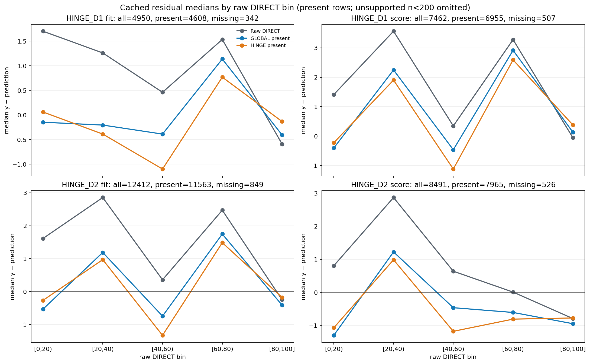
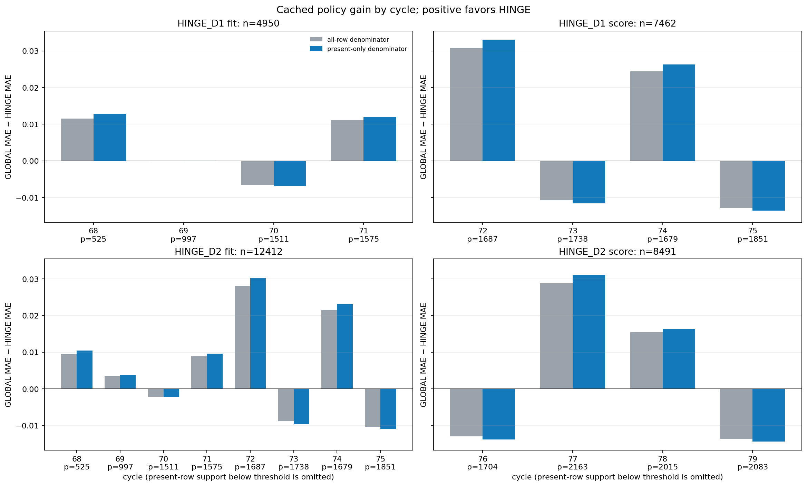

# Fixed-p50 hinge residual discovery R1

## Finding

**No follow-up mechanism is recommended.** The fixed-p50 HINGE has small score
gains over same-history GLOBAL-present-only on both existing score windows, but
the gain is small, varies by raw DIRECT bin and cycle, and comes with p90 and
upper-target harm. The repeated `[40,60)` pattern is worth recording as a
descriptive residual shape; it does not establish a correction that will
generalize.

## Scope and integrity

This was a zero-fit replay of cached R4 D1/D2 fit-input and score-row bundles.
No coefficient, threshold, calibration, or policy was fitted. Only raw DIRECT,
GLOBAL-present-only, and HINGE-present-only were summarized. The cached
`causal_global_all_rows` column was not loaded or scored. Missing predictions
kept their raw DIRECT float64 bits. Fit-population summaries retain all cached
rows, including missing-route rows, while each mapping is applied to present
rows only; all-row and present-only denominators are shown separately.

The source, rules, six novelty summaries, R4 metadata/receipts, and cached
bundles were frozen before numerical array access at commit
`f3df9af6e2ad9f8aa96be980568691b3cd527c66`. Freeze SHA-256:
`fd4181151536a0da065ca4562581b83858b239928f1cdc748e25f552a9c2ee2a`.
The run used the shared job lock, two threads, and the fresh saved-replay memory
gate. Independent reconstruction passed for all 29 frozen file hashes and
2,784 numeric fields, with maximum difference `0.0`; it also rebuilt row
identity hashes and matched the three included policies against the R4
diagnostics whose file hash is bound by the independent R4 verification receipt.

Artifacts:

- [Frozen inputs](../../../experiments/reg_hinge_residual_discovery_v1/INPUT_FREEZE_R1.json)
- [Machine summary](MACHINE_SUMMARY_R1.json)
- [Independent verification](INDEPENDENT_VERIFICATION_R1.json)
- [Raw-bin residual plot](FIGURE_RAW_BIN_RESIDUALS_R1.png)
- [Cycle gain plot](FIGURE_CYCLE_GAINS_R1.png)

## Populations and overall score results

`GLOBAL − HINGE` is positive when HINGE has lower MAE. “All rows” includes
missing-route rows passed through as raw DIRECT; “present only” excludes those
rows from the denominator.

| Population | Rows all / present / missing | Gain, all rows | Gain, present only |
|---|---:|---:|---:|
| D1 fit | 4,950 / 4,608 / 342 | +0.003057 | +0.003284 |
| D1 score | 7,462 / 6,955 / 507 | +0.007356 | +0.007892 |
| D2 fit | 12,412 / 11,563 / 849 | +0.005944 | +0.006380 |
| D2 score | 8,491 / 7,965 / 526 | +0.005485 | +0.005847 |

All five raw DIRECT bins and every cycle meet the frozen present-row support
minimums (200 per bin, 50 per cycle). The conditional median residuals vary
substantially across bins. In `[40,60)`, the present-row median `y − prediction`
for HINGE is `−1.100` (D1 fit), `−1.117` (D1 score), `−1.326` (D2 fit), and
`−1.181` (D2 score); GLOBAL-present-only medians are closer to zero in all four
populations. HINGE also has lower per-bin gain than GLOBAL in `[40,60)` in all
four populations (`−0.0163`, `−0.0238`, `−0.0236`, `−0.0352`). Other bin gains
change sign across populations. Cycle gains also change sign within every score
window, so the bin pattern does not translate into a stable window-wide rule.





## Tail and p90 checks

The score-row metrics below are reconstructed from the existing R4 receipt; tail
counts are descriptive only. `p90` is overall absolute error; upper-tail MAE is
for target `y >= 95`.

| Score window / policy | Overall p90 | MAE at `y <= 5` | MAE at `y >= 95` |
|---|---:|---:|---:|
| D1 raw DIRECT | 25.1295 | 7.7488 | 7.7831 |
| D1 GLOBAL-present-only | 24.8231 | 9.3911 | 7.8133 |
| D1 HINGE-present-only | 24.8431 | 9.1754 | 7.9457 |
| D2 raw DIRECT | 23.0399 | 8.3872 | 5.9497 |
| D2 GLOBAL-present-only | 23.0098 | 10.1405 | 5.8022 |
| D2 HINGE-present-only | 23.0272 | 9.9488 | 5.8237 |

Against GLOBAL-present-only, HINGE worsens overall p90 by `0.01999` on D1 and
`0.01740` on D2, and worsens upper-target MAE by `0.13249` and `0.02145`,
respectively. Lower-target MAE improves against GLOBAL on both windows, but raw
DIRECT remains better for that group. Target support is 362 / 374 rows for D1
score (`y <= 5` / `y >= 95`) and 442 / 434 for D2 score.

## Interpretation limits and prior coverage

D1 score evaluates cycles 72–75 from prediction origin E67. D2 score evaluates
cycles 76–79 from origin E75. Horizon and origin change together, so the D1/D2
contrast cannot isolate a horizon or origin effect. Fit-population diagnostics
are in-sample with respect to the existing HINGE coefficients. The score windows
and development outcomes have been reused during selection; these results make
no fresh holdout or public-score claim.

The six-document novelty scan found that fixed-p50 HINGE has already been
executed; the 45-card plan is proposals, not results; nearby residual offsets
are already proposed; and prior residual learning was mixed across horizons
(`+0.071990` on its primary view, `−0.048271` on full E67 H12). The prior R4
pooled score gain was `+0.006360`, below its `0.02` qualification threshold.
Given the adaptive history, mixed cycle signs, and tail harms, this audit
recommends no next mechanism. Any new mechanism would need a separately
authorized prospective evaluation.

## Reproduction and provenance

Run from the repository root with `python -m` so package imports resolve:

```powershell
python -m scripts.reg_hinge_residual_discovery_v1 --freeze
python -m scripts.reg_hinge_residual_discovery_v1 --run
python -m scripts.verify_reg_hinge_residual_discovery_v1
```

The frozen R1 inputs and result outputs are immutable; the commands refuse to
overwrite them. No raw Train labels, Test/SampleSubmission, E79, or Kaggle data
were opened in this audit.
