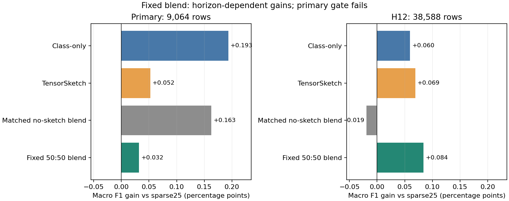

# Fixed Classification Blend — Decision Review

2 November 2026. **NO_GO_FURTHER_FITS_FOR_THIS_BLEND**. Independent verification: **PASS**. Nol estimator fit baru; ledger fase tetap 30 consumed dari cap 60. Tidak membuka Test/SampleSubmission atau Kaggle.

## Pertanyaan dan protokol

Apakah rata-rata probabilitas N02 TensorSketch dan N01 class-only dapat memulihkan recall H12 tanpa kehilangan manfaat primary? Satu recipe: `0.5*N02_sketch + 0.5*N01_class_only`, threshold 0,50. Kedua komponen mempertahankan fallback CB yang sama pada stream kosong. Matched control mengganti sketch dengan no-sketch, dengan bobot tetap identik.

Protokol disimpan sebelum menghitung outcome kombinasi baru. Komponen, kegagalan guard N02, hasil full-six class-only dan sejarah public sudah diketahui: hipotesis ini adaptif, bukan untouched holdout atau penelitian outcome-blind. Tidak ada pencarian bobot/threshold. Protokol: `experiments/optimization_v3/research_next_v1/review_class_blend/protocol.json`.

## Hasil

| View | n | Sparse25 | Class-only | N02 sketch | Matched blend | Fixed blend | Gain blend vs sparse25 |
|---|---:|---:|---:|---:|---:|---:|---:|
| primary | 9,064 | 0.823972 | 0.825907 | 0.824496 | 0.825599 | 0.824291 | +0.000318 |
| W1 | 4,114 | 0.803160 | 0.806590 | 0.803948 | 0.805325 | 0.804152 | +0.000992 |
| W4 | 4,950 | 0.841418 | 0.842083 | 0.841744 | 0.842576 | 0.841183 | -0.000235 |
| H12_55 | 17,685 | 0.795032 | 0.797193 | 0.794877 | 0.795383 | 0.796239 | +0.001207 |
| H12_67 | 20,903 | 0.808961 | 0.808094 | 0.810404 | 0.808307 | 0.809430 | +0.000469 |
| H12_pooled | 38,588 | 0.802966 | 0.803562 | 0.803655 | 0.802773 | 0.803805 | +0.000839 |

Pada primary, fixed blend memperoleh gain +0,000318 terhadap sparse25: di bawah syarat +0,0005. Ia juga kalah 0,001616 dari class-only, 0,000205 dari N02 dan 0,001308 dari matched blend. Keempat primary gate gagal. Ambang incremental +0,0002 terhadap setiap komponen dan matched control ditetapkan sebelum hasil kombinasi dihitung untuk membenarkan biaya continuation.

H12 pooled memberi gain +0,000839 terhadap sparse25 dan sedikit mengungguli kedua komponen. Hasil tersebut valid, tetapi bukan alasan mengganti primary atau gate sesudah melihat hasil. H12 memakai model origin55 untuk cycle56–67 dan origin67 untuk68–79. Ini berbeda dari full-six rolling-origin; tidak ada prediksi N02 origin59/63/71/75.

## Mengapa guard pulih tetapi manfaat primary hilang?

Semua **48 supported subgroup checks** fixed blend pada enam view lulus. Pooled quartile berarti posisi relatif terhadap batas kuartil FIT masing-masing origin; bukan rentang absolut text_load yang sama. Origin juga diperiksa terpisah. Pada Q4 H12 origin67, recall harm turun dari 2,306 pp (N02) menjadi 0,540 pp (blend). Pada Q4 pooled H12, harm turun dari 2,181 pp menjadi 0,443 pp.

Namun hanya 115/9.064 (1,27%) primary rows mempunyai keputusan biner yang berbeda di antara kedua komponen. Di 115 baris itu, class-only benar pada59 baris, sketch pada56, dan probability average pada50. Sebanyak1.428 baris salah pada kedua komponen. Angka ini menjelaskan mengapa perbedaan arah recall tidak otomatis menghasilkan ensemble lebih baik. Ini evaluasi deskriptif pada label development, bukan aturan routing yang tersedia saat inference.

Primary blend memiliki938 FN dan555 FP, dibanding class-only906 FN dan578 FP; penurunan FP dibayar dengan kenaikan FN sehingga Macro F1 turun. Pada pooled H12 dibanding sparse25, blend menurunkan FP sebanyak41 tetapi menambah FN sebanyak6, sehingga keuntungan terutama berasal dari precision tradeoff. Komplementaritas bergantung pada horizon.



## Keputusan dan handoff

**Tidak merekomendasikan delapan fit N02 continuation, refit full-Train atau CSV submission untuk recipe ini.** Gagal primary tetap gagal meskipun subgroup guard telah pulih. Tidak mencoba bobot lain, threshold baru, subgroup routing atau mapping seed sebagai rescue. Kesimpulan hanya menutup fixed blend ini; tidak membuktikan seluruh pendekatan ensemble gagal. Model/submission sebelumnya tidak berubah.

Tugas berikut untuk chat pelaksana: verifikasi ulang evidence tanpa fit; simpan satu ringkasan kampanye Research Next yang menghubungkan semua verdict dan alasan; audit status/ledger/historical checkpoints; pertahankan N01 diagnostic, N02 guard fail, N03 retired, N04 skipped+diagnostic dan N05/N06 information-only. Gunakan laporan ini sebagai keputusan penutupan cabang, bukan kandidat baru. Tidak ada izin Test/Kaggle/notebook final/push atau eksperimen tambahan.

## Reproduksi dan QA

Jalankan dari root repository dengan raw Classification Train dan cache lokal yang disebut manifest protokol. Data/cache ignored tetap dibutuhkan untuk reproduksi historis; tidak dimasukkan Git. Ini cache-based decision review, bukan notebook training final.

```powershell
python -m scripts.optimization_v3_research_next_class_blend
python -m scripts.optimization_v3_research_next_class_blend_verify
python -m pytest tests/test_research_next_contract.py tests/test_research_next_queue.py tests/test_research_next_class_blend.py -q
```

28 tests passed (5,44 detik). Verifier independen memeriksa16 input hashes, enam bundle,50.608 Train rows, rekonstruksi routing/komponen,210 field metrik,240 subgroup rows dan2.160 field subgroup tanpa mismatch. Pemeriksaan ledger sebelum/sesudah identik. Grafik telah dibuka dan diperiksa.

Bukti: [results.json](results.json), [groups.csv](groups.csv), [per_cycle.csv](per_cycle.csv), [independent_verification.json](independent_verification.json), [QA.json](QA.json).
