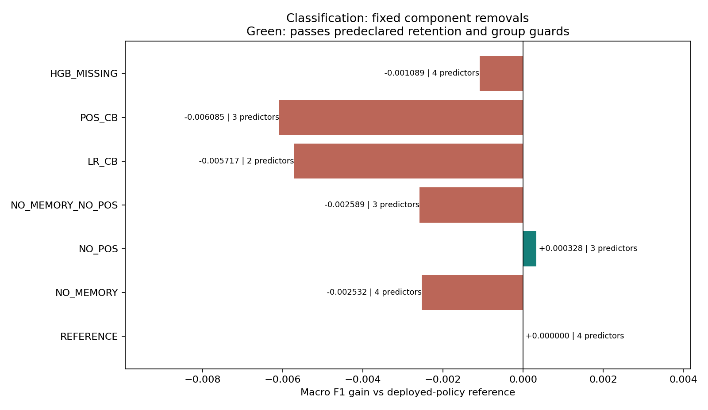
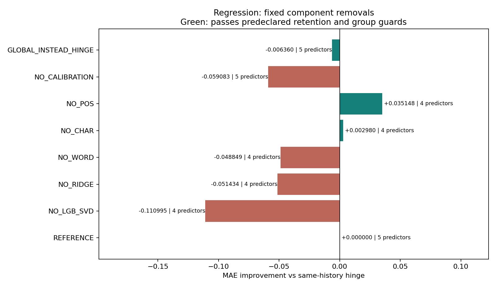

# Dual-task model simplification — root findings

**Decision:** prioritize a POS-free controlled benchmark for each task; retain the deployed champions pending actual application/public testing. This is a zero-fit development audit, not a replacement decision.

The requested audit was performed directly by root in an isolated worktree. Protocol/code/input hashes were frozen before scoring. Six Classification simplifications and seven Regression simplifications were compared, with no weight search, new fitting, raw dataset/Test access or Kaggle upload.

## Classification

| Candidate | Distinct predictors | E67 H12 F1 gain | E75 W6 gain | Unique pool gain | Retention |
|---|---:|---:|---:|---:|---|
| REFERENCE | 4 | +0.000000 | +0.000000 | +0.000000 | PASS |
| NO_MEMORY | 4 | -0.001528 | -0.002642 | -0.002532 | FAIL |
| NO_POS | 3 | +0.000607 | +0.000490 | +0.000328 | PASS |
| NO_MEMORY_NO_POS | 3 | -0.001597 | -0.002522 | -0.002589 | FAIL |
| LR_CB | 2 | -0.006840 | -0.005699 | -0.005717 | FAIL |
| POS_CB | 3 | -0.005683 | -0.004660 | -0.006085 | FAIL |
| HGB_MISSING | 4 | +0.000391 | -0.003282 | -0.001089 | FAIL |

NO_POS removes the positional gamma and token-third transform; it keeps C2B LR, sparse LightGBM, CatBoost missing fallback and A02 residual-neighbor memory. This reduces distinct predictors4→3 and removes positional feature assembly, but retains donor memory/search. All three primary temporal views improve. Worst supported subgroup F1 harm is 0.004397; worst positive-recall harm is 0.019549 (close to the0.02 guard). No unsupported group cells were omitted.
Removing A02 memory saves donor storage/search but loses about0.00253 pool F1. A compact LR+CatBoost route loses about0.00572. Replacing missing CatBoost with HGB harms the latest window and supported missing subgroup; it is a fixed-threshold transport check, not an optimized HGB conclusion.
Threshold0.50 missing sensitivity for NO_POS has unique F1 gain +0.000328. The operational threshold0.53230976129477 was selected historically and is not re-tuned here.
**Public counterevidence:** A02 without the later POS blend was already a historical submission (user-reported public0.82930, recorded in the original [A02 handoff](../../../TP%202/reports/optimization_v3/a02_continuation_v1/FINAL_HANDOFF.md)), whereas the later POS/A02 operational champion reached0.83225 ([CLI-confirmed receipt](../../../TP%202/reports/optimization_v3/cls_a02_missing_temporal_decision_v2/SOL_UPLOAD/RESULT.md)). These historical score records are contextual counterevidence; no Kaggle access occurred during this audit. Thus better local NO_POS is not proof it will retain public performance; do not treat it as an entirely new architecture. The precise current missing policy differs from older submissions. A deployment comparison must hash/reconstruct the exact new policy rather than resubmit an old file blindly.

## Regression

| Candidate | Predictors | D1 gain | D2 gain | Pooled MAE gain | Raw-space gain | Retention |
|---|---:|---:|---:|---:|---:|---|
| REFERENCE | 5 | +0.000000 | +0.000000 | +0.000000 | +0.000000 | PASS |
| NO_LGB_SVD | 4 | -0.042986 | -0.170761 | -0.110995 | -0.114081 | FAIL |
| NO_RIDGE | 4 | -0.074776 | -0.030921 | -0.051434 | -0.064932 | FAIL |
| NO_WORD | 4 | -0.040056 | -0.056576 | -0.048849 | -0.046284 | FAIL |
| NO_CHAR | 4 | -0.026170 | +0.028598 | +0.002980 | +0.006933 | PASS |
| NO_POS | 4 | +0.005482 | +0.061220 | +0.035148 | +0.034833 | PASS |
| NO_CALIBRATION | 5 | -0.073302 | -0.046588 | -0.059083 | — | FAIL |
| GLOBAL_INSTEAD_HINGE | 5 | -0.007356 | -0.005485 | -0.006360 | — | PASS |

NO_POS leaves the four-leaf R06 ensemble, then applies the existing same-history hinge present-only. Both windows improve; missing predictions retain their original policy within floating arithmetic tolerance. Target-tail groups also improve. This removes one400-tree LightGBM and positional token-third features (runtime savings not measured).
NO_CHAR is a secondary candidate: removing the character learner saves an entire character TF-IDF representation and400-tree LightGBM; pooled gain is small, D1 worsens about0.02617, and the low-target group worsens about0.24745, close to the0.25 guard. It passes the predeclared retention rule but has materially weaker stability than NO_POS. No combined NO_POS+NO_CHAR candidate was tested; do not infer their gains add.
LGB-SVD, Ridge and word learner removals fail retention. Ridge has a relatively small weight but still contributes useful complementarity; weight size alone does not establish redundancy. Removing calibration loses about0.05908 MAE. Returning to GLOBAL loses0.00636; hinge is a cheap three-parameter correction and should remain in the simplification direction.
### Numerical flattening, separate from model removal

Present DIRECT can be written as0.31640625·mappedLGB +0.10546875·mappedRidge +0.140625·mappedWord +0.1875·mappedChar +0.25·mappedPosition before final clipping. Missing uses0.421875/0.140625/0.1875/0.25/0, respectively. Cached LGB/Ridge values are already mapped. The positional rank50 branch remains un-clipped until blending. Original clip/rank boundaries are preserved. Nested-versus-flat replay maximum difference is2.84e-14 at both origins: numerically equivalent, not bit-identical and not a model-performance gain. Deployment refactoring should preserve original operation order if bit identity matters.

## Evidence and limits

Classification uses20,903 E67 H12 rows and8,491 E75 W6 rows; their newest cycles overlap. The unique pool is E67 cycles68–75 plus E75 cycles76–79, n20,903. Regression causal windows contain7,462 and8,491 rows, pooled15,953. No final full-OOF fit coefficients are evaluated on their own calibration training rows.

Component removals reuse existing trained leaf predictions and renormalize prescribed weights; they are executable inference ablations, not fresh end-to-end refits. Regression hinge parameters were trained for the original ensemble, so transported-calibration results can advantage/disadvantage a removal. Raw-space results are also shown; no recalibration occurred. Cached data and labels have been used repeatedly in prior research; retention PASS means the explicit local tolerances, not statistical equivalence or a guarantee of Kaggle scores.

Resource use: initial available 1694662656 bytes, final available 1746759680 bytes, estimate256MiB incremental; shared OS lock. No measured deployment latency/peak-memory reductions are claimed. Distinct-predictor counts omit preprocessing state and neighbor memory, which must remain explicit. Four tests cover identity alignment, complete-cycle tied ranks, metric cross-check and non-commuting clipping. Every Classification F1 is checked against sklearn; every Regression MAE against a separate scalar absolute-error calculation. All original full-model vectors and nested/flat recipes replay within1e-10.

Full read-only recomputation and extra physical-row/cycle/source checks passed for **3,732 numeric fields and24 frozen input/source files**, with no Test/raw-data access or fits. See VERIFICATION.json. This is deterministic QA, not independent statistical evidence. Producer receipt archive digests are checked; exact input byte hashes are pinned in INPUT_FREEZE.json. The source commit predates scoring. Zero new predictor/calibrator/preprocessing fits were consumed.

## Bounded next decision

Prioritize1) REG four-leaf R06 plus unchanged hinge,2) CLS A02-only present plus unchanged operational CatBoost missing rule. First verify exact E79 artifacts/feature dependencies and original training history; no new model training should be necessary if existing leaf inference artifacts suffice. Compare exact policies with the current submitted CSVs before considering a benchmark upload. REG NO_CHAR may be a separate low-priority efficiency benchmark. Do not start combinatorial deletion, retraining or distillation until these single-removal results are understood. Preserve the current champions and all ongoing Luna experiments.

Reproduce: `python -m unittest tests.test_simplification_audit_v1`; first immutable run uses `python -m scripts.simplification_audit_v1 --freeze`, then `--run`, then `python -m scripts.report_simplification_audit_v1`. Existing outputs are exclusive-write. External roots may be passed explicitly via CLI; all frozen source/cache paths and hashes are listed in INPUT_FREEZE.json. Raw datasets and model binaries are not committed.
